# FestPass

> Flash-sale-safe ticketing and entry for college fests. Built to stay correct when thousands of students hit "Book" at the same second.

<!-- CI badge goes here on Day 28 -->

**Status:** in development. See the [30-day progress](#30-day-progress) tracker and the [build log](#build-log).

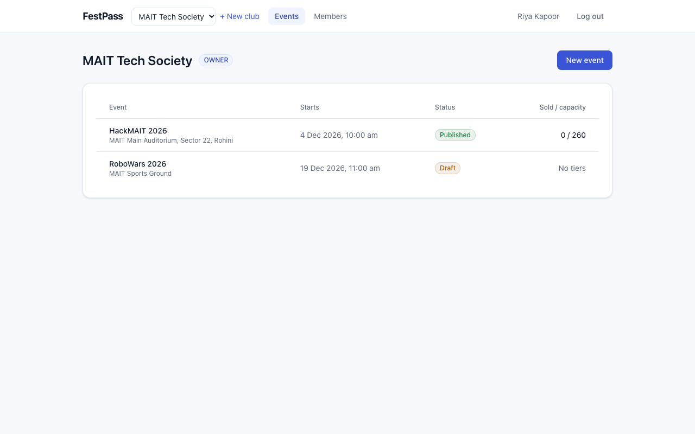

<details>
<summary>More screenshots: analytics, public event page, checkout, my tickets, event editor, team, job queues</summary>

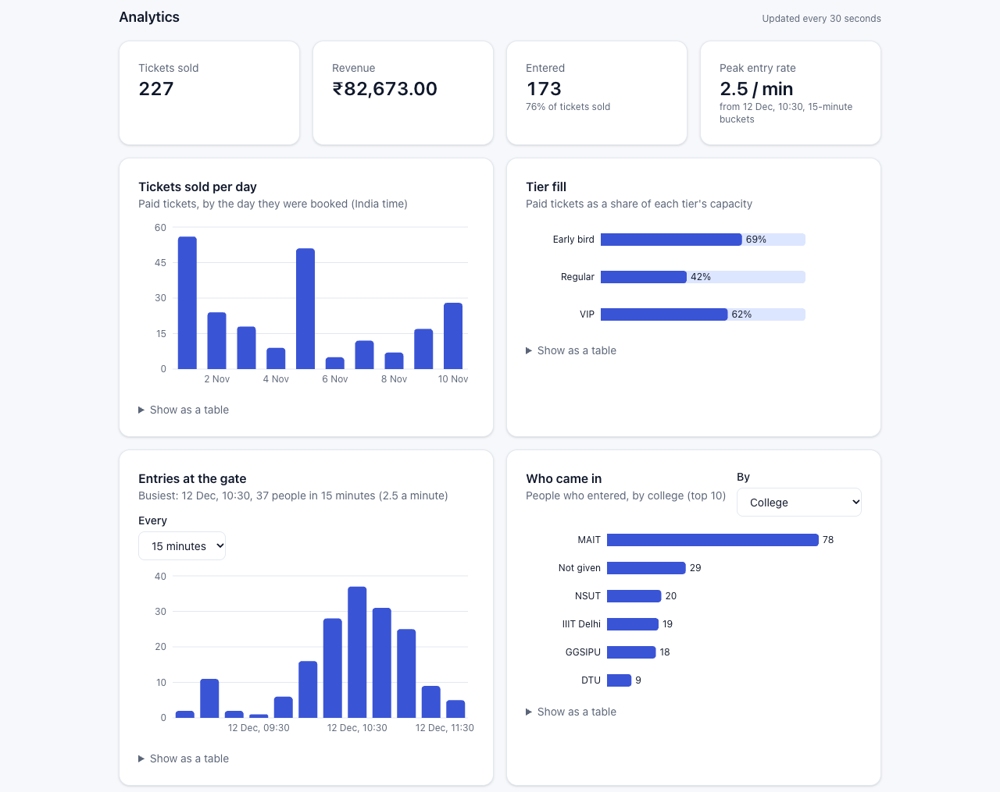

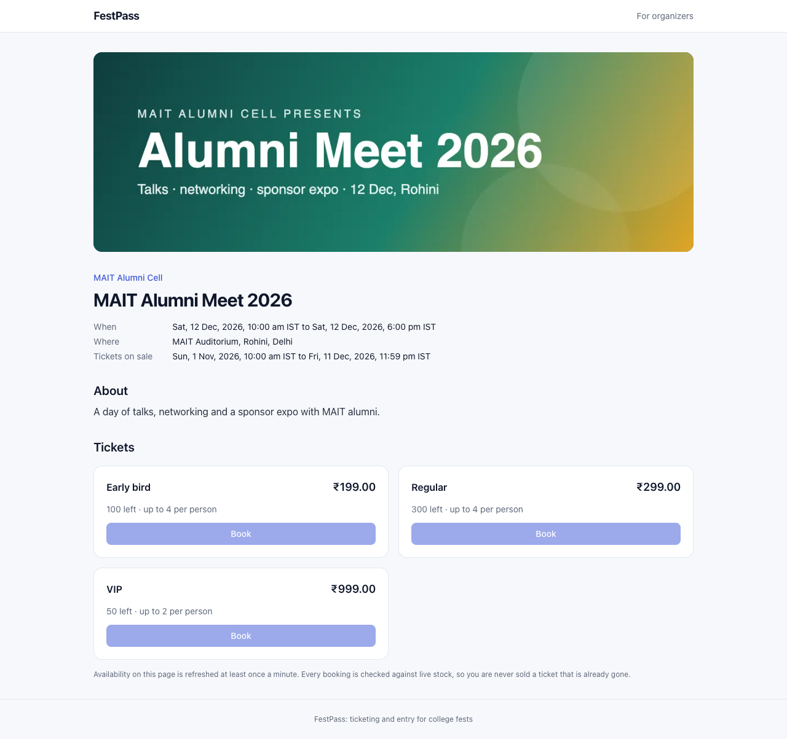

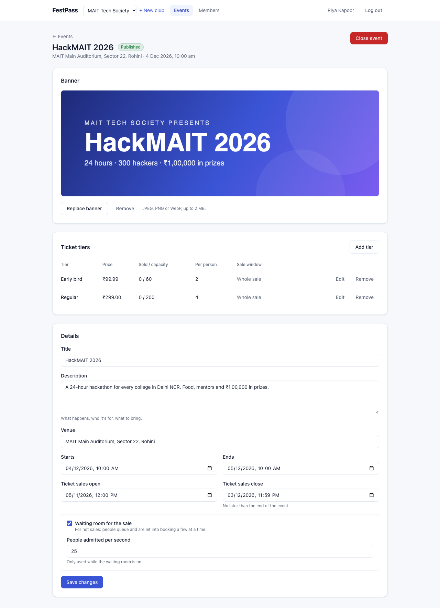

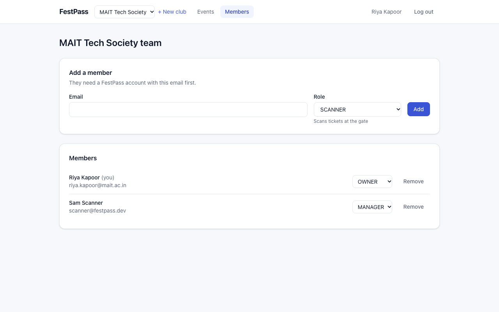

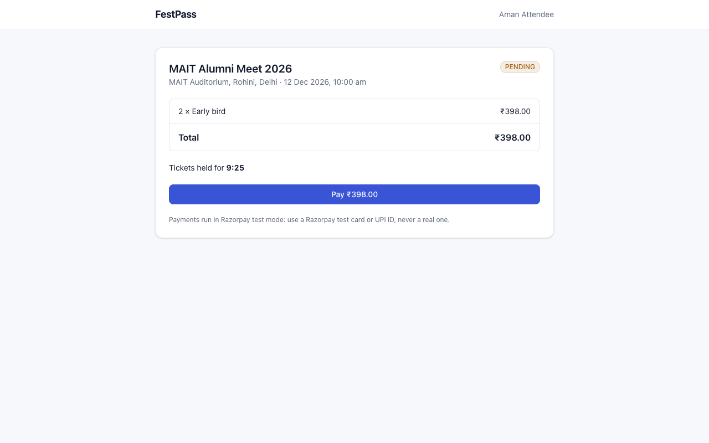

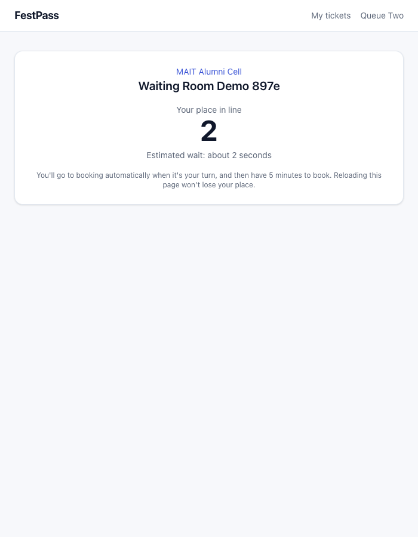

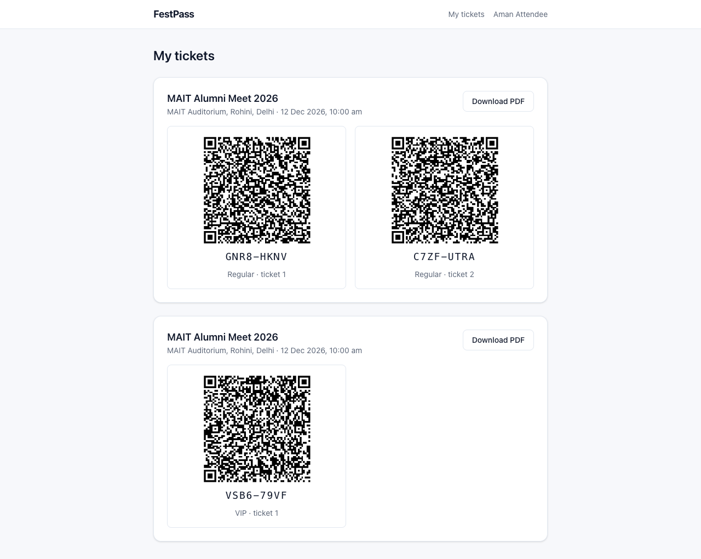

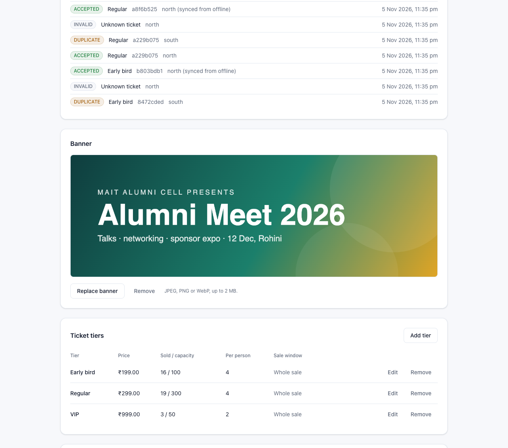

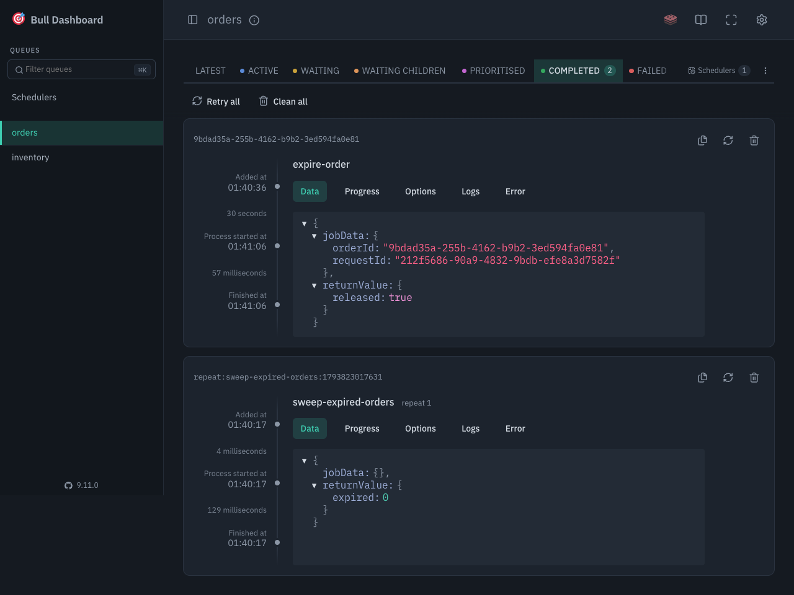

<p>
  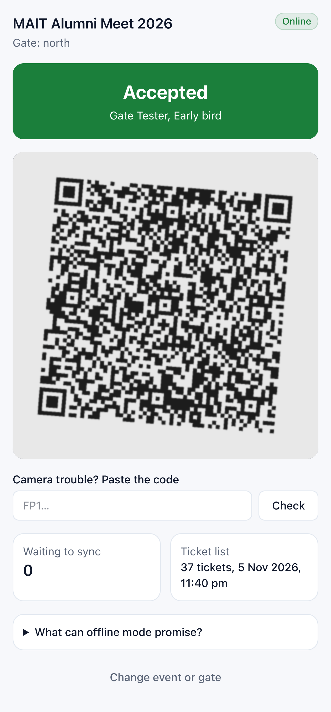
  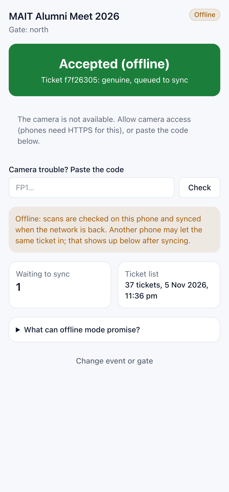
  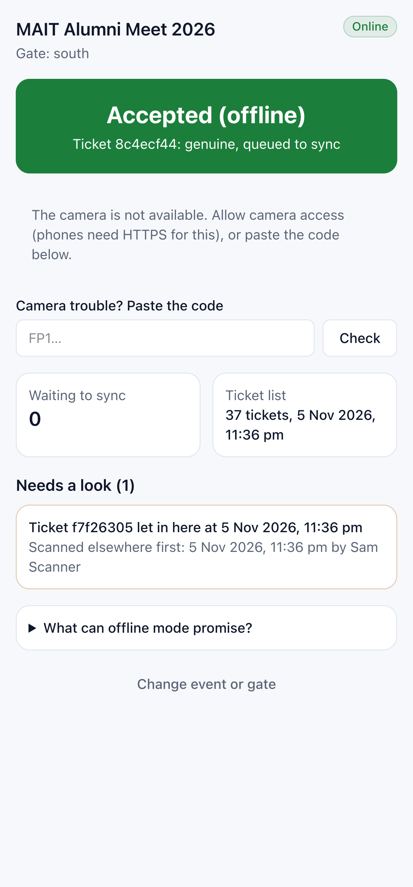
</p>

</details>

**Deeper docs:** [Frontend README](apps/web/README.md) · [Backend README](apps/api/README.md)

## Why I built this

As Sponsorship Coordinator at MAIT's Alumni Cell, I watched fest registrations run on Google Forms and spreadsheets: duplicate entries, passes shared as screenshots, and no way to show sponsors what their money got them. FestPass is the system I wish we'd had.

## Features

| Feature | Status |
|---|---|
| Accounts, clubs (organizations) and roles | Done: API (Days 4–5); register, login and create-club screens (Day 7); members page (Day 9) |
| Web app: auth screens, silent refresh, organizer dashboard | Done (Days 7, 9) |
| Events and ticket tiers, SEO-friendly public pages | API (Day 6) and organizer UI (Day 9) done: create, edit, tiers in rupees, publish and close; public pages with ISR and on-demand revalidation (Day 10) |
| Event banners uploaded straight from the browser to S3-compatible storage | Done: API and storage (Day 8), uploader with preview and progress (Day 9) |
| Oversell-proof booking engine (Postgres + Redis gate) | Done (API): Postgres booking with idempotent retries (Day 11), Redis gate with compensation, fallback and reconciliation (Day 12) |
| Automatic hold expiry and rate limiting | Done: hold expiry, cancel and a job dashboard (Day 13); token-bucket rate limiting on login, register, booking and uploads (Day 14) |
| Razorpay payments with idempotent webhooks | Done: checkout in test mode (Day 15); signed, idempotent webhooks with late-payment re-reserve or refund (Day 16) |
| Ed25519-signed QR tickets, PDF + email delivery | Done: signed QR tickets issued exactly once (Day 17); PDF tickets in private storage, emails sent once through SendGrid templates (or the console in development), and a My Tickets page (Day 18) |
| Exactly-once check-in and an offline-capable scanner PWA | Done (check-in API on Day 19, scanner PWA on Day 20): see [Scanner app](#scanner-app) |
| Live availability and check-in dashboards | Done (Day 21): tiers update live on event pages, and organizers get a live counter and scan feed |
| Virtual waiting room for flash sales | Done (Day 22): a fair line with a live position, admission at the organizer's rate, and signed tokens required to book |
| Caching and load-tested performance | Done: cached public reads, compression and measured indexes (Day 23); k6 flash-sale and browse load tests with zero oversells (Day 24), see [Load test results](#load-test-results) |
| Organizer analytics, sponsor booth analytics and reports | Organizer analytics done (Day 25): sales per day and per tier from Postgres, entries over time and who came from MongoDB, charted on the event page. Sponsor analytics and reports planned (Day 26) |
| AI organizer copilot with permission-scoped tools | Planned (Day 27) |
| Security hardening, observability and CI | Planned (Day 28) |
| Live deployment | Planned (Day 29) |

## Architecture

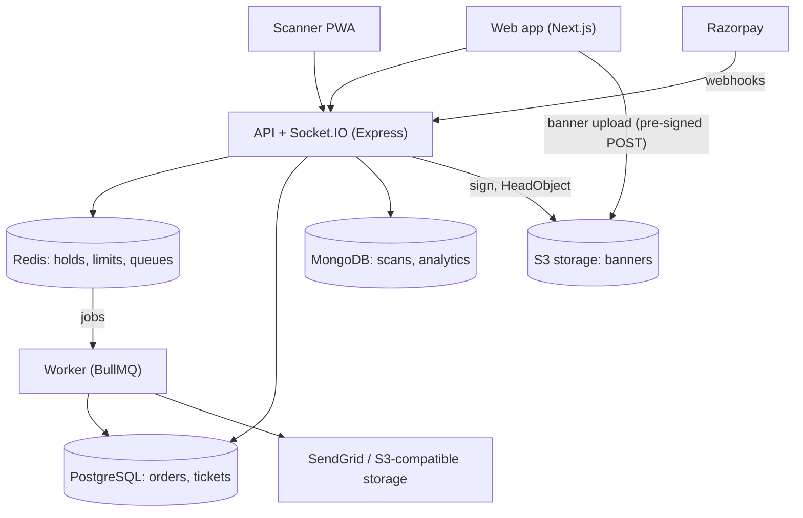

- **PostgreSQL** holds anything involving money or capacity, because it needs transactions and constraints.
- **MongoDB** holds high-volume, append-only scan events that are read through aggregations.
- **Redis** holds fast, temporary state: the inventory gate, rate limits, the waiting room and job queues.

## How it works

FestPass has four kinds of users: **organizers** (college clubs) who run events, **attendees** who buy tickets, **volunteers** who scan passes at the gate and at sponsor booths, and **sponsors** who want to know how many people visited their booth.

One ticket's journey, end to end. The last column shows what works today; everything else is the design being built day by day.

| Step | What happens | Why it's built this way | Status |
|---|---|---|---|
| 1. Publish | An organizer creates an event with ticket tiers (Early bird, Regular, VIP) and publishes it. | Drafts never show on public pages; prices lock once a ticket sells. | Done (API Day 6, dashboard Day 9) |
| 2. Browse | Attendees open a server-rendered event page that is cached and revalidated when the organizer edits it. | Fast, shareable and indexable; availability shown there is only a hint. | Done (Day 10) |
| 3. Queue | For hot sales, attendees join a virtual waiting room and are admitted at a fixed rate. | Turns a stampede into a line so the database isn't flooded. | Done (Day 22) |
| 4. Hold | Clicking **Book** reserves tickets for 10 minutes. Redis rejects the crowd quickly; Postgres makes the final decision with a single conditional `UPDATE`. | Two layers: Redis is fast, Postgres is correct. A CHECK constraint makes overselling impossible even if code has a bug. | Done in the API (Days 11–12); the Book button is wired up on Day 15 |
| 5. Pay | The attendee pays through Razorpay (test mode). Only the signed webhook marks the order paid, never the browser. | Webhooks can arrive twice, late or out of order, so every step is idempotent. Unpaid holds expire and return their tickets automatically. | Done (Days 15–16); tested with signed simulated webhooks until test keys are set |
| 6. Ticket | A background worker issues tickets with Ed25519-signed QR codes, builds a PDF and emails it. | Signed QR codes can't be forged, and a phone can verify them without internet. | Done (Days 17–18) |
| 7. Enter | A volunteer scans the QR at the gate. The ticket is accepted exactly once, even if two phones scan it at the same moment, and the scanner keeps working offline. | One guarded `UPDATE ... WHERE checked_in_at IS NULL` decides entry; offline scans sync later and conflicts are flagged. | API done (Day 19); scanner app planned (Day 20) |
| 8. Measure | Booth scans feed sponsor dashboards (totals only, never names), organizers get live and post-event analytics, and an AI copilot answers questions using permission-checked tools. | Scan events are stored with the fields analytics needs, so dashboards are single aggregation queries. | Planned (Days 21–27) |

## Project structure

```
apps/
  web/       Next.js frontend: public pages, dashboards, checkout, scanner PWA   -> apps/web/README.md
  api/       Express REST API + Socket.IO                                         -> apps/api/README.md
  worker/    BullMQ background jobs (hold expiry, tickets, emails, reports)       -> apps/api/README.md
packages/
  shared/    Zod schemas, types and constants used by frontend and backend
  db/        Prisma schema, migrations and the raw-SQL booking path
  mongo/     Mongoose models for scan events and copilot conversations
infra/
  docker-compose.yml   Postgres, MongoDB, Redis and SeaweedFS (S3) for local development
scripts/     Small developer scripts
```

The [frontend README](apps/web/README.md) covers every screen, how pages are rendered and how the browser talks to the API. The [backend README](apps/api/README.md) covers the API, worker, databases, and the booking and payment flows.

## Tech stack

| Layer | Technology |
|---|---|
| Web | Next.js 16.4 (App Router), React 19.3, TypeScript 6.0, Tailwind CSS 4.3, react-hook-form 7.91 with the shared Zod schemas |
| API | Node.js 22, Express 5.3, Zod 4.6, pino 10.4 + pino-http 11, compression 1.8, bcrypt 6, jsonwebtoken 9, Socket.IO 4.8 with `@socket.io/redis-adapter` |
| Jobs | BullMQ worker |
| Data | PostgreSQL 16 (Prisma 7.10 + raw SQL), MongoDB 7 (Mongoose 9.11), Redis 7 (ioredis 6.0) |
| Storage and email | S3-compatible storage via AWS SDK v3 (SeaweedFS 4.50 locally, Cloudflare R2 in production), SendGrid dynamic templates |
| Payments | Razorpay (test mode) |
| Testing | Vitest 5.0, Supertest 7.3, k6 2.3 (in Docker) |
| CI/CD | GitHub Actions, Docker |
| Tooling | pnpm 12 workspaces, ESLint 9 + typescript-eslint 8, Prettier 3 |

Versions are the ones installed so far; rows without a version arrive on later days. TypeScript is pinned to 6.0 because typescript-eslint does not support TypeScript 7 yet, and ESLint stays on 9 because the plugins inside `eslint-config-next` do not support ESLint 10 yet.

## Engineering decisions

_Filled in as each piece is built. Each entry covers the problem, the approach, alternatives considered, and how it is tested._

### Database constraints as the last line of defence (Day 2)

**Problem:** capacity and money rules are checked in application code, but code has bugs, and the booking path (Day 11) uses raw SQL that skips every ORM-level check. One wrong `UPDATE` during a flash sale would oversell a tier.

**Approach:** Postgres itself enforces the invariants with CHECK constraints in a hand-written migration (`packages/db/prisma/migrations/*_check_constraints`): `sold_count` between 0 and `capacity`, `capacity > 0`, prices and amounts `>= 0`, `per_user_limit` between 1 and 10, `qty > 0`, and `ends_at > starts_at`. Unique constraints cover the retry paths: one payment per `razorpay_payment_id`, one ticket per `(order_id, seq)`. If the app tries to write bad data, the statement fails and the transaction rolls back.

**Alternatives:** relying only on application checks (one bug away from overselling) or triggers (harder to read and test than a one-line CHECK).

**Tested by:** `packages/db/test/constraints.test.ts` runs raw `UPDATE`s against a real Postgres and asserts that `sold_count = capacity` succeeds while `capacity + 1` and `-1` are rejected by name.

### Auth: short-lived JWT + rotating refresh tokens (Day 4)

**Problem:** a single long-lived JWT can't be revoked: if it leaks, it works until it expires. But very short sessions make students log in again every few minutes, in the middle of a flash sale.

**Approach** (`apps/api/src/modules/auth/`):
- **Access token:** a JWT (HS256, 15 minutes) sent as `Authorization: Bearer`. It is checked without a database lookup, and if stolen it is only useful for minutes. `requireAuth` verifies it with the algorithm pinned to HS256 and sets `req.user`.
- **Refresh token:** 256 random bits in an `httpOnly`, `SameSite=Lax` cookie scoped to `/api/v1/auth` (`Secure` in production), so page scripts can't read it and it is never sent to the rest of the API. The database stores only its SHA-256, a `family_id` and a 7-day expiry.
- **Rotation:** every refresh revokes the presented token and issues a new one in the same family, inside one transaction. The revoke is a guarded `UPDATE ... WHERE revoked_at IS NULL`, so two concurrent refreshes with the same token can't both succeed.
- **Reuse detection:** a revoked token should never come back. If one does, someone kept a copy, so the whole family is revoked (attacker and user are both logged out, the user logs in again) and a warning is logged with the user and family IDs, never the token.
- **Passwords:** bcrypt cost 12, at most 72 bytes (bcrypt ignores the rest). Wrong password and unknown email return the same `INVALID_CREDENTIALS` error, and an unknown email still runs a bcrypt compare against a dummy hash so the response time doesn't reveal which emails exist.

**Alternatives:** server-side sessions in Redis (simple to revoke, but every request needs a lookup and the API stops being stateless); one long JWT (can't be revoked); refresh tokens in `localStorage` (readable by any XSS).

**Trade-off:** rotation is strict. If two tabs refresh with the same token at the same moment, the second is treated as reuse and the session ends. A short grace window could soften this later.

**Tested by:** `apps/api/test/auth.test.ts`: rotation revokes the old token and keeps the family; replaying an old token returns `REFRESH_TOKEN_REUSED` and kills the newest token too; only hashes are stored; expired and forged access tokens are rejected.

### Direct-to-storage uploads with pre-signed URLs (Day 8)

**Problem:** event banners are images of up to 2 MB. Streaming them through the API would tie up an Express worker and its memory for the whole upload, on every slow phone connection, and every byte would cross the network twice.

**Approach** (`apps/api/src/modules/uploads/`, `apps/api/src/lib/storage.ts`):
- **Sign, don't receive:** `POST /uploads/presign` checks that the caller may edit the event (OWNER or MANAGER), picks the key itself (`orgs/{orgId}/events/{eventId}/banner/{uuid}.{ext}`) and returns a pre-signed POST valid for 5 minutes. The browser sends the file straight to storage. The API never receives file bytes.
- **Limits enforced by storage:** the signed policy contains `content-length-range 1..2 MB` and `Content-Type` equal to the type that was signed. Storage checks the form against the policy, so a 3 MB file gets `400 EntityTooLarge` and a swapped type gets `403 AccessDenied` before anything is stored. Changing the policy breaks the signature.
- **Verify before saving:** the client then PATCHes the event with `bannerKey`. The API checks the key has this event's banner pattern (so nobody can point their event at another org's file), then runs `HeadObject`. It saves the key only if the object exists, has an allowed type and is within 2 MB. This storage call runs before the database write, never inside a transaction.
- **Public banners, private everything else:** `pnpm storage:init` grants anonymous `GetObject` on `orgs/*/events/*/banner/*` only. Banners appear on public event pages, so a plain URL (`bannerUrl` in every event response) can be cached by browsers and a CDN. Each upload gets a new UUID key, so a replaced banner never serves a stale copy.
- **Why ticket PDFs (Day 18) will be private:** a ticket PDF carries an attendee's name and a QR code that gets someone through the gate. A public URL can be guessed, forwarded or indexed and never expires. So ticket PDFs will sit outside the public prefix and be handed out only as short-lived pre-signed GET links to the ticket's owner.

**Alternatives:** multipart upload through the API with `multer` (simple, but the API carries every byte and needs its own size limit); a pre-signed PUT (one request, but a PUT URL can't enforce a size range, only a fixed `Content-Length`); trusting the client after upload (it could send any key, or a key it never uploaded).

**Limits:** the content type is the one the uploader declared; nothing sniffs the bytes yet. Replaced banners stay in storage until a cleanup job exists. Cloudflare R2 has no bucket policies, so in production banners will go in a bucket with public access turned on (planned, Day 29).

**Tested by:** `apps/api/test/uploads.test.ts` (S3 mocked): the signed policy contains the size range and type; a bad content type returns 400; a non-member gets 404 and a scanner 403; a PATCH with a missing object, a 2 MB + 1 byte object, a non-image type or another event's key is rejected. The real limits were also checked against SeaweedFS: 3 MB upload `400 EntityTooLarge`, swapped type `403 AccessDenied`, anonymous GET outside the banner prefix `403`.

### Money as integer paise, converted at the edge (Day 9)

**Problem:** prices are typed and read in rupees ("₹99.99"), but rupees with decimals are floats in JavaScript, and `99.99 * 100` is `9998.999999999998`. A float price can lose a paisa on the way in, and sums of floats drift.

**Approach:** everything behind the form (API, database, booking maths, Razorpay amounts) uses integer paise (`price_paise INT`, Zod `.int()`). Rupees exist only in the input box and on screen. `packages/shared/src/money.ts` is the only crossing: `rupeesToPaise` parses the text (`"99.99"` -> `99 * 100 + 99`) instead of multiplying a float and rejects more than 2 decimals rather than guessing; `paiseToRupees` and `formatPaise` go back with integer division. The web forms call it inside `sharedSchemaResolver`, so the shared `createTierSchema` validates the paise value and its errors are shown on the rupee input.

**Alternatives:** storing `NUMERIC(10,2)` rupees (exact in Postgres, but JavaScript would still see floats); converting with `Math.round(rupees * 100)` (works for 99.99 but hides typos like 1.005).

**Tested by:** `packages/shared/test/money.test.ts`: ₹99.99, ₹0.29 and ₹1.1 convert exactly; `1.005`, `-5`, `1,299`, `.5` and huge values are rejected; every amount from ₹0.00 to ₹1,000.00 round-trips. In the browser walk-through, typing ₹99.99 stored `price_paise = 9999`.

### Public pages: SSR + ISR with on-demand revalidation (Day 10)

**Problem:** event pages get the traffic spike: everyone opens the shared link the minute the sale is announced. Rendering each request on the server and calling the API means the spike hits the API and Postgres; client-side rendering would hide the content from search engines and link previews and show a spinner first.

**Approach** (`apps/web/src/app/(public)/`, `apps/web/src/app/api/revalidate/route.ts`, `apps/api/src/lib/revalidate.ts`):
- `/` and `/e/[slug]` are Server Components that fetch from the public API and send complete HTML (title, Open Graph banner, tiers) in the first response.
- **ISR** (`export const revalidate = 60`): the rendered HTML is cached and served to everyone; at most once a minute a request triggers a background re-render, and visitors keep getting the cached page meanwhile. A failed re-render keeps the last good page.
- **On-demand revalidation:** after a published event, its tiers or banner change, the API calls `POST /api/revalidate` on the web app with a shared secret (`Authorization: Bearer`, compared in constant time) and `{ slug }`. The route calls `revalidatePath('/e/{slug}')` and `revalidatePath('/')`, so the next visit renders fresh HTML. The call is fire-and-forget, made after the database work and never inside a transaction; if it fails, the 60 s timer still refreshes the page.
- **Availability is a hint:** the "12 left" on a cached page can be up to a minute old. The booking endpoint (Day 11) checks live stock in Postgres, so a stale number can only mean "you thought there were tickets and there weren't", which the booking response says clearly, never an oversell.

**Alternatives:** SSR on every request (always fresh, but every visitor during a spike costs an API call and a Postgres query); fully static at build time (needs a deploy per edit); client-side fetching (no HTML for crawlers or link previews, spinner on first load); tag-based revalidation (`revalidateTag`), which is finer-grained but needs every fetch tagged, while two paths per event are enough here.

**Tested by:** `route.test.ts` (wrong or missing secret 401, right secret revalidates both paths, bad slug 400); `events.test.ts` checks the API calls the route after publish and edits but not for drafts, and that an unreachable web app doesn't fail the request. Measured locally under [Performance](#performance).

### Preventing oversells (Day 11)

**Problem:** 200 students press **Book** on the last 10 tickets in the same second. The naive code, `SELECT sold_count`, check it in JavaScript, then `UPDATE`, lets every request read "10 left" before any of them writes, so all 200 succeed. The same gap lets one student send 20 requests at once and slip past a "2 per person" limit.

**Approach** (`packages/db/src/booking.ts`, one transaction in hand-written SQL, called by `apps/api/src/modules/orders/service.ts` after it checks that the event is published and on sale):

```sql
-- 1. One user's requests for one event take turns; released automatically at COMMIT or ROLLBACK.
SELECT pg_advisory_xact_lock(hashtextextended(:userId || ':' || :eventId, 0));

-- 2. A retry that waited on the lock finds the first request's stored answer and returns it.
SELECT request_hash, status, response FROM idempotency_keys WHERE user_id = :userId AND key = :key;

-- 3. Per-user limit: tickets this user already holds in the tier (PENDING, PAID, TICKETED) + this request,
--    and each tier's price (read without a lock; step 5 checks it again).
SELECT t.id, t.per_user_limit, t.price_paise, COALESCE(SUM(held qty), 0) ... FROM ticket_tiers t WHERE t.id = ANY(:tierIds);

-- 4. The hold, and the answer stored under the key, written first (inside a savepoint).
INSERT INTO orders (..., status, expires_at) VALUES (..., 'PENDING', now() + make_interval(mins => :hold));
INSERT INTO order_items ...;  INSERT INTO idempotency_keys (..., status, response) VALUES (..., 201, :body);

-- 5. Last, for each item sorted by tier ID: take the tickets only if they still exist, at the price read.
UPDATE ticket_tiers SET sold_count = sold_count + :qty
WHERE id = :tierId AND sold_count + :qty <= capacity AND price_paise = :price;
-- no row: ROLLBACK TO SAVEPOINT (the order is undone); sold out -> store 409 SOLD_OUT,
-- price changed in between -> redo 4 and 5 with the new price
```

- **The tickets are taken last (Day 24).** A tier's row stays locked from its `UPDATE` until `COMMIT`, and in a flash sale every buyer of that tier waits behind it. Writing the order first means the lock covers only the `UPDATE` and the `COMMIT`, not three more inserts that are each a round trip from Node. The load test measured the difference: see the gate comparison below.

- **The conditional UPDATE is the whole check.** The `WHERE` clause is evaluated while holding the tier's row lock, against the latest committed `sold_count`, so there is no gap between reading and writing for another request to slip into. Under READ COMMITTED, a request that waited for the lock re-checks the condition against the winner's committed value.
- **Tier IDs are sorted** so every transaction locks rows in the same order: two orders for {Day pass, Workshop} and {Workshop, Day pass} can't each hold one row while waiting for the other.
- **The advisory lock** is per (user, event), so it serialises one user's parallel requests (making the per-user count trustworthy) without slowing anyone else down.
- **Idempotency:** the answer (`201` with the order, or a `409` like `SOLD_OUT`) is stored with the order in one transaction, so they commit or fail together. A retry is answered from the table, even after the sale closes. If two requests use the same key for different events at once, the unique `(user_id, key)` index stops the second, its whole transaction (order included) rolls back, and it gets `422`.
- The CHECK constraint `sold_count <= capacity` from Day 2 stays underneath as the last line of defence.

**Alternatives:** `SELECT ... FOR UPDATE` then `UPDATE` (correct, but two round trips holding the lock and easy to get wrong); SERIALIZABLE isolation (correct, but losers fail with serialization errors that need retry loops); checking stock in Redis only (fast, but Redis is not the source of truth; it becomes the fast gate on Day 12).

**Tested by** `apps/api/test/orders.test.ts` (real Postgres, requests through the HTTP API with `Promise.all`), run 5 times in a row, same result every time:

| Test | Result |
|---|---|
| 200 different users, 1 ticket each, tier capacity 10 | 10 × `201`, 190 × `409 SOLD_OUT`, `sold_count` = 10, 10 orders |
| 1 user, 20 parallel requests, `perUserLimit` 2 | 2 × `201`, 18 × `409 PER_USER_LIMIT`, `sold_count` = 2 |
| Same user, advisory lock removed (manual check, not committed) | 11 × `201` against a limit of 2, in 3 out of 3 runs: the lock is what makes the limit hold |
| 60 users, half ordering {A, B} and half {B, A} | 60 × `201`, no deadlock |
| Same key and body twice; 10 parallel copies of one request | one order, every response identical, `Idempotent-Replayed: true` on retries |
| Same key, different body | `422 IDEMPOTENCY_KEY_REUSED`, nothing booked |
| Second tier sold out in a two-tier order | `409 SOLD_OUT` naming it; the first tier's tickets are given back |

`packages/db/test/booking.test.ts` forces the unique-index case deterministically (another transaction holds the same key uncommitted) and checks the booking rolls back completely and reports the key as reused.

#### Two layers: the Redis gate in front of Postgres (Day 12)

Postgres alone is correct, but in a flash sale every refused request still costs a transaction, a connection and a wait on the same tier row. A Redis gate turns most of the crowd away in memory first. It may only ever say **no** early; every **yes** is decided again by Postgres.

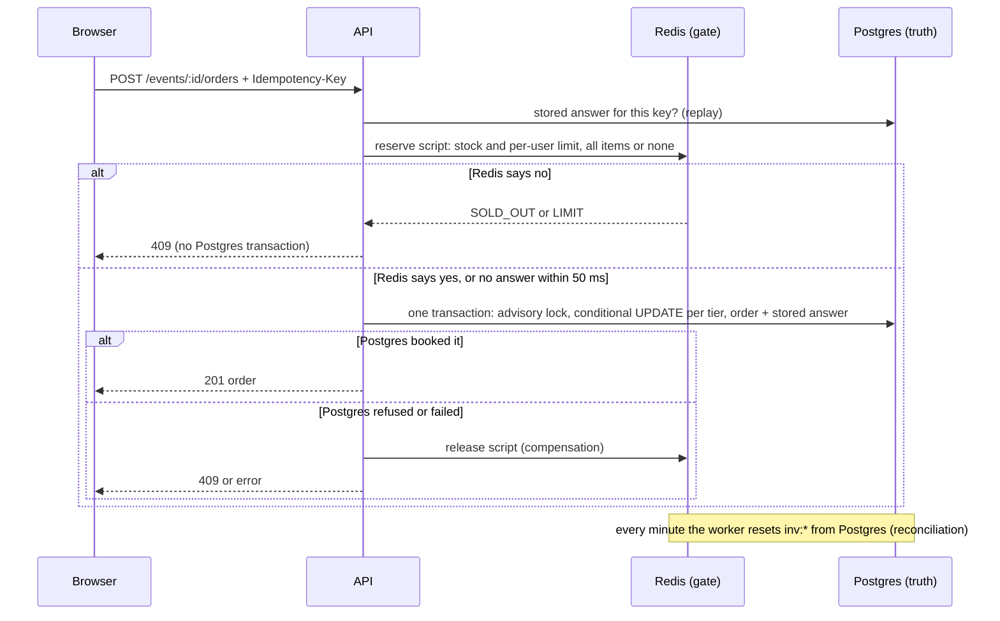

- **Keys:** `inv:{tierId}` = tickets left (`capacity - sold_count`), set when an event is published and whenever a tier changes; `usr:{eventId}:{userId}:{tierId}` = tickets the user holds. Names live in `packages/shared/src/redis-keys.ts`.
- **One Lua script** (`apps/api/src/modules/orders/gate.ts`) checks every item's stock and per-user limit, then decrements all of them or none. Redis runs a script as one step, so no other request can run between the check and the write; separate `GET` and `DECRBY` calls from Node would reopen the exact race the conditional `UPDATE` closes in Postgres.
- **Compensation:** if Redis said yes but Postgres didn't book (sold out after all, over the limit, a replay, an error), a matching `release` script gives the stock back.
- **Duplicates:** a request that passes the gate leaves a 60-second `req:{userId}:{key}` marker, so copies of the same request (double click) skip the gate instead of taking stock twice; Postgres gives them the first answer.
- **Refusals from the gate aren't stored** under the Idempotency-Key (that would be a Postgres write per refusal, which is what the gate avoids). Nothing was booked, so a retry simply asks again.
- **Reconciliation:** `reconcileInventory()` (`packages/db/src/inventory.ts`) sets every `inv:*` of events still on sale from Postgres and reports what it fixed. The worker runs it every minute as a BullMQ job scheduler; the API runs it for one event after publishing or a tier change.
- **Counters:** the API logs `booked`, `rejectedAtGate`, `rejectedAtPostgres`, `gateSkipped` and `compensated` once a minute. In the 200-buyer test with the gate on: 190 refused at Redis, 0 at Postgres.

#### Gate on vs off, under load (Day 24)

Measured with k6 on one laptop (setup under [Load test results](#load-test-results)), 500 tickets, `BOOKING_GATE=on` or `off`, three runs each:

| Target rate | Gate | p95 | p99 | Attempts completed | Refusals that ran a Postgres transaction |
|---|---|---|---|---|---|
| 300/s | on | 8.8 ms | 19.5 ms | 4,499 of 4,500 | 0 |
| 300/s | off | 9.8 ms | 32.9 ms | 4,499 of 4,500 | 3,999 |
| 1,000/s | on | 29.7 ms | 110.1 ms | 14,998 of 15,000 | 0 |
| 1,000/s | off | 1,377 ms | 2,453 ms | 11,374 of 15,000 | 10,874 |

- **At 300/s** the two are close: Postgres keeps up, so the gate mostly saves database work (3,999 transactions per sale) rather than time.
- **At 1,000/s** the difference is the whole point of the gate. With it, the roughly 14,500 people who arrived after the tickets were gone got a 409 from Redis in milliseconds, and Postgres only saw the 500 bookings. Without it, every one of them ran a transaction (advisory lock, reads, a stored refusal) through a pool of 10 connections, the queue grew faster than it drained, answers took seconds, and 18% to 64% of the attempts were never even sent because every virtual user was still waiting.
- **Correct either way:** both sold exactly 500 in every run. The gate changes how fast people hear "no", never who gets a ticket.
- **Two changes came out of the load test:** the tickets are now taken last in the transaction, so the tier's lock is held only for the `UPDATE` and the commit (at 400 bookings a second, p95 went from 404 to 31 ms; see Load test results); and a tier already sold out at step 3 is refused before anything is written, which keeps refusals cheap when the gate is off or bypassed.

#### When Redis is down

- The gate uses its own client with no offline queue and a 50 ms limit, so a dead or slow Redis costs at most 50 ms. The API logs a warning and books through **Postgres only**, which is always correct, just with more load on the database.
- Tested: the whole booking suite runs three times, with Redis working, with every Redis command failing, and with Redis never answering. All three give exactly 10 orders for 10 tickets and the same answers.
- Publishing still works: syncing `inv:*` has a 1 s limit and only logs if Redis is unreachable.
- When Redis comes back empty (restarted without data), a tier with no `inv:` key is booked through Postgres and its key is filled in right after; the worker refills the rest within a minute.
- Ways Redis can drift from Postgres, and how each heals: a release that failed while Redis was down (Redis too low until reconciliation), a script that timed out but still ran (too low), reconciliation racing a booking in flight (briefly too high, which Postgres refuses). Too high only costs a Postgres refusal; too low would show "sold out" for tickets that exist, which reconciliation fixes within a minute.

### Hold expiry (Day 13)

**Problem:** a booking holds tickets for 10 minutes. If the buyer never pays, those tickets must go back on sale, exactly once: not never (a sold-out event with empty seats), and not twice (more tickets than seats). Jobs can run twice (a retry, a race with the sweeper), run late (worker down), or get lost (Redis without persistence).

**Approach:**
- **Order state machine** (`packages/db/src/order-state.ts`): the allowed moves are one table, and `transition(orderId, from, to)` is a guarded `UPDATE orders SET status = to WHERE id = $1 AND status = from`. It returns whether it hit a row; a move the table doesn't allow throws. All status changes go through it.
- **One delayed job per order:** after the booking commits, the API adds `expire-order` with `jobId = orderId` and `delay = expiresAt - now`. BullMQ keeps one job per ID, so a retry or a replayed request can't queue a second one.
- **Release** (`releaseHold` in `packages/db/src/booking.ts`): one transaction runs the guarded `PENDING → EXPIRED` (or `→ CANCELLED`). Only if it hit a row does it run `sold_count = sold_count - qty` for each item (in tier-ID order, like booking). After the commit, the Redis stock and the user's count go back too. A job that fires before `expires_at` (clock skew) does nothing.
- **Cancel:** `POST /orders/:id/cancel` is the same release with `→ CANCELLED`; the expiry job still fires later and finds nothing to do.
- **Sweeper:** a BullMQ job scheduler runs `sweep-expired-orders` every minute: `PENDING` orders past `expires_at` (served by the `orders(status, expires_at)` index), released through the same function. It catches holds whose own job never ran.
- **Retries:** every queue (one factory, `packages/shared/src/server.ts`) retries a failed job 5 times with exponential backoff (1 s, 2 s, 4 s, 8 s) and keeps failed jobs for inspection in Bull Board (`/admin/queues`, `ADMIN_EMAILS` only).
- **Traceable:** the job carries the booking's request ID, so the worker's "hold expired" log line can be matched to the request that made the hold.

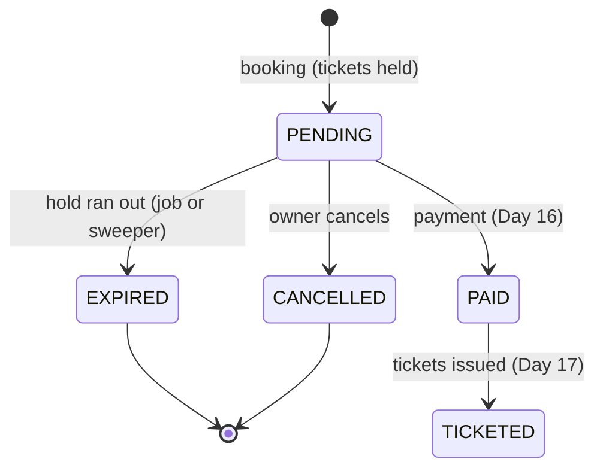

The initial version; the full machine, with payments and refunds, is under [Payment idempotency and the order state machine](#payment-idempotency-and-the-order-state-machine-day-16). Leaving `PENDING` gives the tickets back (`EXPIRED`, `CANCELLED`) or keeps them (`PAID`); every arrow is a guarded `UPDATE`, so only one of them can ever win for a given order.

**Alternatives:** a cron job only (simple, but every hold would wait for the next run and nothing would be precise); checking expiry lazily at read time (the stock would stay taken until someone looked); a database trigger or `pg_cron` (hard to test, and the Redis release still needs code).

**Tested by:** `apps/worker/test/expiry.test.ts` (real BullMQ worker, test database, Redis database 15): a 2-second hold is still `PENDING` with 3 sold, then its delayed job expires it and `sold_count`, Redis stock and the user's count all go back; running the expiry twice releases once; the job and the sweeper racing on one order release it once; a job that fires early leaves the hold alone; the sweeper expires only overdue holds. `apps/api/test/orders.test.ts` checks the job is queued once per order with the right delay, and cancel (pending, twice, paid, someone else's). Watched live: a 30-second hold's job in Bull Board went from delayed to completed with `released: true`, and the tier's availability went from 98 back to 100.

### Rate limiting (Day 14)

**Problem:** login invites password guessing, register invites fake accounts, and during a flash sale one script can hammer **Book** or upload endlessly. Each endpoint needs a cap per client that allows normal bursts (a double click, a retry) but stops sustained abuse.

**Approach** (`apps/api/src/lib/rate-limit.ts`, the only place the algorithm lives):
- **Token bucket in one Redis Lua script.** Each key (`rl:{name}:{who}`) is a hash with `tokens` and `ts`. On every request the script reads Redis `TIME`, adds `elapsed × rate` tokens up to the capacity, takes one if there is one, and saves both. Nothing runs between requests: the refill is computed when the next request arrives, and an idle key expires once it would be full again.
- **Redis TIME, not the server clock:** all API instances share one clock, so a server whose clock runs ahead can't mint extra tokens and one that runs behind can't refuse too early. The script is atomic: 20 parallel requests on a bucket of 3 let exactly 3 through.
- **Routes only declare limits:** `rateLimit({ name, keyFn, capacity, refillPerSec })`. Login counts per IP **and** email (slows guessing one account without locking out a campus behind one IP), register per IP (a generous limit for the same reason), booking and presign per user. Limits come from env as `<burst>/<per minute>`; `createApp({ rateLimits })` lets tests use tiny ones.
- **Headers:** every answer carries `RateLimit-Limit` (burst), `RateLimit-Remaining` and `RateLimit-Reset` (seconds until full); a `429 RATE_LIMITED` adds `Retry-After` (seconds until the next token) and the same number in `details.retryAfterSeconds`.
- **Fail open:** if Redis errors or takes over 50 ms, the request goes through and a warning is logged. The limiter guards against abuse, not against bad data: Postgres constraints, the per-user ticket limit, idempotency keys and bcrypt's cost all still hold without it. Failing closed would turn a Redis outage into an outage of login and booking, exactly what the booking gate (Day 12) was built to avoid. The cost: during an outage, password guessing is limited only by bcrypt (about 4 guesses per second per CPU core), which the warning logs make visible.

| Algorithm | How it counts | Problem |
|---|---|---|
| Fixed window | A counter per minute that resets on the minute | A client can send the full limit at 0:59 and again at 1:00: double the rate at the boundary |
| Sliding log | A timestamp per request, counting those in the last minute | Exact, but stores every request (memory grows with traffic) |
| **Token bucket** (chosen) | Two numbers per key: tokens and the last refill time | Allows a burst up to the capacity, then exactly the refill rate; constant memory |

**Tested by:** `apps/api/test/rate-limit.test.ts` against real Redis with tiny limits: a burst of 3 passes and the 4th gets `429` with `Retry-After`; headers on allowed and limited answers; a token comes back after the refill time; 20 parallel requests on a bucket of 3 let exactly 3 through; login counts per account (case and spaces ignored); register per IP; booking and presign per user; with Redis failing, requests pass without rate headers. Live with the defaults (`RATE_LIMIT_LOGIN=5/5`): attempts 1–5 got 401 with `RateLimit-Remaining` 4 → 0, attempts 6–8 got 429 with `Retry-After: 11`, and another account from the same IP still logged in.

### Payments: why the webhook is the source of truth (Day 15)

**Problem:** after paying in Razorpay Checkout, the browser runs a success callback. It is tempting to call the API from there and mark the order paid. But that callback runs on the buyer's machine: anyone can call it without paying (devtools, a script), and a real payment's callback can be lost (tab closed, phone locked, network gone right after paying).

**Approach:**
- `POST /orders/:id/pay` (`apps/api/src/modules/payments/`) only *starts* a payment: for a `PENDING`, unexpired order of the caller it creates a Razorpay order for the exact amount in paise, with `receipt` and `notes.orderId` set to our order ID, stores `razorpay_order_id` and returns what Checkout needs. A second call returns the stored Razorpay order instead of creating another; two parallel calls are settled by a guarded `UPDATE ... WHERE razorpay_order_id IS NULL`, so exactly one is kept.
- The Razorpay call happens **outside any database transaction**, behind a 10 s limit: a transaction waiting on the network would hold locks and a pool connection for seconds. Nothing is written until Razorpay has answered, so a failure (`502`) leaves nothing half-done.
- The browser's success callback only switches the checkout page to "Confirming payment…" and starts polling `GET /orders/:id`. **Only Razorpay's webhook, signed with a secret the browser never sees and verified on the server, will move an order to `PAID` (Day 16).** A faked callback changes nothing; a lost one doesn't lose the payment, because the webhook still arrives.
- Test mode only: the API refuses to start with a live key (`rzp_live_...`), and card details are typed into Razorpay's own window, never into FestPass.
- The web app's **Book** creates the hold with an Idempotency-Key the browser generates once and keeps in `sessionStorage`, so a double click, a timeout or a reload sends the same key and gets the same order back instead of a second hold.

**Alternatives:** marking paid from the client callback (forgeable, and loses payments whose callback never runs); verifying Razorpay's payment signature in a "client says paid" endpoint (stops forgery, but still loses payments whose browser died, so the webhook is needed anyway); polling Razorpay's API for each order (works, but slow and rate-limited at flash-sale volume).

**Tested by:** `apps/api/test/payments.test.ts` with Razorpay replaced by a fake (see [Testing](#testing)). In the browser (headless Chrome, test mode without keys): **Book** on a public event page → login with `?next=` → back on the booking page → 2 tickets held → checkout with a running countdown → booking the same attempt again returned the same order → **Pay** without keys showed "Payments are not set up on this server". A completed test-mode payment needs Razorpay test keys in `.env`.

### Payment idempotency and the order state machine (Day 16)

**Problem:** Razorpay tells us about payments with webhooks, which are delivered **at least once**: the same event can arrive twice, five times, minutes apart, and `order.paid` and `payment.captured` both arrive for one payment, in either order. A payment can also arrive after the hold ran out and its tickets went back on sale, or for an order the buyer cancelled. Anyone can also send our endpoint a forged "payment captured".

**Approach** (`apps/api/src/modules/webhooks/`, `packages/db/src/payments.ts`, `packages/db/src/order-state.ts`):
- **Verify first:** the route is mounted before the app's JSON parser with `express.raw`, so the handler gets the exact bytes. `HMAC-SHA256(raw body, RAZORPAY_WEBHOOK_SECRET)` must equal `X-Razorpay-Signature`, compared with `crypto.timingSafeEqual`. Nothing is parsed, looked up or logged before that; a bad signature is `400` and changes nothing.
- **Record once:** `INSERT INTO payments ... ON CONFLICT (razorpay_payment_id) DO NOTHING RETURNING id`. Only if a row was inserted does anything else happen, in the same transaction: the order row is locked (`FOR UPDATE`) and moved on by the state machine. A redelivery inserts nothing and answers `"duplicate"`.
- **What a payment does to its order:** `PENDING` → `PAID`. `EXPIRED` → re-reserve with the same conditional `UPDATE` as booking (all tiers or none, in tier-ID order): if the tickets are still there, `EXPIRED` → `PAID`; if not, the order stays `EXPIRED` and the payment is marked `refund_pending`. A cancelled order, or a second payment for an order already paid, is also marked `refund_pending`.
- **Fast handler:** verify, record, enqueue, respond. On `PAID` it queues `issue-tickets` with `jobId = orderId` (the `tickets` queue, worked from Day 17); for each `refund_pending` payment it queues `refund-payment` with `jobId = paymentId`. Follow-ups are read from the stored state, not from what this delivery did, so if queuing failed (a `500`, Razorpay retries) the redelivery queues them; job IDs make queuing twice harmless.
- **Refunds** run in the worker: Razorpay's refund API outside any transaction, Razorpay's "already fully refunded" treated as done (a retry after a crash), then a guarded update marks the payment `refunded` and an expired order `REFUNDED`.

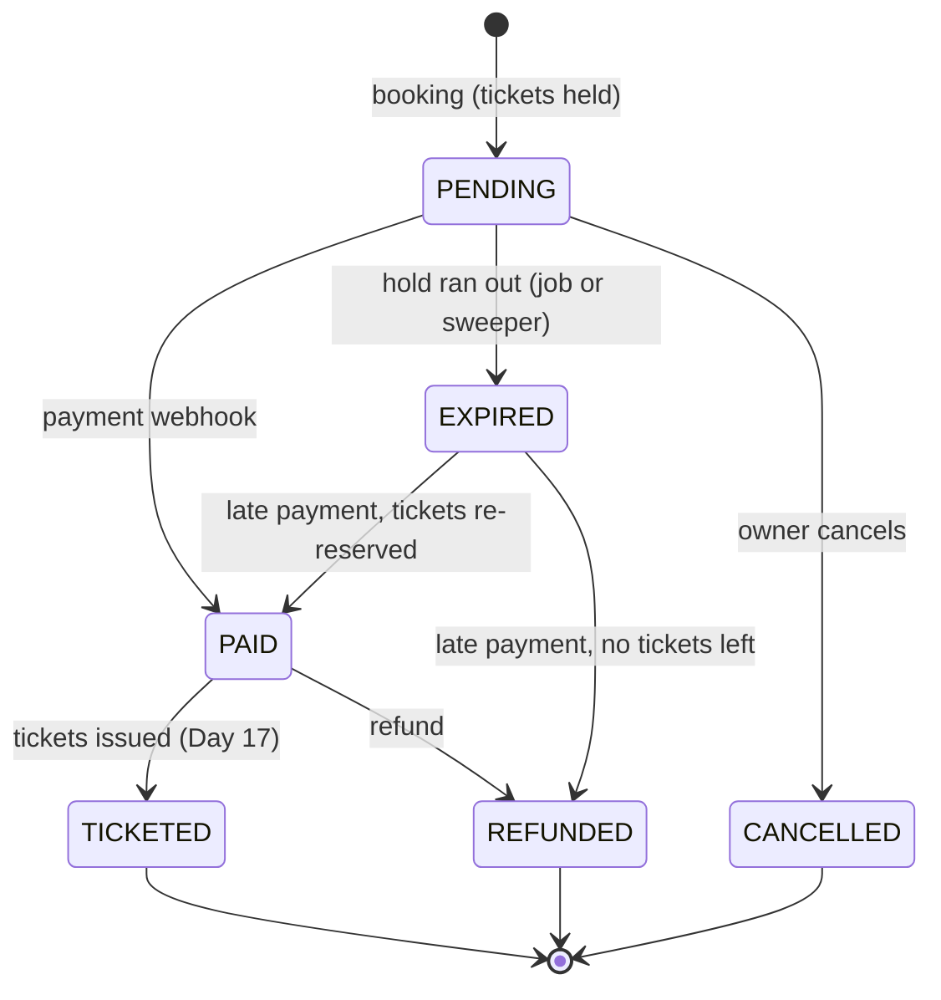

Any move not drawn here throws in `transition()`, and every move is a guarded `UPDATE orders SET status = $to WHERE id = $1 AND status = $from`, so two webhooks, a webhook and the expiry job, or a cancel and a payment can never both move the same order.

**Alternatives:** trusting the browser's success callback (forgeable, and lost when the tab closes); deduplicating with an in-memory or Redis set of seen event IDs (lost on restart; the unique index lives with the data it protects); processing everything inside the webhook request (slow responses make Razorpay time out and resend, multiplying the load).

**Tested by:** `apps/api/test/webhooks.test.ts`: a wrong, missing or foreign signature and a body re-formatted after signing are `400` with nothing recorded; the same webhook 5 times in a row and 5 at once (plus `order.paid` for the same payment) give one payment row, one `PAID` and one `issue-tickets` job; a failed enqueue is repaired by the redelivery; a late payment is re-reserved when tickets remain and refunded when they don't (nothing partly taken); a second payment and a payment for a cancelled order are refunded. In the browser: a hold's checkout page showed "Payment confirmed" after `pnpm webhook:simulate`, and resending the same payment ID answered `"duplicate"` with still one payment row.

### Forgery-proof QR tickets (Day 17)

**Problem:** a ticket is a QR code on a phone or a printout. Anyone can screenshot one, edit it or generate their own. The gate has to tell a real one from a forgery, ideally on a volunteer's phone even when the venue's network is down.

**Approach:**
- **Format** (`packages/shared/src/qr.ts`): `FP1.<base64url(JSON)>.<base64url(signature)>`, where the JSON is `{ t: ticketId, e: eventId, v: qrVersion, iat }` and the signature is Ed25519 over the exact bytes `FP1.<payload>` (prefix included, so a payload can't be reused under another format).
- **Signing, server only:** `encodeTicket()` (and `createTicketSigner()`, which binds the key once) in `@festpass/shared/server` uses Node's `crypto.sign` with `TICKET_SIGNING_PRIVATE_KEY`, checked at API startup. QR strings aren't stored: `GET /me/tickets` signs them on read from the ticket's ID, event, current version and issue time. Ed25519 is deterministic, so a ticket keeps the same QR until its version changes.
- **Verifying anywhere:** `verifyTicket()` uses `@noble/ed25519` (strict RFC 8032, no Node APIs), so the same code runs in the API and on a phone with only the public key. The payload is parsed only after the signature checks out.
- **No personal data in the QR:** QR codes are signed, not encrypted; anyone with a scanner app can read them. So the payload holds IDs and numbers only, and the gate looks the person up (or, offline, shows the ticket ID).
- **Issued exactly once:** the `issue-tickets` job locks the order and, only if it is `PAID`, inserts one ticket per unit (`seq` 1..n, a readable random code like `K7QM-X9PA`, `qr_version` 1) with `ON CONFLICT (order_id, seq) DO NOTHING`, then moves `PAID → TICKETED`, all in one transaction.
- **Revocation:** `POST /tickets/:id/reissue` bumps `qr_version`. The old QR still carries a genuine signature, but its `v` no longer matches the database, which the gate checks online (Day 19). An offline scanner catches it from its downloaded ticket list, so it can only miss a bump made after the last download: see [Offline scanning and its limits](#offline-scanning-and-its-limits-day-20).

| | HMAC (shared secret) | Ed25519 (key pair, chosen) |
|---|---|---|
| What verifies a code | The same secret that creates codes | A public key that can only verify |
| An offline scanner needs | The secret on every volunteer's phone | Only the public key |
| A lost or inspected phone means | Anyone can mint valid tickets | Nothing: the public key can't sign |

**Tested by:** see [Testing](#testing) (`qr.test.ts`, worker `tickets.test.ts`, API `tickets.test.ts`). Live: the worker picked up an `issue-tickets` job waiting since Day 16 for a paid order, issued 2 tickets, and both QR strings from `GET /me/tickets` verified with the public key from `.env`.

### Ticket delivery: private PDFs and emails sent once (Day 18)

- **Private PDFs, public banners:** both live in one bucket, but only `orgs/*/events/*/banner/*` is publicly readable. A banner is meant to be seen by anyone, cached by a CDN and linked from a public page. A ticket PDF carries the buyer's name and QR codes that get someone through the gate; a public URL is permanent and can be guessed, forwarded or indexed. So PDFs sit under `orgs/{org}/events/{event}/tickets/{order}.pdf`, and every link to one is a pre-signed GET: 24 hours in the email, 5 minutes for **Download PDF** (a new one on every click). Unsigned requests get `403`.
- **The PDF** (`apps/worker/src/pdf.ts`, pdfkit + qrcode): one A5 page per ticket with the event, time in IST, venue, attendee name, tier, the signed QR and the readable code.
- **Sent once:** `email_log(order_id, template)` is unique. A job first claims the row (`UPDATE ... SET claimed_at = now() WHERE sent_at IS NULL AND (claimed_at IS NULL OR claimed_at < now() - 5 min)`), so a second run at the same time can't claim it; then builds and sends; then sets `sent_at`. A retry finds `sent_at` and stops; a failed send drops the claim so the retry can try again. Exactly-once delivery isn't possible over a network (a crash after SendGrid accepted the email but before `sent_at` is written would resend once); this makes that window as small as it can be.
- **`EmailProvider`:** jobs say *which* template and *what data*; `SendGridProvider` (dynamic templates) or `ConsoleProvider` (logs + HTML preview) decides *how*. Tests use a fake, so no test needs SendGrid or a network.
- **Follow-ups from state:** issuing tickets (order `TICKETED`), an expired hold and a finished refund each queue their email with `jobId = <job>-<orderId>`, whenever the order is in that state, so a run that died after changing the order but before queuing is covered by the next run.

### Exactly-once entry (Day 19)

**Problem:** the same ticket can be scanned on two phones at the same moment, by a friend with a screenshot or by a volunteer double-tapping. Exactly one must get in, and the answer must come back fast, whatever else is down.

**Approach** (`apps/api/src/modules/checkins/service.ts`, `packages/db/src/tickets.ts`):
1. **Signature:** `verifyTicket()` with the public key. A tampered or foreign code is `400 INVALID_QR`, and nothing inside it is trusted or recorded.
2. **Event:** the signed event ID must be this event (`409 WRONG_EVENT`).
3. **Version:** the signed `v` must equal `tickets.qr_version` (`409 QR_REVOKED`), which is what makes a reissue revoke older codes.
4. **One statement decides:**
   ```sql
   UPDATE tickets SET checked_in_at = now(), checked_in_by = $scanner
   WHERE id = $ticket AND qr_version = $version AND checked_in_at IS NULL
   RETURNING checked_in_at;
   ```
   The row lock makes parallel scans take turns, and a scan that waited re-checks the `WHERE` against the winner's commit, so only one gets a row back. The others re-read the ticket and answer `409 ALREADY_CHECKED_IN` with when and by whom it was first scanned.
- **Permission:** `requireEventPermission('checkin:scan')` finds the club from the event: non-members get `404`.
- **Offline sync:** `POST /events/:id/checkins/batch` runs scans one at a time in the phone's timestamp order and returns one result per scan in that order, each with its `clientScanId`. The phone's clock is used only for ordering within a batch and the scan's history time, and a future time becomes now. Between phones, the first scan to reach the server wins.
- **Sending again is safe:** the winning `clientScanId` is stored on the ticket (`checked_in_scan_id`), so a batch re-sent after a lost response gets `ACCEPTED` again, not a false conflict, and adds no history row. The single scan endpoint accepts the same ID: a scan that timed out online and falls back to the queue is recognised at sync.

**Alternatives:** read `checked_in_at` and then update (the same race as overselling: two phones both read "not used"); a Redis lock (Redis isn't the source of truth, and a gate should keep working when it is down); a unique "check-ins" table (works, but one guarded `UPDATE` on the ticket says the same in less).

**Tested by:** `apps/api/test/checkins.test.ts`: one scan accepted and a second `409` with details; ten parallel scans give exactly one `ACCEPTED` and nine `ALREADY_CHECKED_IN` (and with `AND checked_in_at IS NULL` removed by hand, all ten were accepted, so the test does catch it); wrong event, an old QR after a reissue, a tampered QR, plain text and a QR signed with another key are rejected; a batch sent out of order is processed and answered in client-time order; 200 scans fit the request limit.

### Offline scanning and its limits (Day 20)

**Problem:** venue networks fail exactly when a crowd arrives. The gate must keep moving with no server, but a phone alone can't know everything the server knows, so the app has to be honest about the difference.

**Approach** (`apps/web/src/lib/scan/`, extending [the QR design](#forgery-proof-qr-tickets-day-17)):
- **Same checks, local data:** `scanOffline()` verifies the Ed25519 signature with the public key, checks the event, compares the version with the downloaded ticket list, then refuses a ticket this phone has already scanned (IndexedDB). A pass is queued and shown as "Accepted (offline)".
- **Ticket list:** at gate open and every 5 minutes, `GET /events/:id/checkins/manifest` downloads `{ id, v, used }` per ticket, with no personal data, so a lost phone gives nothing away. A QR older than the list is revoked. A QR newer than the list, or a ticket not on it, has a valid signature and arrived after the download, so it is let in and the server decides at sync.
- **Sync:** every 30 seconds and on reconnect, `syncQueue()` sends the queue oldest first in batches of up to 200, saving each answer as it arrives. If a request fails, the rest stay queued.
- **Conflicts:** two offline phones can each accept one ticket. The guarded `UPDATE` lets the first scan to reach the server win, and the other is listed on that phone under "Needs a look", with when and by whom the ticket was first scanned. Nobody is removed automatically: the person is already inside, so a volunteer follows up.
- **Staying up:** a hand-written service worker (`public/sw.js`) caches the page and its files but never touches API calls, so they fail honestly. A saved gate opens without waiting for auth: a failed refresh from no network is reported separately from "logged out", and an expired session only stops syncing, not scanning.

| Offline mode can promise | It cannot promise |
|---|---|
| The ticket is genuine and for this event | That another offline phone hasn't let the same ticket in |
| This phone hasn't scanned it | Anything that changed after the last ticket list download (a new reissue, a scan at another gate) |
| It wasn't replaced or used as of the last download | That the phone's clock is right (scan times come from it) |

**Alternatives:** refusing to scan offline (the gate stops when it is needed most, or volunteers wave people through unchecked); putting the private key or an HMAC secret on phones (a lost phone could mint tickets); phones syncing with each other over Bluetooth or local Wi-Fi (closes the two-phones gap, but is far more to build and fails in new ways); earliest timestamp wins across phones (phone clocks can't be trusted, and the first ticket holder's entry would be undone after the fact).

**Tested by:** `apps/web/src/lib/scan/offline.test.ts` with QR strings signed once by a throwaway key: local checks (forged, tampered, wrong event, older and newer than the list, used, unknown, repeat on this phone) and the queue (oldest first, conflicts and rejections recorded, a failed network keeps scans queued, a 450-scan queue splits into batches and keeps what was answered). `apps/api/test/checkins.test.ts`: a re-sent batch gets the same answer and no extra history row, and the manifest holds no personal fields. Live: see [Scanner app](#scanner-app).

### Why scans live in MongoDB (Day 19)

**Problem:** entry is one row per ticket, but history is many rows per ticket: every scan, including duplicates and invalid codes, at every gate and later every sponsor booth. It is written constantly during an event and only ever read as aggregates ("per gate, per minute", "by college").

**Approach** (`packages/mongo/src/scan-event.ts`):
- **Postgres decides, MongoDB remembers.** A `ScanEvent` goes to a **time-series collection** (`timeField: ts`, `metaField: { eventId, type, gateOrBoothId }`): MongoDB groups documents with the same meta into compressed, time-ordered buckets, built for many small appends read by time range.
- **Attendee fields are copied at write time** (college, branch, graduation year, tier name), so an analytics query is a single aggregation with no join across databases, and it keeps what was true on the day.
- **Written after the Postgres commit, and not awaited:** the volunteer never waits for analytics. If the write fails, a `write-scan-event` job retries it from the worker (10 attempts with exponential backoff from 5 s, kept in Bull Board if they run out). **The check-in is never undone:** a person at the gate matters more than a row in a chart.

**Alternatives:** a Postgres table (works at first, but heavy append traffic and analytics scans would compete with the database that decides money and capacity); writing to MongoDB first (a Mongo outage would stop the gate); writing inside the Postgres transaction (a network call inside a transaction, and two databases can't commit together anyway).

**Tested by:** `checkins.test.ts` checks the collection is really `timeseries`, the copied fields, and that a failing write leaves the check-in in place with a retry job queued; `apps/worker/test/scan-events.test.ts` checks the retry writes the event at its original time. Live against the dev stack: with the MongoDB container stopped, a scan was accepted in 25 ms; after restarting it, the worker wrote the missed event, 16 s after the scan.

### Real-time updates (Day 21)

**Problem:** people watching a sale want to see tickets disappear, and organizers want to see the gate. But a flash sale is the worst moment to add load: one message per booking, sent to every open page, would multiply the traffic exactly when the system is busiest.

**Approach** (`apps/api/src/sockets/`):
- **A change is a signal, not data.** After a booking, cancel or late payment commits (and from the worker, after an expiry), `announceAvailabilityChange()` publishes just the event ID on a Redis channel. The worker has no Socket.IO server, so this is how it reaches the API. A Redis failure here is logged and ignored: a live number must never slow down or fail a booking.
- **Throttled per event, across all instances.** The first change claims `avail:throttle:{eventId}` with `SET NX PX 500`. Whichever API instance wins waits out the window, then reads the numbers from Postgres and sends one update. So there are at most about 2 updates a second however many instances run, and the update includes every change made during the window, including the last.
- **Redis adapter.** `io.to(room).emit()` only reaches sockets on the same process. With `@socket.io/redis-adapter` it also goes to the other instances, so a visitor connected to instance 1 hears about a booking made through instance 2.
- **Rooms.** Anyone may join `event:{id}:public`, which only ever receives `{ eventId, tiers: [{ id, available }] }`. `event:{id}:staff` needs a valid token and membership of the event's club, and carries scans with ticket IDs but no names. Clients ask for "public" or "staff" and the server builds the room name, so nobody can name a room of their choosing.
- **Authentication.** The access token goes in the WebSocket handshake. No token means anonymous; a bad or expired one is refused, and the client refreshes it and connects again. A connection is ended when its token expires, so the membership check runs again and someone removed from a club loses the feed within 15 minutes.
- **WebSocket only.** Long polling would need sticky sessions, because all its requests must reach the same instance. If WebSockets are blocked, the page still shows its cached numbers and says so.
- **Catching up.** Rooms belong to a connection, so the client rejoins on every reconnect. Joining a public room sends the current numbers, shared for a second, so a crowd reconnecting together costs one query per instance per event rather than one each. The dashboard reloads its summary from the API after a reconnect.

| | Polling | Socket.IO (chosen) |
|---|---|---|
| Cost when nothing changes | Every open page keeps asking | An idle connection |
| Freshness | The polling interval | About half a second |
| Load during a sale | Grows with the crowd, on the same API that takes bookings | One read per window per event, then one broadcast |
| New moving parts | None | The adapter, and handling for reconnects |

**Limits:** availability on the page is still a hint, and booking checks live stock. If Redis is down, live updates stop and the page keeps its last numbers, while bookings carry on through Postgres. How many connections one instance can hold hasn't been measured yet.

**Alternatives:** debouncing (it waits for a quiet moment, and a flash sale has none, so people would see nothing until the rush ended); a throttle in each process with no shared claim (the limit would grow with every instance); sending the numbers in each signal (messages can arrive out of order, so a late one could overwrite newer numbers; reading at send time can't).

**Tested by:** `apps/api/test/availability-throttle.test.ts` with fake timers: 1,000 changes in a second give at most 2 sends in that second, the last change is never lost, each event has its own limit, and two instances share one. `apps/api/test/realtime.test.ts` with `socket.io-client` against real servers: a stranger or anonymous client can't join the staff room and hears nothing; bad, expired and foreign tokens are refused; a token's expiry ends the connection; public messages hold only numbers; a draft's numbers stay private; a message crosses between two instances (with the adapter removed by hand, that test fails). Live: two browsers and two API instances, where a booking in one browser changed the other without a reload, and so did the worker expiring a hold. With one instance stopped, the page said it was no longer live, then reconnected and caught up on a booking it had missed.

### Virtual waiting room (Day 22)

**Problem:** when a popular sale opens, thousands of people press Book in the same second. The booking engine stays correct, but everyone arrives at once, so the first seconds are a wall of row-lock contention and refusals, and who gets through is down to luck.

**Approach** (`apps/api/src/modules/queue/`, `packages/shared/src/waiting-room-server.ts`, `admitWaitingRooms` in `apps/worker/src/processors.ts`):
- **The line is a Redis sorted set**, `wr:{eventId}`, of user IDs scored by Redis's own `TIME`. Every API instance reads the same clock, so they all agree who came first. `ZADD NX` keeps a user's first score, so joining again never moves anyone, and that's the one-entry-per-user rule. `ZRANK` gives a position without walking the line. A join is also limited per user.
- **The worker lets people in.** A job runs every second and serves every event in `wr:active`, reading each event's `admitRatePerSec` on each tick, so a change applies within a second. If the worker was down, it doesn't catch up with a burst; it carries on at the set rate.
- **Peek, sign, then remove in one step.** The tick reads the next N users, signs their tokens, then a Lua script removes each user and stores their token together. Only the run that actually removes a user stores a token. With `ZPOPMIN` first, a crash between the pop and the signing would lose those places, and a retry would admit extra people.
- **Admission tokens** are JWTs with their own secret, a 5-minute life, `sub` = user and an `eventId` claim. `POST /orders` needs one when queue mode is on, in the `X-Admission-Token` header. A copy is kept in Redis with the same expiry only so the page can fetch it; booking never reads that copy.
- **Finding out:** the worker publishes "this user was admitted" on a Redis channel and each API instance tells its own sockets in `user:{id}`, a room joined automatically from the verified token. The message holds no token: the page fetches it with `GET /queue/status`, which is also what a reload uses. If the socket message is missed, the page's regular status check finds out anyway. People far back in line check less often (every 2 to 30 seconds).
- **The check runs after the idempotency lookup**, inside `createOrder`, not in middleware. A retry of a booking that already worked gets its order back even if the token has since expired.

| | Redis flag ("user X may book") | Signed token (chosen) |
|---|---|---|
| Checking it during a booking | A Redis call on the hottest path | CPU only, no network |
| Redis down | Nobody can book, or everybody can | People already admitted can still book |
| Forging it | Needs write access to Redis | Needs the secret |
| Taking it back early | Delete the key | Not possible; it ends on its own within 5 minutes |

**What it protects:** the admit rate limits how fast people reach booking, which is what Postgres row locks, the connection pool and Razorpay order creation have to absorb. It doesn't guarantee anything about tickets: a token doesn't reserve one, and the Redis gate and Postgres still decide. If the token check were removed, the sale would be a stampede again but could still not oversell.

**Limits:**
- If Redis is down, nobody can join (`503 QUEUE_UNAVAILABLE`), while people already admitted can still book, and Postgres still protects the tickets.
- Someone who closes the tab keeps their place, and their turn then uses up one admission. Their token expires unused. A heartbeat would fix this, at the cost of more traffic from everyone in line.
- Many accounts mean many places in line. The limit is per account, and paid tickets still have the per-user limit.
- Admission can't be withdrawn early, including when the organizer changes settings: tokens already issued work for up to 5 minutes.
- Each join and status check reads the event's settings from Postgres, once per request.
- The best admit rate for a real sale hasn't been measured yet (Day 24).

**Alternatives:** a Redis list (finding a position means walking it, and stopping duplicates needs a second structure); one scheduled job per event (more parts to start and stop, and a failed start would leave a line nobody serves); pushing each person's position every second (one message per waiting person per second, the kind of load this exists to prevent).

**Tested by:** `apps/api/test/waiting-room.test.ts`: positions follow join order and joining again keeps the place; 10 users are admitted in join order; a booking with no token is refused and takes no stock; expired, another user's, another event's and wrongly signed tokens are refused; a token doesn't get past a sold-out tier; a retry whose token has expired still gets its order; join is rate-limited; two overlapping admission runs admit nobody twice; `queue:admitted` reaches only the admitted user, once, across two API instances; admission tokens are redacted from logs. `apps/worker/test/waiting-room.test.ts`: the rate per tick, a new rate on the next tick, each event at its own rate, and the line being deleted when queue mode goes off, the event closes or the sale ends. Removing the token check, the subject check, the ordering or `io.local` by hand each made these tests fail. Live, on one laptop with one API instance and one worker: three browsers at position 1, 2 and 3 with the rate set to 1 in the organizer form, a reload that kept position 3, and arrival at booking 1.6, 2.6 and 3.5 seconds after the worker started, each through to checkout. Turning queue mode off sent a waiting fourth user to booking with no worker running.

### Analytics (Day 25)

**Problem:** organizers want to know how the sale went and who came, while it happens. The data is in two places: orders in Postgres, scans in MongoDB. Loading every order or scan into Node to count them would move thousands of documents to produce a handful of numbers, on every refresh.

**Approach:** every number is computed by the database that holds it, and only the result travels.

- **Sales (Postgres, `packages/db/src/analytics.ts`):** per tier, paid and held tickets and revenue, using `SUM ... FILTER (WHERE status ...)` over order items. Per day, `date_trunc('day', created_at AT TIME ZONE 'Asia/Kolkata')`, so a sale at 00:30 India time counts for that day, not the UTC day before. `generate_series` fills the days with no sales, so a quiet day shows as zero instead of disappearing from the chart.
- **Check-ins (MongoDB, `packages/mongo/src/analytics.ts`):** one aggregation. A `$match` on the event's gate scans is served by the new `{ meta.eventId: 1, ts: 1 }` index. Then a `$facet` runs the timeline (`$dateTrunc` into 5- or 15-minute buckets), the results and the college, branch, year and tier breakdowns over the same documents in one round trip. A final `$sortArray` picks the peak bucket. No join back to Postgres is needed, because the attendee's college, branch, year and tier were copied onto each scan when it was written (Day 19).
- **Endpoints:** `GET /orgs/:orgId/events/:eventId/analytics/sales` and `/analytics/checkins?bucket=5|15`, for owners and managers only (`analytics:read`: gate scanners don't see revenue). Answers are cached for 30 s with the same cache-aside as public pages (`lib/cache.ts`).
- **Dashboard:** four Recharts charts on the organizer's event page (`apps/web/src/components/events/event-analytics.tsx`): tickets per day, tier fill, entries at the gate and who came in. Each is a single series in the brand blue, checked against the white surface for contrast, and each has a table view.

The check-in pipeline (`checkinPipeline()`):

```js
[
  { $match: { 'meta.eventId': eventId, 'meta.type': 'GATE' } },
  { $facet: {
      timeline: [
        { $match: { result: 'ACCEPTED' } },
        { $group: { _id: { $dateTrunc: { date: '$ts', unit: 'minute', binSize: 15 } }, count: { $sum: 1 } } },
        { $sort: { _id: 1 } },
      ],
      results: [{ $group: { _id: '$result', count: { $sum: 1 } } }, { $sort: { count: -1, _id: 1 } }],
      college: [{ $match: { result: 'ACCEPTED' } }, { $group: { _id: '$college', count: { $sum: 1 } } },
                { $sort: { count: -1, _id: 1 } }, { $limit: 10 }],
      // branch, graduationYear and tier: the same shape
      entered: [{ $match: { result: 'ACCEPTED' } }, { $count: 'n' }],
  } },
  { $project: { /* ... */ peak: { $first: { $sortArray: { input: '$timeline', sortBy: { count: -1, at: 1 } } } } } },
]
```

**Measured** (MacBook Air M2; MongoDB 7.0.45 in Docker; `pnpm perf:explain-mongo`: 100,000 generated scans for 50 events, inserted in time order as real scans arrive, which packs them into 1,386 time-series buckets; the sample event has 9,957 scans; median of 7 runs):

| | Plan | Buckets read | Whole aggregation |
|---|---|---|---|
| With `{ meta.eventId: 1, ts: 1 }` | `IXSCAN` then `FETCH` | 156 of 1,386 | 13.1 ms |
| Forced to ignore it (`$natural`) | `COLLSCAN` | 1,386 | 13.3 ms |

The index cuts the buckets read by about 9 times, but at this size the time is the same, because most of the work is unpacking and grouping the event's 9,957 scans, not finding them. The gap grows with the number of events in the collection. On the Postgres side (`pnpm perf:explain`, 58,300 orders), sales per tier takes 5.5 ms and sales per day 7.6 ms. Both read every order item, because the planner prefers one hash join over 1,500 index lookups. Indexes on `order_items(tier_id)` (unused by the planner) and `orders(event_id, status)` (7.6 → 5.0 ms) were measured and left out: with a 30 s cache, they aren't worth the extra writes on every booking.

**Tested by:** `apps/api/test/analytics.test.ts`, with fixtures worked out by hand:
- Sales: 3 paid Regular and 2 paid VIP tickets, ₹2,895.00 in all; a sale at 00:30 India time counted on the next day; a quiet day reported as zero; held, expired and refunded orders not counted as revenue.
- Check-ins: 6 entries in buckets of 2, 3 and 1, with the peak at 04:45 UTC (0.2 a minute); 5-minute buckets with the earliest bucket winning a tie; refusals counted only in the results; booth scans and another event's scans left out; exact college, branch, year and tier counts.
- Access: answers are cached for 30 s, owners and managers can read them, scanners get `403`, other clubs `404`.

**Limits:** numbers can be up to 30 s old, and there is no date-range filter yet.

**Planned:**

- Sponsor analytics and privacy (Day 26)
- AI copilot safety (Day 27)

## Roles and permissions

A college club is an **organization**; each member has one role in it. The matrix is data in `packages/shared/src/permissions.ts`, so the API (which enforces it) and the web app (which uses it to hide buttons) read the same table.

| Action | OWNER | MANAGER | SCANNER |
|---|:-:|:-:|:-:|
| `org:read`: see the org and its members | ✓ | ✓ | ✓ |
| `member:manage`: add, change and remove members | ✓ | | |
| `event:create` / `event:update` | ✓ | ✓ | |
| `event:publish` | ✓ | ✓ | |
| `checkin:scan`: scan tickets at the gate | ✓ | ✓ | ✓ |
| `analytics:read`: sales and check-in analytics, including revenue | ✓ | ✓ | |

- Enforced by `requireOrgPermission(action)` (`apps/api/src/middleware/require-org-permission.ts`) on every org route. The UI may hide buttons, but the API is the boundary.
- Not a member of the org: **404**, exactly like an org that doesn't exist, so org IDs can't be probed. A member without the permission: **403**.
- An org always keeps at least one OWNER: demoting or removing the last one returns `409 LAST_OWNER`, and the check locks the org's OWNER rows so two owners demoting each other at once can't both succeed.

## Data model

Schema: `packages/db/prisma/schema.prisma`. Tables and columns are snake_case, IDs are UUIDs generated by Postgres, money is integer paise and every timestamp is `timestamptz` (UTC).

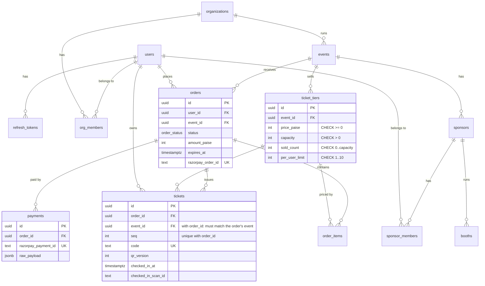

- **Orders vs tickets:** an order is a purchase (amount, hold expiry, payment status). A ticket is one entry right (QR code, owner, check-in). An order for 3 tickets has one order row and three ticket rows, and a ticket can later change owner without touching the payment.
- **Idempotency keys:** `idempotency_keys(user_id, key UNIQUE, request_hash, status, response jsonb)` stores the answer to each booking request (HTTP status and body) in the same transaction as the order, so a retry gets exactly that answer.
- **Hot-path indexes:** `orders(user_id, status)`, `orders(expires_at) WHERE status = 'PENDING'` for the hold-expiry sweep (partial, Day 23), `tickets(event_id, checked_in_at)` for the scanner's ticket list and the live counter (Day 23), `tickets(owner_user_id)`, `events(org_id, status)`, `events(status, starts_at, id)` for the public event list. `tickets(order_id)` is served by the unique `(order_id, seq)` index, so it has no separate index.

## Getting started

**Prerequisites**

- Node.js 22 (`.nvmrc`)
- pnpm 12 (`npm i -g pnpm`)
- Docker Desktop or OrbStack (for Postgres, MongoDB, Redis and SeaweedFS)

**Run it locally**

```bash
pnpm install
cp .env.example .env
pnpm keys:generate  # prints the ticket signing keys: paste both lines into .env
pnpm infra:up   # starts the four services and waits until all are healthy
pnpm db:migrate  # creates the tables and CHECK constraints
pnpm db:seed     # demo org, users, a published event with three tiers, a sponsor
pnpm storage:init  # creates the bucket, public-read for banners, CORS for the web app
pnpm dev        # web on :3000, API on :4000, worker in the background
```

Seed accounts (`organizer@`, `scanner@`, `sponsor@` and `attendee@festpass.dev`) all log in with the password `festpass-dev`.

Check it: open http://localhost:3000 to see the published seed events, open one (`/e/mait-alumni-meet-2026`), then register (or log in with a seed account), create a club and reload the page: you stay logged in. Then click **New event**, add tiers and a banner, and publish it from the event page. `curl http://localhost:4000/api/v1/health/ready` should return `{"status":"ok","checks":{"postgres":"up","redis":"up","mongo":"up"}}`.

#### Email setup

The worker sends three emails, each at most once per order (`email_log`), through an `EmailProvider`:

- **Development (default):** `EMAIL_PROVIDER=console`. Nothing is sent; each email is logged and written as an HTML file (with its QR images) to `.email-previews/` in the repo root, which is git-ignored. Open the file to see it.
- **SendGrid:** set `EMAIL_PROVIDER=sendgrid`, `SENDGRID_API_KEY`, a verified `EMAIL_FROM`, and create three **dynamic templates** in SendGrid (Email API → Dynamic Templates), putting their IDs in the env vars below. The worker sends only the template ID and these fields (Handlebars, e.g. `{{eventTitle}}`, `{{#each tickets}}`):

| Template (env var) | Sent when | Fields |
|---|---|---|
| Ticket confirmation (`SENDGRID_TEMPLATE_TICKET_CONFIRMATION`) | Tickets are issued for a paid order | `name`, `eventTitle`, `eventDate` (IST), `venue`, `tickets[]` with `code`, `tier`, `qrCid` (show the QR with ``), `downloadUrl` (the PDF, valid 24 h), `downloadExpiresAt`, `ticketsUrl` |
| Order expired (`SENDGRID_TEMPLATE_ORDER_EXPIRED`) | A hold ran out unpaid (not if a late payment re-reserved it) | `name`, `eventTitle`, `bookAgainUrl` |
| Refund issued (`SENDGRID_TEMPLATE_REFUND_ISSUED`) | The refund job has returned a payment | `name`, `eventTitle`, `amount` (e.g. `₹598.00`), `reason` |

#### Testing webhooks locally

- **Without Razorpay:** set `RAZORPAY_WEBHOOK_SECRET` in `.env` to any long random string, start `pnpm dev`, hold tickets in the browser, then run `pnpm webhook:simulate <orderId>` (the order ID is the last part of the checkout URL). It signs a `payment.captured` body the way Razorpay does and posts it; the checkout page shows "Payment confirmed". Run it again with the printed payment ID to see a duplicate answered `"outcome":"duplicate"`.
- **Real test-mode webhooks:** Razorpay must reach your laptop, so open a tunnel to the API: `cloudflared tunnel --url http://localhost:4000` (or `ngrok http 4000`). In the Razorpay dashboard, in **Test Mode**, add a webhook with the tunnel's HTTPS URL plus `/api/v1/webhooks/razorpay`, the same secret as `RAZORPAY_WEBHOOK_SECRET`, and the events `payment.captured` and `order.paid`. Pay with a test card; Razorpay's dashboard lists each delivery and our response. The tunnel URL changes on every `cloudflared` start, so update the webhook each time.

Upload a banner end to end (with `pnpm dev` running): `pnpm storage:upload-banner ./some-image.png`. It logs in as the seed organizer, presigns, uploads straight to storage, PATCHes the event and prints the public URL.

Local S3 storage is [SeaweedFS](https://github.com/seaweedfs/seaweedfs), because MinIO's free Docker images can no longer be pulled. The API only speaks the S3 protocol through AWS SDK v3, so any S3-compatible server (MinIO, R2) works by changing the `S3_*` variables.

The containers use host ports 5433, 27018 and 6380 instead of the defaults, so they don't clash with a Postgres, MongoDB or Redis already installed on your machine; storage is on 9000. Change them in `.env` if needed.

## Scanner app

The gate app for volunteers, at `/scan`. It needs a club role with `checkin:scan` (`scanner@festpass.dev` in the seed).

1. Open `/scan` and log in. The dashboard has a Scanner link too.
2. Pick the event and name your gate, then choose **Open gate**. The phone downloads the event's ticket list; the choice is remembered.
3. Point the camera at a ticket. Green means accepted, amber already scanned, red invalid or revoked, and the phone vibrates where supported. If the camera can't read a code, paste it into the field below.
4. Use the browser's **Install** or **Add to Home Screen** to get an app icon.

**With no network** the badge says Offline and scanning continues: each scan is checked on the phone and shown as "Accepted (offline)". Scans sync by themselves when the network returns. Anything the server disagrees with appears under **Needs a look**. **What can offline mode promise?** on the same screen, and [Offline scanning and its limits](#offline-scanning-and-its-limits-day-20), say exactly what it can and can't guarantee.

**Set up and connect once before the gate opens.** Choosing a gate needs the network, and the ticket list is only as fresh as the last download.

**Trying it:**
- The service worker registers only in production builds, because in development a cached page would hide every code change: run `pnpm build`, then `pnpm --filter @festpass/web start` with the API and worker running. Without it, offline scanning still works, but reloading the page offline doesn't.
- On a phone, camera access needs HTTPS (or `localhost`), so test through an HTTPS tunnel to the web and API ports, with `NEXT_PUBLIC_API_URL` and `WEB_ORIGINS` set to those URLs.
- Tested in headless Chrome: two isolated browser profiles as two phones, real tickets, network off and the web server stopped, an offline reload from the service worker, then reconnecting one at a time (one ticket ended accepted on the first phone and flagged on the second). The camera path was tested with a generated video of a real ticket's QR fed in as Chrome's fake camera. **Not yet tried on a real phone.**

## Environment variables

| Variable | Used by | Description |
|---|---|---|
| `API_PORT` | api | Port the API listens on (default 4000) |
| `WEB_ORIGINS` | api | Comma-separated browser origins allowed to call the API with cookies (CORS); default `http://localhost:3000` |
| `NEXT_PUBLIC_API_URL` | web | API base URL the browser and the public pages' Server Components call (default `http://localhost:4000/api/v1`). Inlined into the bundle at build time, so never a secret |
| `WEB_REVALIDATE_URL` | api | The web app's revalidation route (default `http://localhost:3000/api/revalidate`), called when a published event changes |
| `REVALIDATE_SECRET` | api, web | Shared secret for `POST /api/revalidate`, sent as `Authorization: Bearer ...`. At least 32 characters; generate with `openssl rand -base64 48`. Server-only on the web side (no `NEXT_PUBLIC_`) |
| `NODE_ENV` | api | `development`, `test` or `production` (default `development`). Only `development` shows error messages and stacks in responses |
| `LOG_LEVEL` | api | pino level: `fatal`, `error`, `warn`, `info`, `debug`, `trace` or `silent` (default `info`) |
| `ADMISSION_TOKEN_SECRET` | api, worker | Signs waiting-room admission tokens (HS256): the worker signs and the API verifies, so both need the same value. Required, at least 32 characters, and the API refuses to start if it matches `JWT_ACCESS_SECRET`; generate one with `openssl rand -base64 48` |
| `JWT_ACCESS_SECRET` | api | Secret that signs access tokens (HS256). Required, at least 32 characters; generate one with `openssl rand -base64 48` |
| `ACCESS_TOKEN_TTL_SECONDS` | api | Access-token lifetime (default 900 = 15 minutes) |
| `REFRESH_TOKEN_TTL_DAYS` | api | Refresh-token lifetime; each refresh starts a new period (default 7) |
| `POSTGRES_PORT` | docker compose | Host port for Postgres (default 5433) |
| `DATABASE_URL` | api, db (Prisma CLI, seed) | Postgres connection string |
| `DATABASE_URL_TEST` | tests (`packages/db`, `apps/api`) | Separate Postgres database for tests; must end in `_test`, because tests truncate every table |
| `MONGO_PORT` | docker compose | Host port for MongoDB (default 27018) |
| `MONGODB_URI` | api, worker | MongoDB connection string (scan history). Tests use the `festpass_test` database on the same server |
| `REDIS_PORT` | docker compose | Host port for Redis (default 6380) |
| `REDIS_URL` | api, worker | Redis connection string (booking gate, BullMQ queues). Tests use database 15 of the same server |
| `BOOKING_GATE` | api | `on` (default) or `off`. Off sends every booking straight to Postgres, only to compare the two in load tests; bookings are correct either way |
| `HOLD_MINUTES` | api | How long a booking holds its tickets before they go back on sale if unpaid: minutes, up to 60, default 10. Fractions are allowed (`0.5` = 30 s, handy for watching an expiry) |
| `RATE_LIMIT_LOGIN` | api | Token bucket for login, per IP + email, as `<burst>/<per minute>` (default `5/5`) |
| `RATE_LIMIT_REGISTER` | api | Register, per IP (default `20/10`; generous because a campus can share one public IP) |
| `RATE_LIMIT_ORDERS` | api | Booking, per user (default `10/30`) |
| `RATE_LIMIT_PRESIGN` | api | Banner upload signing, per user (default `10/10`) |
| `RATE_LIMIT_QUEUE_JOIN` | api | Joining a waiting room, per user (default `10/30`) |
| `RAZORPAY_KEY_ID` | api, worker | Razorpay **test** key ID from the dashboard in Test Mode. Must start with `rzp_test_`: a live key stops the API and worker at startup. The worker uses the keys for refunds. Sent to the browser for Checkout (it is public) |
| `RAZORPAY_WEBHOOK_SECRET` | api, `webhook:simulate` | A long random string you choose (`openssl rand -hex 32`) and paste into Razorpay's webhook settings; every webhook is checked against it. Without it, `POST /webhooks/razorpay` answers `503` |
| `RAZORPAY_KEY_SECRET` | api, worker | Its secret, never sent anywhere. Set both or neither; without them `POST /orders/:id/pay` answers `503 PAYMENTS_NOT_CONFIGURED` |
| `TICKET_SIGNING_PRIVATE_KEY` | api, worker | Ed25519 private key that signs ticket QR codes (PKCS#8, base64url). Create a pair with `pnpm keys:generate`. Checked at startup; never sent to the browser or committed. Changing it invalidates every QR already issued |
| `NEXT_PUBLIC_TICKET_PUBLIC_KEY` | web (scanner) | The matching public key (32 raw bytes, base64url) from `pnpm keys:generate`. Required: the scanner verifies signatures with it when offline. Public by design: it can only verify |
| `EMAIL_PROVIDER` | worker | `console` (default: nothing is sent; each email is logged and saved as HTML in `.email-previews/`) or `sendgrid` |
| `EMAIL_FROM` | worker | Sender, e.g. `FestPass <tickets@festpass.dev>`; with SendGrid it must be a verified sender |
| `SENDGRID_API_KEY` | worker | SendGrid API key (`SG.…`), required when `EMAIL_PROVIDER=sendgrid`; never logged |
| `SENDGRID_TEMPLATE_TICKET_CONFIRMATION`, `SENDGRID_TEMPLATE_ORDER_EXPIRED`, `SENDGRID_TEMPLATE_REFUND_ISSUED` | worker | Dynamic template IDs (`d-…`), required with SendGrid; fields under [Email setup](#email-setup) |
| `PUBLIC_WEB_URL` | worker | The web app's address, for links inside emails (default `http://localhost:3000`) |
| `ADMIN_EMAILS` | api | Comma-separated emails allowed to open the job dashboard (Bull Board) at `/admin/queues`. Empty means nobody. Local `.env` lists the seed organizer |
| `S3_PORT` | docker compose | Host port for the local SeaweedFS S3 API (default 9000) |
| `S3_ENDPOINT` | api, worker | S3-compatible endpoint: `http://localhost:9000` locally, `https://<account>.r2.cloudflarestorage.com` for R2 |
| `S3_REGION` | api, worker | Signing region (default `us-east-1`; `auto` for R2) |
| `S3_BUCKET` | api, worker | Bucket for banners (public prefix) and ticket PDFs (private prefix) (`festpass`) |
| `S3_ACCESS_KEY_ID` | api, worker, docker compose | Storage access key; docker compose also uses it as the local SeaweedFS admin key |
| `S3_SECRET_ACCESS_KEY` | api, worker, docker compose | Storage secret key (never logged) |
| `S3_PUBLIC_URL` | api, web | Base URL public objects are served from, used to build `bannerUrl` (api) and as the only allowed `next/image` source (web): `http://localhost:9000/festpass` locally, the R2 public domain in production |

## Scripts

| Command | What it does |
|---|---|
| `pnpm dev` | Runs web, API and worker in parallel with hot reload |
| `pnpm build` | Builds every package and app |
| `pnpm lint` | ESLint over the whole repo |
| `pnpm typecheck` | TypeScript checks in every package |
| `pnpm test` | Runs all test suites (Vitest), one package at a time because the API and worker tests share the test database and Redis database 15 |
| `pnpm format` | Formats code with Prettier |
| `pnpm infra:up` | Starts Postgres, MongoDB, Redis and SeaweedFS and waits for healthchecks |
| `pnpm infra:down` | Stops the containers (data stays in named volumes) |
| `pnpm db:migrate` | Applies pending Prisma migrations (and creates a new one if the schema changed) |
| `pnpm db:reset` | Drops the database and re-applies every migration (destroys local data) |
| `pnpm db:seed` | Inserts demo data; safe to run repeatedly |
| `pnpm demo:analytics` | After `pnpm db:seed`: gives the seeded event 160 demo buyers, paid orders over ten days and gate scans on the event day, so its analytics have something to show. Deterministic, and safe to run again |
| `pnpm db:studio` | Opens Prisma Studio to browse the tables |
| `pnpm perf:seed` | Builds a separate `festpass_perf` database (created and migrated if needed) with 50 events, 58,300 orders and 100,142 tickets for realistic query plans; refuses any other database, so dev data is never touched |
| `pnpm perf:explain` | Runs `EXPLAIN (ANALYZE, BUFFERS)` on the hot queries against `festpass_perf` and prints each plan with its median time over 7 runs |
| `pnpm perf:explain-mongo` | `explain()` of the check-in aggregation on 100,000 generated scans in a separate `festpass_perf` Mongo database, with the index and forced to ignore it |
| `pnpm loadtest:api` | Builds the API and runs its production build against `festpass_perf` and Redis database 3 (`BOOKING_GATE=off` to turn the gate off) |
| `pnpm loadtest:setup` | With that API running: a published event with one tier (`CAPACITY`, default 500) and `USERS` buyers (default 5,000) with signed tokens, written to `infra/k6/.data/sale.json` (gitignored) |
| `pnpm loadtest:flash` | k6 (Docker) flash sale: arrivals ramp to `RATE` booking attempts a second (default 300); fails on any status other than 201, 409 or 429 |
| `pnpm loadtest:browse` | k6 (Docker): `GET /events/:slug` at `RATE` requests a second (default 1,000) for 30 s |
| `pnpm loadtest:verify` | Checks in SQL that every tier's `sold_count` equals the tickets its live orders hold and never exceeds capacity, and that the sale sold what k6 saw booked; exit code 1 otherwise |
| `pnpm storage:init` | Creates the bucket, makes `orgs/*/events/*/banner/*` publicly readable and allows `WEB_ORIGINS` to POST uploads (CORS); safe to run repeatedly |
| `pnpm keys:generate` | Prints a new Ed25519 key pair for ticket QR codes as `.env` lines (`TICKET_SIGNING_PRIVATE_KEY`, `NEXT_PUBLIC_TICKET_PUBLIC_KEY`) |
| `pnpm webhook:simulate <orderId> [paymentId]` | Sends the local API a `payment.captured` webhook for the order, signed with `RAZORPAY_WEBHOOK_SECRET`; pass the printed payment ID again to send a duplicate |
| `pnpm storage:upload-banner <image> [email] [password]` | Uploads an image as the banner of the first event of that user's first org (default: the seed organizer) and prints its public URL |

## API reference

### Conventions

- **Base path:** every endpoint lives under `/api/v1` and speaks JSON.
- **Errors** always have one shape, produced by a single error handler (`apps/api/src/middleware/error-handler.ts`):
  ```json
  { "error": { "code": "VALIDATION_FAILED", "message": "Request validation failed", "details": { "fields": [{ "location": "body", "path": "email", "message": "Invalid email address" }] }, "requestId": "6f1c..." } }
  ```
  Codes so far: `VALIDATION_FAILED` (400), `INVALID_JSON` (400), `UNAUTHORIZED`, `INVALID_CREDENTIALS`, `INVALID_ACCESS_TOKEN`, `INVALID_REFRESH_TOKEN`, `REFRESH_TOKEN_REUSED` (401), `FORBIDDEN` (403), `NOT_FOUND` (404), `EMAIL_TAKEN`, `SLUG_TAKEN`, `ALREADY_MEMBER`, `LAST_OWNER`, `INVALID_TRANSITION`, `NO_TIERS`, `EVENT_IN_PAST`, `EVENT_CLOSED`, `TIER_NAME_TAKEN`, `PRICE_LOCKED`, `CAPACITY_LOCKED`, `TIER_HAS_SALES`, `SALE_NOT_STARTED`, `SALE_ENDED`, `PER_USER_LIMIT`, `SOLD_OUT`, `ORDER_NOT_PENDING`, `HOLD_EXPIRED`, `NOTHING_TO_PAY`, `TICKET_USED`, `PDF_NOT_READY`, `ALREADY_CHECKED_IN`, `WRONG_EVENT`, `QR_REVOKED` (409), `INVALID_QR` (400), `INVALID_SIGNATURE`, `INVALID_PAYLOAD` (400, webhooks), `IDEMPOTENCY_KEY_REUSED` (422), `RATE_LIMITED` (429), `INTERNAL_ERROR` (500), `PAYMENT_PROVIDER_ERROR` (502), `PAYMENTS_NOT_CONFIGURED`, `WEBHOOKS_NOT_CONFIGURED` (503). Outside development, a 500 never includes the internal message or stack. Waiting room: `ADMISSION_REQUIRED` (403), `QUEUE_UNAVAILABLE` (503).
- **Request IDs:** send `X-Request-Id` (up to 64 letters, digits, `_` or `-`) to reuse your own; otherwise the API generates a UUID. It comes back in the `X-Request-Id` response header, in every error body and in every log line for that request.
- **Validation:** params, query and body are validated with Zod schemas from `packages/shared`; every invalid field is reported at once.
- **CORS:** only origins in `WEB_ORIGINS` get CORS headers, with credentials allowed, so only the web app can call the API from a browser with the refresh cookie. Allowed request headers: `Content-Type`, `Authorization`, `X-Request-Id`, `Idempotency-Key`; readable response headers: `X-Request-Id`, `Idempotent-Replayed`, `Retry-After`, `RateLimit-*`.
- **Auth:** protected endpoints need `Authorization: Bearer <accessToken>`. The refresh token is only ever an `fp_refresh` cookie; it never appears in a response body.
- **Pagination:** list endpoints take `?cursor=&limit=` (`limit` 1–100, default 20) and return `{ items, nextCursor }`; pass `nextCursor` back to get the next page (`null` on the last page). Cursors are opaque and keyset-based on `(startsAt, id)`, so pages stay correct when events are added between requests.
- **Rate limits:** login, register, booking and presign answer with `RateLimit-Limit`, `RateLimit-Remaining` and `RateLimit-Reset` headers; over the limit they return `429 RATE_LIMITED` with `Retry-After` (seconds) and `details.retryAfterSeconds`.
- **Idempotency:** `POST /events/:eventId/orders` requires an `Idempotency-Key` header (a UUID the client generates once per booking attempt). Retrying with the same key and body returns the stored answer, with `Idempotent-Replayed: true`, and books nothing new; the same key with a different body is a `422`.
- **Dates:** ISO 8601 with a timezone, e.g. `2026-12-12T10:00:00+05:30`; stored and returned in UTC.
- **Banners:** every event response includes `bannerKey` and `bannerUrl` (a public URL, or `null`).
- **Caching:** `GET /events` and `GET /events/:slug` send `Cache-Control: public, max-age=5, stale-while-revalidate=25` (not on a 404) and, like every JSON answer, an `ETag`, so a repeat request with `If-None-Match` gets an empty `304`. Responses over 1 KB are gzip- or brotli-compressed when the client sends `Accept-Encoding`.

### Endpoints

| Method | Path | Auth | Description |
|---|---|---|---|
| POST | `/api/v1/orgs` | Bearer | Body `{ name, slug? }` (slug derived from the name if missing). Creates the org with the caller as OWNER. `201 { org }`; `409 SLUG_TAKEN` |
| GET | `/api/v1/orgs/mine` | Bearer | `200 { orgs: [{ id, name, slug, role }] }`: every org the caller belongs to, with their role |
| GET | `/api/v1/orgs/:orgId` | Bearer, `org:read` | `200 { org, members: [{ userId, name, email, role }] }`; `404` for non-members |
| POST | `/api/v1/orgs/:orgId/members` | Bearer, `member:manage` | Body `{ email, role }` adds an existing user. `201 { member }`; `404` if no account has that email; `409 ALREADY_MEMBER` |
| PATCH | `/api/v1/orgs/:orgId/members/:userId` | Bearer, `member:manage` | Body `{ role }`. `200 { member }`; `409 LAST_OWNER` if it would leave no OWNER |
| DELETE | `/api/v1/orgs/:orgId/members/:userId` | Bearer, `member:manage` | `204`; `409 LAST_OWNER` for the last OWNER |
| POST | `/api/v1/orgs/:orgId/events` | `event:create` | Body `{ title, description?, venue, startsAt, endsAt, saleStartsAt, saleEndsAt, queueMode?, admitRatePerSec? }` (ends after start, sales end by the event's end; waiting room off and 50/s by default, rate 1–1000). Creates a DRAFT; the slug comes from the title, with a 4-character suffix if taken. `201 { event }` |
| GET | `/api/v1/orgs/:orgId/events` | `org:read` | All of the org's events, any status, `{ items, nextCursor }`; each item has `capacity` and `soldCount` summed over its tiers |
| GET | `/api/v1/orgs/:orgId/events/:eventId` | `org:read` | `200 { event }` with its tiers (`soldCount`, `available`) |
| GET | `/api/v1/orgs/:orgId/events/:eventId/analytics/sales` | `analytics:read` | `200 { sales: { tiers: [{ tierId, name, capacity, paid, held, revenuePaise }], days: [{ day, tickets, revenuePaise }], totals } }`. Days are India-time calendar days, from the first paid order to the last, quiet days included. Cached 30 s; `404` for another club's event |
| GET | `/api/v1/orgs/:orgId/events/:eventId/analytics/checkins?bucket=15` | `analytics:read` | `bucket` is `5` or `15` (default). `200 { checkins: { bucketMinutes, timeline: [{ at, count }], peak: { at, count, perMinute } \| null, results: [{ value, count }], breakdown: { college, branch, graduationYear, tier }, totals: { entered } } }`, from accepted gate scans. Cached 30 s |
| PATCH | `/api/v1/orgs/:orgId/events/:eventId` | `event:update` | Partial update; dates re-checked together, tier sale windows must still fit. The slug never changes. `bannerKey` (from presign) is saved only after `HeadObject` confirms the object exists, is JPEG/PNG/WebP and at most 2 MB, else `400` on `bannerKey`; `null` removes the banner. `409 EVENT_CLOSED` once closed |
| POST | `/api/v1/uploads/presign` | Bearer, `event:update` on the event's org | Body `{ eventId, contentType: image/jpeg \| image/png \| image/webp }`. `201 { upload: { url, fields, key, maxBytes, expiresAt } }`: POST a multipart form to `url` with every `fields` entry, then the file as `file`, within 5 minutes. `400` for another type, `404` for non-members (same as a missing event), `403` for scanners |
| POST | `/api/v1/orgs/:orgId/events/:eventId/publish` | `event:publish` | DRAFT → PUBLISHED. `409 NO_TIERS` without tiers, `409 EVENT_IN_PAST` if it already started, `409 INVALID_TRANSITION` otherwise |
| POST | `/api/v1/orgs/:orgId/events/:eventId/close` | `event:publish` | PUBLISHED → CLOSED (stays public, no longer bookable) |
| POST | `/api/v1/orgs/:orgId/events/:eventId/tiers` | `event:update` | Body `{ name, pricePaise ≥ 0, capacity > 0, perUserLimit 1–10 (default 4), saleStartsAt?, saleEndsAt? }`; the tier's sale window must sit inside the event's. `201 { tier }`; `409 TIER_NAME_TAKEN` |
| PATCH | `/api/v1/orgs/:orgId/events/:eventId/tiers/:tierId` | `event:update` | Partial update. After the first sale: `409 PRICE_LOCKED` for a new price, `409 CAPACITY_LOCKED` for less capacity |
| DELETE | `/api/v1/orgs/:orgId/events/:eventId/tiers/:tierId` | `event:update` | `204`; `409 TIER_HAS_SALES` once anything is sold |
| GET | `/api/v1/events` | none | Published events that haven't ended, soonest first. `?cursor=&limit=&orgId=`. `{ items, nextCursor }` |
| GET | `/api/v1/events/:slug` | none | A published or closed event with its org and tiers, each with `available = capacity - soldCount`. Drafts: `404` |
| POST | `/api/v1/events/:eventId/orders` | Bearer, `Idempotency-Key: <uuid>` | Body `{ items: [{ tierId, qty 1–10 }] }` (1–10 items, each tier once). Holds the tickets and creates a `PENDING` order that expires after `HOLD_MINUTES`: `201 { order: { id, eventId, status, amountPaise, expiresAt, items: [{ tierId, tierName, qty, unitPricePaise }] } }`. `409 SOLD_OUT` (names the tier, nothing is held), `409 PER_USER_LIMIT` (counts the user's pending, paid and ticketed orders), `409 SALE_NOT_STARTED` / `SALE_ENDED` / `EVENT_CLOSED`, `404` for drafts, `400` for a tier of another event, `422 IDEMPOTENCY_KEY_REUSED` |
| GET | `/api/v1/orders/:orderId` | Bearer (the order's owner) | `200 { order, event: { id, title, slug, venue, startsAt } }`, polled by checkout; `404` for someone else's order |
| GET | `/api/v1/events/:eventId/checkins/summary` | Bearer, `checkin:scan` | For the dashboard: `200 { summary: { checkedIn, totalTickets, recent: [{ ticketId, tierName, gateId, result, offline, ts }] } }`, latest 20 scans |
| GET | `/api/v1/events/:eventId/checkins/manifest` | Bearer, `checkin:scan` | For offline scanners: `200 { manifest: { eventId, generatedAt, tickets: [{ id, v, used }] } }`, with no personal data |
| POST | `/api/v1/events/:eventId/queue/join` | Bearer, rate-limited per user | Joins the waiting room while the sale is open; joining again keeps the same place. `200` with a status: `{ state: "waiting", position, estimatedWaitSeconds }`, `{ state: "admitted", token, expiresAt }` or `{ state: "not_required" }` when queue mode is off. `404`; `409 SALE_NOT_STARTED`, `SALE_ENDED`, `EVENT_CLOSED`; `429`; `503 QUEUE_UNAVAILABLE` |
| GET | `/api/v1/events/:eventId/queue/status` | Bearer | The same status without joining, plus `{ state: "not_joined" }`. Same errors except `429` |
| POST | `/api/v1/events/:eventId/checkins` | Bearer, `checkin:scan` in the event's club | Body `{ qr, deviceId, gateId?, clientScanId? }` (`gateId` defaults to `main`; `clientScanId` recognises this scan if it is sent again). `200 { result: "ACCEPTED", ticket: { id, code, tierName, attendeeName, checkedInAt } }`. `409 ALREADY_CHECKED_IN` with `details: { ticketId, firstScannedAt, firstScannedBy }`, `409 WRONG_EVENT`, `409 QR_REVOKED`, `400 INVALID_QR`; `404` for non-members |
| POST | `/api/v1/events/:eventId/checkins/batch` | Bearer, `checkin:scan` | Offline sync. Body `{ deviceId, gateId?, scans: [{ clientScanId, qr, scannedAt }] }` (1–200). `200 { results: [...] }`, one per scan in client-time order, each with `clientScanId` and `result` (`ACCEPTED`, `DUPLICATE`, `INVALID`, `REVOKED`) plus the same details as above |
| GET | `/api/v1/me/tickets` | Bearer | `200 { tickets: [{ id, code, seq, qrVersion, qr, checkedInAt, orderId, tier, event }] }`, soonest event first. `qr` is the signed `FP1.…` string to show at the gate |
| GET | `/api/v1/orders/:orderId/tickets-pdf` | Bearer (the order's owner) | `200 { pdf: { url, expiresAt } }`: a fresh 5-minute pre-signed link to the order's private PDF tickets. `404` for someone else's order, `409 PDF_NOT_READY` until the worker has built it |
| GET | `/api/v1/tickets/:ticketId` | Bearer (the ticket's owner) | `200 { ticket }`; `404` for someone else's ticket |
| POST | `/api/v1/tickets/:ticketId/reissue` | Bearer (owner) | New QR for a leaked code: bumps `qrVersion`, so every earlier QR of the ticket is outdated at the gate. `200 { ticket }`; `409 TICKET_USED` once checked in |
| POST | `/api/v1/webhooks/razorpay` | `X-Razorpay-Signature` (HMAC-SHA256 of the raw body) | Razorpay calls this. Checked against the raw body before anything is parsed: `400 INVALID_SIGNATURE` changes nothing. `payment.captured` and `order.paid` record the payment once (by its ID) and move the order on; other events and unknown orders get `200 { handled: false }`. `200 { handled: true, outcome: "paid" \| "duplicate" \| "refund" }` |
| POST | `/api/v1/orders/:orderId/pay` | Bearer (owner) | Starts payment: creates a Razorpay order (amount in paise, `receipt` and `notes.orderId` = our order ID) or returns the one already stored. `200 { payment: { orderId, keyId, razorpayOrderId, amountPaise, currency, expiresAt, description, prefill } }`. `409 ORDER_NOT_PENDING` / `HOLD_EXPIRED` / `NOTHING_TO_PAY` (free order), `404` for others' orders, `502 PAYMENT_PROVIDER_ERROR`, `503 PAYMENTS_NOT_CONFIGURED`. Never marks anything paid |
| POST | `/api/v1/orders/:orderId/cancel` | Bearer (the order's owner) | `PENDING` → `CANCELLED`: the tickets go back on sale at once. `200 { order }`; `409 ORDER_NOT_PENDING` (with `details.status`) for any other status; `404` for someone else's order |
| POST | `/api/v1/admin/session` | Bearer, email in `ADMIN_EMAILS` | Sets a 15-minute `fp_admin` cookie (`httpOnly`, `SameSite=Lax`, `Path=/admin`) and returns `204`; `403` for everyone else. The web app's `/dashboard/queues` calls it, then opens the board |
| GET | `/admin/queues` | `fp_admin` cookie | Bull Board for the `orders` and `inventory` queues: delayed, completed and failed jobs, retry and clean. `401` without the cookie, `403` if the email is no longer in `ADMIN_EMAILS` |
| GET | `/api/v1/health/live` | none | Liveness: `200 { "status": "ok" }` whenever the process can answer. Checks no dependencies |
| POST | `/api/v1/auth/register` | none | Body `{ email, password (8+ chars, max 72 bytes), name, college?, branch?, graduationYear? }`. `201 { user, accessToken }` and sets the `fp_refresh` cookie. `409 EMAIL_TAKEN` if the email (case-insensitive) exists |
| POST | `/api/v1/auth/login` | none | Body `{ email, password }`. `200 { user, accessToken }` and a new `fp_refresh` cookie (a new token family). `401 INVALID_CREDENTIALS` for a wrong password or unknown email alike |
| POST | `/api/v1/auth/refresh` | `fp_refresh` cookie | Rotates the refresh token: `200 { user, accessToken }` and a new cookie. `401 INVALID_REFRESH_TOKEN` if missing, unknown or expired; `401 REFRESH_TOKEN_REUSED` (and the whole family is revoked) if the token was already used |
| POST | `/api/v1/auth/logout` | `fp_refresh` cookie | Revokes this session's token family and clears the cookie. Always `204` |
| GET | `/api/v1/auth/me` | Bearer | `200 { user }`. `401` without a valid access token |
| GET | `/api/v1/health/ready` | none | Readiness: pings Postgres, Redis and MongoDB in parallel (1 s timeout each). `200` with `{ "status": "ok", "checks": { "postgres": "up", ... } }`, or `503` with `"status": "unavailable"` and the down dependency marked `"down"` |

## Testing

_How to run the tests and what the key tests prove._

Run `pnpm test`. The `packages/db` tests need Postgres running, because constraints can only be proven by the real database. They use a separate database (`DATABASE_URL_TEST`, default `festpass_test`): Vitest's global setup creates and migrates it automatically, and `truncateAll` (`packages/db/src/testing.ts`) empties it between tests. `truncateAll` refuses to run on any database whose name doesn't end in `_test`, so tests can never wipe dev data.

- `apps/api/test/errors.test.ts`: a bad body or query returns 400 with every invalid field and the request ID; unknown routes return 404 in the standard shape; invalid JSON returns 400; an `AppError` keeps its status and code; an unexpected error returns a generic 500 with no internal message or stack; incoming `X-Request-Id` values are reused only when safe.
- `apps/api/test/health.test.ts`: liveness; readiness returns 200 when all checks pass, and 503 naming the dependency when a check fails or hangs (checks are injected fakes, so no real outage is needed).
- `apps/api/test/auth.test.ts` (against the test database): register stores a cost-12 bcrypt hash and only the SHA-256 of the refresh token, and sets an `HttpOnly`, `SameSite=Lax`, `/api/v1/auth` cookie; duplicate email (any case) returns 409; wrong password and unknown email return the same 401; `/me` rejects a missing, expired or forged token; refresh rotates the token within its family; replaying an old token revokes the whole family; logout makes the refresh token stop working.
- `apps/api/test/orgs.test.ts` (against the test database): loops over every role × action and checks both `can()` and the real `requireOrgPermission` middleware against a hand-written policy table; a non-member gets 404 for every action, identical to a nonexistent org; creating an org makes the creator OWNER; owners add members by email, managers get 403; the last OWNER can't be demoted or removed; two owners demoting each other concurrently leave exactly one OWNER.
- `apps/api/test/orders.test.ts` (against the test database, parallel HTTP requests): every booking test runs three times, with Redis working, failing and hanging (both Redis states mocked on the gate client), with identical results; see the table under [Preventing oversells](#preventing-oversells-day-11). The gate tests check publishing fills `inv:*`, compensation gives stock back when Postgres refuses, a gate refusal isn't stored under the key, a missing key is refilled after the booking, and reconciliation fixes a corrupted and a missing key (and finds nothing on a second run). Also a missing or non-UUID `Idempotency-Key` (400 on the header), no login (401), a tier of another event and duplicate tiers (400), drafts (404), `SALE_NOT_STARTED` and `EVENT_CLOSED`, and that the hold lasts `HOLD_MINUTES` and copies the tier price.
- `packages/db/test/booking.test.ts`: when another transaction stores the same idempotency key first, the booking rolls back completely (no order, `sold_count` unchanged) and returns `key-reused`.
- `apps/api/test/events.test.ts` (against the test database): the full organizer flow ends with the event on `GET /events`; slug collisions get a suffix; every tier rule (capacity, price, per-user limit, sale window) returns 400 on its field; after a sale (soldCount set directly) the price is locked, capacity only grows and the tier can't be deleted; publishing needs tiers and a future start; DRAFT → PUBLISHED → CLOSED only; drafts never appear publicly; queue settings default to off at 50/s and survive unrelated edits, and a rate of 0 is a 400; the org list sums sold and capacity over tiers; paging through 7 events (3 with the same start time) with `limit=3` returns each exactly once in order, even when a new event is inserted between pages.
- `packages/shared/test/money.test.ts`: rupee↔paise conversion, including ₹99.99 (`9999`, where a float multiply gives `9998.999…`), ₹0.29 and ₹1.1; amounts with 3 decimals, signs, commas or symbols are rejected; every amount up to ₹1,000.00 round-trips.
- `apps/web/src/lib/form-helpers.test.ts`: `sharedSchemaResolver` returns exactly what the API accepts and puts the shared schema's messages on the typed-in fields (`pricePaise` -> `price`); `datetime-local` values round-trip through UTC.
- `apps/worker/test/expiry.test.ts` and the cancel tests: see [Hold expiry](#hold-expiry-day-13).
- `apps/api/test/checkins.test.ts` and `apps/worker/test/scan-events.test.ts`: see [Exactly-once entry](#exactly-once-entry-day-19).
- `apps/web/src/lib/scan/offline.test.ts`: see [Offline scanning and its limits](#offline-scanning-and-its-limits-day-20).
- `packages/db/test/verify-inventory.test.ts`: the load-test check (`findInventoryProblems()`) passes on consistent data and fails when `sold_count` disagrees with the orders or orders hold more than the capacity. `packages/db/test/booking.test.ts`: a price edit committed while a booking waits for the tier books at the new price (removing the price condition from the `UPDATE` makes it fail). `apps/api/test/orders.test.ts`: with `BOOKING_GATE=off`, 6 buyers for 3 tickets get 3 bookings and 3 refusals, all decided in Postgres.
- `apps/api/test/analytics.test.ts` (test database and `festpass_test` in MongoDB): both pipelines against hand-built fixtures with exact expected numbers. See [Analytics](#analytics-day-25).
- `apps/api/test/cache.test.ts` (real Redis and test database): a change made behind the API isn't seen while cached, and an update, tier change, publish or close through the API shows on the next read; tickets left come from `inv:*` and fall back to Postgres; Redis failing still answers from Postgres; a 404 isn't cached; 50 requests missing one key run one load; a load that started before an invalidation is never served afterwards; hits and misses have the same shape; `Cache-Control`, `304` and gzip. Breaking each guard by hand (no invalidation, no cache read, no shared load, no generation, no live stock) made these tests fail. `packages/db/test/constraints.test.ts` also checks that a ticket can't name another event than its order's.
- `apps/api/test/waiting-room.test.ts` and `apps/worker/test/waiting-room.test.ts` (real Redis and test database), plus `apps/web/src/lib/waiting-room.test.ts` (wait text, check interval): see [Virtual waiting room](#virtual-waiting-room-day-22).
- `apps/api/test/realtime.test.ts` and `apps/api/test/availability-throttle.test.ts`: see [Real-time updates](#real-time-updates-day-21). `apps/worker/test/expiry.test.ts` also checks that an expiry and the sweeper announce the change.
- `apps/worker/test/emails.test.ts` (fake email provider and storage): the PDF builder returns a real PDF; `send-tickets` stores the PDF outside the public prefix, emails a 24-hour link and each QR inline, and records it; a retry, and two runs at once, send once; a failed send is retried and still sent once; issuing tickets and an expired hold queue their emails keyed by the order; no "hold expired" email after a late payment re-reserved the tickets; the console provider writes an HTML preview with its images. `apps/api/test/tickets.test.ts` also covers the PDF link: a 5-minute pre-signed GET for the owner, `404` for anyone else, `409 PDF_NOT_READY` before the worker has stored it.
- `packages/shared/test/qr.test.ts`: a QR signed with Node's crypto verifies with `@noble/ed25519`; its payload has only `t`, `e`, `v`, `iat`; a changed payload, another key, a wrong prefix, a missing part, a truncated signature or non-base64url characters all fail; a validly signed payload that isn't a ticket fails. `apps/worker/test/tickets.test.ts`: a paid order gets one ticket per unit numbered 1..n and becomes `TICKETED`; running the job twice, or twice at once, creates them once; an unpaid order gets none. `apps/api/test/tickets.test.ts`: `/me/tickets` returns QR strings that verify with the public key, the same string on every read, owner-only `/tickets/:id`, and reissue moving the QR to `v=2` (not for used tickets).
- `apps/api/test/webhooks.test.ts`: see [Payment idempotency](#payment-idempotency-and-the-order-state-machine-day-16). `packages/db/test/order-state.test.ts`: the table allows exactly the listed transitions and `transition()` throws for any other before touching the database. `apps/worker/test/refund.test.ts` (Razorpay faked): a refund marks the payment refunded and the expired order `REFUNDED`, running it twice refunds once, and a Razorpay failure changes nothing so the retry can finish.
- `apps/api/test/payments.test.ts` (Razorpay replaced by a fake): pay creates one Razorpay order for the amount with our order ID, and repeated or parallel pay calls all get the one stored; someone else's order is 404; an expired hold (even before the sweeper), a paid and a cancelled order are 409; a Razorpay failure is a 502 that stores nothing. `GET /orders/:id` shows the owner the order and its event, and 404s for anyone else.
- `apps/web/src/lib/booking.test.ts`: a retry of the same booking reuses its Idempotency-Key; another tier or quantity gets a new one; booking again after a hold ends gets a new one. `next-path.test.ts`: login only returns to paths on this site (no open redirect).
- `apps/api/test/rate-limit.test.ts`: see [Rate limiting](#rate-limiting-day-14).
- `apps/api/test/admin.test.ts`: only `ADMIN_EMAILS` get the admin cookie (`Path=/admin`, `HttpOnly`, `SameSite=Lax`); Bull Board needs it and lists both queues; an access token doesn't work as the cookie and the cookie doesn't work as an access token (separate signing keys); someone removed from `ADMIN_EMAILS` loses access with a valid cookie.
- `apps/web/src/lib/api.test.ts` (Vitest, fake `fetch`): on a 401 the client refreshes once and retries with the new token; a retry that is still 401 is not retried again; a failed refresh stops immediately and reports the logout; two requests failing at once share one refresh call; error bodies become a typed `ApiError`.
- `apps/api/test/uploads.test.ts` (S3 mocked with a spy on the client's `send`): presign signs a fixed key under the event's banner prefix with `content-length-range` and `Content-Type` in the policy; a bad content type returns 400, a non-member 404, a scanner 403, no login 401; PATCH saves a confirmed `bannerKey` and returns `bannerUrl`, rejects a missing object, an object over 2 MB and a non-image type, rejects another event's key without calling storage, and `null` clears the banner.
- `apps/web/src/app/api/revalidate/route.test.ts` (`next/cache` mocked): a wrong secret, no header, or the secret without `Bearer` get 401 and revalidate nothing; the right secret revalidates `/e/{slug}` and `/`; a slug like `../dashboard` is a 400.
- `apps/web/src/lib/tier-state.test.ts`: a tier follows the event's sale window unless it has its own (early bird); exact boundaries; closed beats sold out beats the window.
- `apps/api/test/events.test.ts` › public page revalidation (`fetch` spied): editing a draft calls nothing; publishing and editing a published event POST `{ slug }` with the Bearer secret to `WEB_REVALIDATE_URL`; a web app that can't be reached never fails the organizer's request.
- `apps/api/test/cors.test.ts`: the web origin gets a preflight with credentials allowed; any other origin gets no CORS headers.
- `apps/api/test/env.test.ts`: env parsing applies defaults, coerces numbers and lists every invalid variable in one message.
- `packages/db/test/constraints.test.ts`: Postgres rejects `sold_count` above capacity or below zero and an out-of-range `per_user_limit`, even through raw SQL.
- `packages/db/test/seed.test.ts`: on an empty database the seed creates exactly the demo rows, and a second run changes nothing; seed users log in with `festpass-dev`; `truncateAll` refuses a non-`_test` database.

## Performance

**Public pages (Day 10), measured** on a MacBook Air (Apple M2, 8 GB, macOS 27.2), everything local: `next start` (production build), the API in dev mode, Postgres in Docker.

| What | Result |
|---|---|
| Event page served from the ISR cache | `x-nextjs-cache: HIT` on the second request; a title changed directly in the database (bypassing the API) stays hidden until revalidation, proving the page is cached |
| Edit through the API → public page updated | new title visible 137 ms after the PATCH was sent (first poll that saw it) |
| Edit saved in the dashboard → public page updated | visible on the first check after "Changes saved", 27 ms later |

### Database and caching (Day 23), measured

**Setup:** the same MacBook Air (Apple M2, 8 GB, macOS 27.2), PostgreSQL 16.15 in Docker (OrbStack), default settings, all data in memory. `pnpm perf:seed` builds a separate `festpass_perf` database with 50 events, 30,000 users, 58,300 orders and 100,142 tickets, the same data on every run. `pnpm perf:explain` runs `EXPLAIN (ANALYZE, BUFFERS)` on each hot query: one warm-up, then the median of 7 runs. Writes are rolled back. Prisma's queries are captured from its query log, so the plan is for the SQL the app actually sends. "Before" ran the old schema and the SQL Prisma generated before the change, on the same data, in a transaction that was rolled back.

| Query | Before | After | Change |
|---|---|---|---|
| Scanner's ticket list for an event (2,698 tickets) | 10.86 ms | 0.53 ms | `tickets.event_id` with an index, instead of a join through `orders` that read all 100,142 tickets |
| Live check-in counter (event with 1,964 check-ins) | 6.27 ms | 0.12 ms | The same index, read as an index-only scan |
| Live check-in counter (upcoming event, none yet) | 6.17 ms | 0.01 ms | The same index |
| Hold-expiry sweeper | 0.13 ms | 0.15 ms | No change in time. Its index went from 1,824 kB to 16 kB: a partial index on `PENDING` orders only |
| Booking (per-user check and the conditional `UPDATE`), check-in `UPDATE`, My Tickets, public event list | under 0.08 ms each | unchanged | Already index scans; nothing to fix |

The slow queries weren't the ones expected. Booking, check-in and the sweeper were already fast. The two queries behind "this event's tickets" (the scanner's list and the live counter) had no usable index. An index on `orders(event_id)` alone only took them to 8.4 and 4.7 ms, because the cost was in scanning `tickets`. The copy of `event_id` on tickets can't drift: the foreign key covers `(order_id, event_id)`, so a ticket's event must be its order's. That costs a 3.7 MB unique key on `orders(id, event_id)` at this size, and the tickets table grew from 13 to 14 MB.

<details>
<summary>Plans: the scanner's ticket list, before and after</summary>

Before (10.86 ms median):

```
Hash Join  (cost=1580.24..4687.55 rows=2540 width=28) (actual time=1.848..10.642 rows=2698 loops=1)
  Hash Cond: (tickets.order_id = j0.id)
  Buffers: shared hit=2676
  ->  Seq Scan on tickets  (cost=0.00..2844.42 rows=100142 width=44) (actual time=0.001..4.667 rows=100142 loops=1)
        Buffers: shared hit=1843
  ->  Hash  (cost=1561.75..1561.75 rows=1479 width=16) (actual time=1.835..1.835 rows=1527 loops=1)
        Buckets: 2048  Batches: 1  Memory Usage: 88kB
        Buffers: shared hit=833
        ->  Seq Scan on orders j0  (cost=0.00..1561.75 rows=1479 width=16) (actual time=0.003..1.757 rows=1527 loops=1)
              Filter: ((id IS NOT NULL) AND (event_id = '86fe1ded-3e33-4487-8ead-d4998ca4763d'::uuid))
              Rows Removed by Filter: 56773
              Buffers: shared hit=833
Planning Time: 0.068 ms
Execution Time: 10.715 ms
```

After (0.53 ms median):

```
Bitmap Heap Scan on tickets  (cost=33.04..2001.99 rows=2677 width=28) (actual time=0.115..0.422 rows=2698 loops=1)
  Recheck Cond: (event_id = '86fe1ded-3e33-4487-8ead-d4998ca4763d'::uuid)
  Heap Blocks: exact=850
  Buffers: shared hit=855
  ->  Bitmap Index Scan on tickets_event_id_checked_in_at_idx  (cost=0.00..32.37 rows=2677 width=0) (actual time=0.068..0.068 rows=2722 loops=1)
        Index Cond: (event_id = '86fe1ded-3e33-4487-8ead-d4998ca4763d'::uuid)
        Buffers: shared hit=5
Planning Time: 0.012 ms
Execution Time: 0.485 ms
```

</details>

<details>
<summary>Plans: the hold-expiry sweeper, before and after</summary>

Before (`orders(status, expires_at)`, 1,824 kB):

```
Limit  (cost=606.13..606.84 rows=284 width=24) (actual time=0.109..0.123 rows=248 loops=1)
  Buffers: shared hit=224
  ->  Sort  (cost=606.13..606.84 rows=284 width=24) (actual time=0.109..0.115 rows=248 loops=1)
        Sort Key: expires_at
        Sort Method: quicksort  Memory: 42kB
        Buffers: shared hit=224
        ->  Bitmap Heap Scan on orders  (cost=11.33..594.56 rows=284 width=24) (actual time=0.037..0.092 rows=248 loops=1)
              Recheck Cond: ((status = 'PENDING'::order_status) AND (expires_at <= now()))
              Heap Blocks: exact=221
              Buffers: shared hit=224
              ->  Bitmap Index Scan on orders_status_expires_at_idx  (cost=0.00..11.26 rows=284 width=0) (actual time=0.022..0.022 rows=248 loops=1)
                    Index Cond: ((status = 'PENDING'::order_status) AND (expires_at <= now()))
                    Buffers: shared hit=3
Planning Time: 0.015 ms
Execution Time: 0.138 ms
```

After (`orders(expires_at) WHERE status = 'PENDING'`, 16 kB):

```
Limit  (cost=640.77..641.56 rows=315 width=24) (actual time=0.098..0.112 rows=249 loops=1)
  Buffers: shared hit=222
  ->  Sort  (cost=640.77..641.56 rows=315 width=24) (actual time=0.097..0.103 rows=249 loops=1)
        Sort Key: expires_at
        Sort Method: quicksort  Memory: 42kB
        Buffers: shared hit=222
        ->  Bitmap Heap Scan on orders  (cost=10.59..627.70 rows=315 width=24) (actual time=0.023..0.077 rows=249 loops=1)
              Recheck Cond: ((expires_at <= now()) AND (status = 'PENDING'::order_status))
              Heap Blocks: exact=221
              Buffers: shared hit=222
              ->  Bitmap Index Scan on orders_pending_expires_at_idx  (cost=0.00..10.51 rows=315 width=0) (actual time=0.011..0.011 rows=249 loops=1)
                    Index Cond: (expires_at <= now())
                    Buffers: shared hit=1
Planning Time: 0.021 ms
Execution Time: 0.132 ms
```

</details>

**Cache-aside** for `GET /events/:slug` and `GET /events`. Measured with the API in dev mode against `festpass_perf`, one client, 300 sequential requests after 20 warm-up requests, with a miss forced before each request:

| Request | Miss p50 / p95 | Hit p50 / p95 |
|---|---|---|
| `GET /events/perf-fest-35` | 5.26 / 9.48 ms | 3.51 / 6.81 ms |
| `GET /events?limit=48` | 3.76 / 6.16 ms | 3.40 / 5.36 ms |

The saving per request is small, because the queries take well under a millisecond; most of the time is Node, Express and Prisma. The point is what a sale does to Postgres: a crowd on one event page costs one query per API instance per 30 seconds, not one per visitor. Concurrent load is measured on Day 24.

**Compression:** `GET /events?limit=48` (40 events) is 17,924 bytes uncompressed, 2,483 gzip and 2,041 brotli (`curl`, same server).

**Not measured yet:** concurrent load (Day 24), production hardware, and data too big to stay in memory (every read above is a cache hit inside Postgres).

**Lighthouse:** not measured yet. To record it, run against the production build with a published event:

```bash
pnpm build && pnpm --filter @festpass/web start
npx lighthouse http://localhost:3000/e/mait-alumni-meet-2026 --only-categories=performance,accessibility,best-practices,seo --view
```

and note the Lighthouse version, mobile or desktop preset, throttling and machine next to the scores.

## Load test results

**Setup (all runs):** one MacBook Air (Apple M2, 4 performance + 4 efficiency cores, 8 GB RAM, macOS 27.2). Postgres 16.15, Redis 7 and k6 2.3.0 run in Docker (OrbStack, its VM given 8 CPUs and 4 GB); the API runs outside Docker as one Node 22.23 process from its production build (`pnpm loadtest:api`: `NODE_ENV=production`, the default `info` logging written to a file, the default database pool of 10 connections). No worker, no web app. The database is `festpass_perf` (`pnpm perf:seed`: 50 events, 58,300 orders, 100,142 tickets) and Redis database 3, so dev data is never touched. Each run gets a fresh event with one 500-ticket tier and fresh buyers from `pnpm loadtest:setup`, and the API is restarted for each run. The load generator, the API and both databases share the same 8 cores.

**Flash sale** (`infra/k6/flash-sale.js`): booking attempts ramp from 0 to the target rate over 10 s, then stay there for 10 s, which is 15 attempts per second of target. Every attempt is a different buyer asking for 1 ticket, so 4,500 or 15,000 buyers compete for 500 tickets. Only `201`, `409` and `429` are accepted. Three runs per row; each column shows the median of the three runs, with the range in brackets.

| Target rate | Gate | Attempts completed | Throughput | p50 | p95 | p99 | Refused inside Postgres | Unexpected status | Oversold |
|---|---|---|---|---|---|---|---|---|---|
| 300/s | on | 4,499 of 4,500 (all 3 runs) | 224.9 req/s | 3.1 ms | 8.8 ms (8.4–9.4) | 19.5 ms (19.1–20.8) | 0 | 0 | 0 |
| 300/s | off | 4,499 (4,499–4,499) | 224.9 req/s | 4.0 ms | 9.8 ms (8.9–13.7) | 32.9 ms (26.3–62.4) | 3,999 | 0 | 0 |
| 1,000/s | on | 14,998 of 15,000 (14,996–14,998) | 749.6 req/s | 1.6 ms | 29.7 ms (7.2–128.1) | 110.1 ms (48.8–263.4) | 0 | 0 | 0 |
| 1,000/s | off | 11,374 of 15,000 (5,362–12,247) | 532.6 req/s | 141.0 ms | 1,377 ms (1,080–6,832) | 2,453 ms (1,899–8,367) | 10,874 | 0 | 0 |

- **Correct in every run:** each of the 12 sold exactly 500 tickets. The 201s k6 counted, the orders and `sold_count` were equal, and `pnpm loadtest:verify` found every tier's `sold_count` equal to the tickets its live orders hold, never above capacity. No request got a status other than `201` or `409`; no `429` either, since each buyer booked once. Attempts are uncompleted when k6 has no free virtual user (3,000 at most) because answers are too slow; they were never sent, so they are not errors.
- **Gate on vs off:** see [Preventing oversells](#preventing-oversells-day-11).
- **Run-to-run spread is large** at 1,000/s, even with the gate on (p95 from 7.2 to 128 ms), because the load generator and the databases compete with the API for the same cores.

**Bottleneck found and fixed: the tier's row lock.** With every attempt a booking (capacity 100,000, gate on, one run each), the API held 400 bookings a second before the fix but with a long tail, and collapsed at 800:

| Booking-only rate | Before | After |
|---|---|---|
| 400/s | p50 13.0 ms, p95 404 ms, p99 439 ms; up to 8 of the 10 pool connections waiting on a row lock | p50 5.1 ms, p95 31.0 ms, p99 91.7 ms; at most 5 waiting |
| 800/s | 4,753 of 12,000 completed, p50 1.8 s, p95 10.8 s | 6,112 of 12,000 completed, p50 1.1 s, p95 4.6 s |

Every booking takes the one tier row's lock, and it was held from the `UPDATE` through three inserts and the commit, each a round trip from Node. Writing the order first and taking the tickets last holds it for the `UPDATE` and the commit only (`packages/db/src/booking.ts`, see Preventing oversells). At 800/s the API is still overloaded, but now the single Node process is the busiest part rather than the lock; more API instances would be the next step (Day 29).

**Browse** (`infra/k6/browse.js`): `GET /events/:slug` at a constant rate for 30 s, one run each. Answers come from the Redis cache (Day 23), 758 bytes gzipped.

| Rate | Requests | p50 | p95 | p99 | Failed | Not sent (no free virtual user) |
|---|---|---|---|---|---|---|
| 1,000/s | 30,004 | 0.9 ms | 2.2 ms | 7.8 ms | 0 | 0 |
| 2,000/s | 60,000 | 0.6 ms | 1.4 ms | 3.5 ms | 0 | 0 |
| 3,000/s | 87,875 (2,929/s) | 0.9 ms | 14.3 ms | 80.7 ms | 0 | 2,130 |

**How to run it** (Docker running; the API in one terminal, the rest in another):

```bash
pnpm perf:seed
pnpm loadtest:api
USERS=15000 pnpm loadtest:setup
RATE=1000 pnpm loadtest:flash
pnpm loadtest:verify
RATE=2000 pnpm loadtest:browse
```

For the gate off, start the API with `BOOKING_GATE=off pnpm loadtest:api` and run `loadtest:setup` again (a sale is used once). `loadtest:verify` exits with code 1 on any mismatch or oversell.

**Limits of these numbers:** one laptop, so the load generator steals CPU from the system it measures and there is no network between them; one API process; data that fits in memory; 20-second runs, so nothing about hours of load (connection churn, vacuum, memory growth). They show the design holds and where it breaks on this machine, not what a production deployment will do.

## Deployment

_Day 29._

## 30-day progress

The project is built in 30 daily slices. Each day ships working, tested code and adds an entry to the build log below.

<!-- TRACKER:START -->
- [x] Day 01 (Fri 30 Oct): Monorepo and local infrastructure
- [x] Day 02 (Sat 31 Oct): Database schema v1
- [x] Day 03 (Sun 01 Nov): API foundation
- [x] Day 04 (Mon 02 Nov): Authentication with refresh-token rotation
- [x] Day 05 (Tue 03 Nov): Organizations and role-based access
- [x] Day 06 (Wed 04 Nov): Events and ticket tiers API
- [x] Day 07 (Thu 05 Nov): Web foundation and auth UI
- [x] Day 08 (Fri 06 Nov): Banner uploads with pre-signed URLs
- [x] Day 09 (Sat 07 Nov): Organizer dashboard UI
- [x] Day 10 (Sun 08 Nov): Public event pages with SSR and ISR
- [x] Day 11 (Mon 09 Nov): Booking engine I: Postgres correctness
- [x] Day 12 (Tue 10 Nov): Booking engine II: the Redis gate
- [x] Day 13 (Wed 11 Nov): Hold expiry with BullMQ
- [x] Day 14 (Thu 12 Nov): Rate limiting with a token bucket
- [x] Day 15 (Fri 13 Nov): Razorpay checkout (test mode)
- [x] Day 16 (Sat 14 Nov): Webhooks and the order state machine
- [x] Day 17 (Sun 15 Nov): Signed QR tickets
- [x] Day 18 (Mon 16 Nov): PDF tickets and email delivery
- [x] Day 19 (Tue 17 Nov): Check-in API and scan events
- [x] Day 20 (Wed 18 Nov): Scanner PWA with offline mode
- [x] Day 21 (Thu 19 Nov): Real-time updates with Socket.IO
- [x] Day 22 (Fri 20 Nov): Virtual waiting room
- [x] Day 23 (Sat 21 Nov): Caching and query performance
- [x] Day 24 (Sun 22 Nov): Load testing with k6
- [x] Day 25 (Mon 23 Nov): Analytics pipelines and dashboards
- [ ] Day 26 (Tue 24 Nov): Sponsor portal, booth scans and reports
- [ ] Day 27 (Wed 25 Nov): AI organizer copilot
- [ ] Day 28 (Thu 26 Nov): Security, observability and CI
- [ ] Day 29 (Fri 27 Nov): Deploy
- [ ] Day 30 (Sat 28 Nov): Ship it and prepare the story
<!-- TRACKER:END -->

## Build log

<!-- BUILD-LOG:START -->
### Day 01: Monorepo and local infrastructure (2026-10-30)
**Built:**
- pnpm workspace with `apps/web` (Next.js + Tailwind), `apps/api` (Express), `apps/worker` and `packages/shared`, `db`, `mongo`; every package builds.
- Shared TypeScript (strict, `noUncheckedIndexedAccess`), ESLint and Prettier config at the root.
- `infra/docker-compose.yml` with Postgres 16, MongoDB 7, Redis 7 and MinIO, each with a named volume and a healthcheck.
- `GET /api/v1/health` with a Vitest + Supertest test.

**Key decision:** containers publish on non-default host ports (5433, 27018, 6380) bound to 127.0.0.1, instead of 5432/27017/6379, because this machine already runs local copies of all three and a clash would silently connect the app to the wrong database.
**Verify:** `pnpm install && pnpm lint && pnpm typecheck && pnpm test`, then `pnpm infra:up && pnpm dev` and `curl localhost:4000/api/v1/health`.
**Next:** Day 2 adds the Prisma schema, CHECK constraints and seed data in `packages/db`.

### Day 02: Database schema v1 (2026-10-31)
**Built:**
- Prisma 7 in `packages/db` with an exported client singleton and 14 snake_case tables (users and refresh tokens, orgs and roles, events and tiers, orders, payments, tickets, sponsors and booths).
- A hand-written migration with CHECK constraints (capacity, prices, per-user limit, event dates), plus hot-path indexes.
- An idempotent seed: MAIT Alumni Cell, four role users, a published event with Early bird / Regular / VIP tiers, one sponsor with a booth.
- Root `db:migrate`, `db:reset`, `db:seed`, `db:studio` scripts and tests for the constraints and the seed.

**Key decision:** capacity is enforced by a Postgres CHECK constraint, not just application code, because the booking path uses raw SQL and one buggy `UPDATE` must not be able to oversell; the database rejects it no matter which code path wrote it.
**Verify:** `pnpm infra:up && pnpm db:reset && pnpm db:seed && pnpm test`.
**Next:** Day 3 adds env validation, structured errors, request IDs and a readiness check that pings Postgres through this client.

### Day 03: API foundation (2026-11-01)
**Built:**
- `apps/api/src` split into `config/`, `lib/`, `middleware/` and `modules/health/` (routes, controller, service, repository), with env validated by Zod at startup.
- pino + pino-http logging with a request ID per request (reused from `X-Request-Id` when safe), an `AppError` hierarchy and one error handler that returns the standard error shape.
- A `validate({ params, query, body })` middleware, `/api/v1/health/live` and `/api/v1/health/ready` (Postgres, Redis, Mongo, 503 if any is down), and graceful shutdown on SIGTERM/SIGINT.
- A separate test database that Vitest migrates automatically, plus a `truncateAll` helper that only runs on `*_test` databases.

**Key decision:** readiness checks are passed into `createApp()` instead of being imported directly, so tests simulate a dead Redis or a hanging Mongo with a fake function instead of stopping containers; the real checks run in parallel with a 1 s timeout each, because a hung dependency is as bad as a dead one.
**Verify:** `pnpm test`, then `pnpm dev` and `curl -i localhost:4000/api/v1/nope -H 'X-Request-Id: demo-1'` (404 in the standard shape with `requestId: "demo-1"`) and `curl localhost:4000/api/v1/health/ready`.
**Next:** Day 4 adds register, login, refresh-token rotation with reuse detection, logout and `/me` on top of this error and validation layer.

### Day 04: Authentication with refresh-token rotation (2026-11-02)
**Built:**
- `POST /auth/register`, `/login`, `/refresh`, `/logout` and `GET /auth/me`, with request schemas in `packages/shared` and an `auth` module split into routes, controller, service and repository.
- bcrypt (cost 12) passwords and one generic login error; 15-minute HS256 access tokens checked by a `requireAuth` middleware.
- 256-bit refresh tokens stored only as SHA-256 hashes, in an `httpOnly` cookie scoped to `/api/v1/auth`, rotated on every refresh, with reuse detection that revokes the whole token family.
- Seed users now log in with a real password (`festpass-dev`).

**Key decision:** refresh tokens are random strings stored hashed in Postgres instead of being a second JWT, because a refresh token has to be revocable and detectable on reuse, which needs a database row anyway; the short JWT access token keeps every other request free of database lookups.
**Verify:** `pnpm test`, then `pnpm dev` and `curl -c jar -X POST localhost:4000/api/v1/auth/login -H 'Content-Type: application/json' -d '{"email":"organizer@festpass.dev","password":"festpass-dev"}'`, then `curl -b jar -c jar -X POST localhost:4000/api/v1/auth/refresh`.
**Next:** Day 5 adds club organizations with OWNER, MANAGER and SCANNER roles, enforced by middleware on top of `requireAuth`.

### Day 05: Organizations and role-based access (2026-11-03)
**Built:**
- Org endpoints: create (creator becomes OWNER), list mine, get one, and add, change or remove members by email.
- A permission matrix as data in `packages/shared` (OWNER, MANAGER, SCANNER × org, member, event and check-in actions) with a `can(role, action)` helper.
- `requireOrgPermission(action)` middleware: 404 for non-members, 403 for members without the permission.
- The last-OWNER rule, enforced in a transaction that locks the org's OWNER rows.

**Key decision:** non-members get 404 instead of 403, because 403 would confirm that an org with that ID exists; members without a permission get 403, since they already know the org.
**Verify:** `pnpm test`, then log in as `organizer@festpass.dev` and `curl localhost:4000/api/v1/orgs/mine -H "Authorization: Bearer <token>"`; the same org ID with the attendee's token returns 404.
**Next:** Day 6 adds events and ticket tiers under an org, guarded by `event:create` and `event:publish`.

### Day 06: Events and ticket tiers API (2026-11-04)
**Built:**
- Organizer endpoints under `/orgs/:orgId/events`: create (slug from the title, short suffix on collision), list, get, update, publish and close, guarded by the Day 5 permission matrix.
- Tier create, update and delete with validation (capacity, price, per-user limit, sale window inside the event's), plus price lock and grow-only capacity once a ticket is sold, checked under a row lock.
- An event status module (DRAFT → PUBLISHED → CLOSED) with guarded updates; publishing needs a tier and a future start.
- Public `GET /events` (keyset cursor on `(startsAt, id)`, optional org filter) and `GET /events/:slug` with `available` per tier; a new index on `events(status, starts_at, id)`.

**Key decision:** keyset (cursor) pagination on `(startsAt, id)` instead of `OFFSET`, because events added while someone is paging would shift offsets and show an event twice or skip one; the cursor says "after this row", which doesn't move.
**Verify:** `pnpm test`, then log in as the organizer, `POST /orgs/:orgId/events`, add a tier, `POST .../publish`, and `curl localhost:4000/api/v1/events`.
**Next:** Day 7 starts the web app: auth pages with silent refresh, creating an org and an organizer dashboard shell.

### Day 07: Web foundation and auth UI (2026-11-05)
**Built:**
- Next.js route groups `(public)`, `(auth)` and `(dashboard)`, design tokens in Tailwind's `@theme`, and Button, Input, Card, Badge, Toast and EmptyState components.
- A typed API client that keeps the access token in memory, refreshes once on a 401 and retries once (shared between concurrent requests), and turns error bodies into `ApiError`.
- An auth context that silently refreshes on page load from the httpOnly cookie; register and login forms with react-hook-form and the shared Zod schemas.
- A protected dashboard with an org switcher, team list and create-club flow; API CORS for the web origin with credentials.

**Key decision:** the access token lives only in JavaScript memory and the refresh token only in an httpOnly cookie, instead of putting either in `localStorage`, because anything in storage can be read by any script on the page; a reload costs one `/auth/refresh` call, which is the price of nothing stealable being stored.
**Verify:** `pnpm test`, then `pnpm dev`, open http://localhost:3000/register, create an account and a club, and hard-reload `/dashboard`: you stay logged in.
**Next:** Day 8 adds banner uploads straight from the browser to S3-compatible storage with pre-signed URLs.

### Day 08: Banner uploads with pre-signed URLs (2026-11-06)
**Built:**
- A storage module on AWS SDK v3 (path-style, so it works on SeaweedFS locally and R2 later) and SeaweedFS in docker compose in place of MinIO, whose images can no longer be pulled.
- `POST /uploads/presign` for OWNER and MANAGER: a 5-minute pre-signed POST for a server-chosen key `orgs/{orgId}/events/{eventId}/banner/{uuid}.{ext}` with a 2 MB `content-length-range` and the content type in the signed policy.
- PATCH event with `bannerKey`: the key must match the event's banner pattern and `HeadObject` must confirm the object, its type and size; events now return `bannerUrl`.
- `pnpm storage:init` (bucket, public-read on banners only, CORS for the web app) and `pnpm storage:upload-banner` for the whole flow from the command line.

**Key decision:** the browser uploads straight to storage with a pre-signed POST instead of sending the file through the API, so the API never handles file bytes. The POST policy (rather than a pre-signed PUT) lets storage itself enforce the 2 MB range and the content type.
**Verify:** `pnpm test`, then `pnpm infra:up`, `pnpm storage:init`, `pnpm dev`, and `pnpm storage:upload-banner ./some-image.png`. Open the printed URL.
**Next:** Day 9 builds the organizer dashboard UI, including a banner uploader on top of this flow.

### Day 09: Organizer dashboard UI (2026-11-07)
**Built:**
- Events list per club with status badges and sold / capacity (summed by the API), and an event editor at `/dashboard/orgs/[orgId]/events/[eventId]` for details, sale window, waiting-room toggle and admit rate.
- A tier editor that takes rupees and sends paise through a shared, tested `rupeesToPaise`, and a banner uploader on the Day 8 flow with preview, progress and error states.
- Publish and close behind confirmation dialogs that show the API's refusal (e.g. "Add at least one ticket tier before publishing"), and a members page to add by email, change roles and remove.
- `sharedSchemaResolver` so converted forms (local dates, rupees) still validate with the shared Zod schemas, with server field errors shown under the right input.

**Key decision:** convert at the edge: the form shows rupees and local time, and the moment it's submitted they become paise and UTC, the only forms the API, database and booking maths ever see. Storing rupees would put floats (`99.99 * 100 = 9998.999…`) into money maths.
**Verify:** `pnpm test`, then `pnpm dev`, log in, click **New event**, add a ₹99.99 tier and a banner, publish, and add `scanner@festpass.dev` on **Members**.
**Next:** Day 10 builds the public event pages (server-rendered and cached) that published events appear on.

### Day 10: Public event pages with SSR and ISR (2026-11-08)
**Built:**
- `/` (upcoming events) and `/e/[slug]` (event page) as Server Components that fetch from the API, cached with ISR (60 s), with loading, error and 404 states (unknown slugs and drafts).
- On-demand revalidation: the API calls a secret-protected `POST /api/revalidate` after a published event, its tiers or banner change, and the route revalidates `/e/{slug}` and `/`.
- `generateMetadata` with title, description and the banner as the Open Graph image; tier cards with price, availability, sale state and a Book button (wired up on Days 11 and 15).
- Banners through `next/image`, env validation in `next.config.ts`, and login and dashboard moved under an `(app)` group so public pages load no auth code.

**Key decision:** ISR plus on-demand revalidation instead of rendering every request: during a sale spike everyone gets the cached HTML and the API isn't touched, while an organizer's edit still appears in well under a second. Availability on that cached page is only a hint; booking checks live stock.
**Verify:** `pnpm test`, then `pnpm build && pnpm --filter @festpass/web start` with the API running, open http://localhost:3000/e/mait-alumni-meet-2026, view source, and edit the event in the dashboard: the public page changes on the next reload.
**Next:** Day 11 starts the booking engine: holding tickets with a single conditional `UPDATE` in Postgres.

### Day 11: Booking engine I: Postgres correctness (2026-11-09)
**Built:**
- `POST /events/:eventId/orders` with a required `Idempotency-Key`: holds tickets in a `PENDING` order that expires after `HOLD_MINUTES` (10), after checking the event is published and on sale.
- `packages/db/src/booking.ts`: one raw-SQL transaction with a per-(user, event) advisory lock, the per-user limit check, a conditional `UPDATE` per tier in tier-ID order, and the order with its items.
- An `idempotency_keys` table: the answer (201 or 409) is stored in the same transaction as the order and replayed for retries; the same key with a different body is a 422.
- Concurrency tests through the HTTP API: 200 buyers for 10 tickets, one buyer racing themselves, opposite lock orders, and idempotent retries.

**Key decision:** a single conditional `UPDATE ... WHERE sold_count + qty <= capacity` instead of reading the count and then writing, so the database decides who gets the last ticket under the row lock, with no read-then-write gap; tier rows are always locked in ID order so multi-tier orders can't deadlock.
**Verify:** `pnpm --filter @festpass/api exec vitest run test/orders.test.ts` (5 times in a row: 10 × 201 and 190 × SOLD_OUT every time), then `pnpm test`.
**Next:** Day 12 puts a Redis gate in front of Postgres so most of a flash-sale crowd is turned away before touching the database.

### Day 12: Booking engine II: the Redis gate (2026-11-10)
**Built:**
- A Lua `reserve` script checks stock (`inv:{tierId}`) and the per-user limit (`usr:...`) for every item and takes all or none; a `release` script gives stock back when Postgres doesn't book (compensation).
- Order flow: replay check, on-sale checks, Redis gate, then the Day 11 Postgres transaction. If Redis fails or takes over 50 ms, the gate is skipped and Postgres alone decides.
- `reconcileInventory()` sets `inv:*` from Postgres after publishing and tier changes, and every minute from a BullMQ job in the worker (its first real job), logging any drift it fixes.
- Counters of refusals at the gate vs at Postgres, logged every minute; the booking suite runs with Redis working, failing and hanging.

**Key decision:** Redis is only a gate that can say no early, never the source of truth: every yes is decided again by the conditional `UPDATE` in Postgres, Redis numbers are reset from Postgres, and losing Redis only costs speed.
**Verify:** `pnpm --filter @festpass/api exec vitest run test/orders.test.ts` (47 tests: the booking suite in three Redis modes plus the gate tests), `pnpm test`, and `pnpm --filter @festpass/worker dev` to see the reconciliation job run.
**Next:** Day 13 expires unpaid holds with delayed BullMQ jobs and gives their tickets back in both Postgres and Redis.

### Day 13: Hold expiry with BullMQ (2026-11-11)
**Built:**
- The order state machine (`order-state.ts`: a transition table and a guarded `UPDATE ... WHERE status = $from`), and `releaseHold()`, which returns tickets only if its transition hit a row, in the same transaction, then gives Redis its stock back after the commit.
- A delayed `expire-order` job per order (`jobId` = order ID, delay = time left on the hold), a sweeper every minute for holds whose job never ran, and `POST /orders/:id/cancel` on the same release path.
- A shared queue factory (5 attempts, exponential backoff, failed jobs kept) and job payload schemas; Bull Board at `/admin/queues` behind a 15-minute admin cookie for `ADMIN_EMAILS`, opened from `/dashboard/queues`.
- Worker tests with a real BullMQ worker and a 2-second hold, double runs and races; cancel and admin tests in the API.

**Key decision:** the guarded transition, not the job system, makes the release happen exactly once: `UPDATE orders ... WHERE status = 'PENDING'` succeeds for one caller only, and stock is returned only by that caller. That is what allows both a per-order delayed job and a sweeper, since either may run twice or late without harm.
**Verify:** `pnpm test`; then `HOLD_MINUTES=0.5 pnpm --filter @festpass/api dev`, `pnpm --filter @festpass/worker dev` and `pnpm --filter @festpass/web dev`, book a ticket, log in as `organizer@festpass.dev`, open http://localhost:3000/dashboard/queues and watch the job go from delayed to completed.
**Next:** Day 14 adds rate limiting with a token bucket in Redis.

### Day 14: Rate limiting with a token bucket (2026-11-12)
**Built:**
- A token bucket in one Redis Lua script that uses Redis `TIME` as the clock and refills lazily on each request, behind a `rateLimit({ name, keyFn, capacity, refillPerSec })` middleware.
- Limits on login (per IP + email), register (per IP), booking and presign (per user), from `RATE_LIMIT_*` env vars, with `RateLimit-*` headers and `429 RATE_LIMITED` + `Retry-After`.
- Fail open with a warning when Redis is down or slow, so a Redis outage never takes login or booking down with it.

**Key decision:** a token bucket instead of a fixed window or a sliding log: it allows short bursts, holds a client to a steady rate, has no boundary spike and stores only two numbers per key.
**Verify:** `pnpm --filter @festpass/api exec vitest run test/rate-limit.test.ts`, then with `pnpm dev` running, send 8 wrong logins for one email: the 6th gets `429` with `Retry-After`.
**Next:** Day 15 starts payments: Razorpay checkout in test mode.

### Day 15: Razorpay checkout (test mode) (2026-11-13)
**Built:**
- A payments module on the Razorpay Node SDK (test keys only; a live key stops the API): `POST /orders/:id/pay` creates the Razorpay order outside any transaction and reuses it on repeat calls, and `GET /orders/:id` for the checkout to poll.
- Web: **Book** on the public page links to `/book/[slug]` (login first with `?next=`), which holds the tickets with a browser-generated Idempotency-Key kept for retries, then `/checkout/[orderId]` with the summary, a countdown, Razorpay Checkout and "Confirming payment…" polling.
- When the countdown reaches zero, payment is disabled and "Book again" starts a fresh attempt; CORS now allows the `Idempotency-Key` header (found by the browser test).

**Key decision:** the browser's success callback is only a hint for the UI; an order becomes `PAID` only from Razorpay's signed webhook (Day 16), because the callback can be faked by anyone and lost for real payments.
**Verify:** `pnpm test`; with Razorpay test keys in `.env` and `pnpm dev` running, open http://localhost:3000/e/mait-alumni-meet-2026, press **Book**, hold tickets and pay with a Razorpay test card. The order stays `PENDING` until the webhook arrives on Day 16.
**Next:** Day 16 verifies Razorpay webhooks and moves orders to `PAID` through the state machine, exactly once.

### Day 16: Webhooks and the order state machine (2026-11-14)
**Built:**
- `POST /webhooks/razorpay` on the raw body: HMAC-SHA256 checked with `timingSafeEqual` before parsing; `payment.captured` and `order.paid` handled, other events acknowledged.
- `recordCapturedPayment()`: `INSERT ... ON CONFLICT (razorpay_payment_id) DO NOTHING`, then the state machine (now `PENDING→PAID/EXPIRED/CANCELLED`, `PAID→TICKETED/REFUNDED`, `EXPIRED→PAID/REFUNDED`, anything else throws); late payments re-reserved with the conditional `UPDATE` or marked for refund.
- Jobs queued from stored state: `issue-tickets` (jobId = order ID, waits in the `tickets` queue for Day 17) and `refund-payment` (worker, Razorpay refund API, "already refunded" counts as done).
- `pnpm webhook:simulate <orderId> [paymentId]` and instructions for real test-mode webhooks through a tunnel.

**Key decision:** the payment ID's unique index, not a cache of seen events, makes webhooks idempotent: the insert and the order's state change commit together, so any number of deliveries move the order once.
**Verify:** `pnpm test`; with `pnpm dev` running, hold tickets in the browser and run `pnpm webhook:simulate <orderId>`: the checkout shows "Payment confirmed"; run it again with the printed payment ID and the answer is `"duplicate"`.
**Next:** Day 17 issues Ed25519-signed QR tickets for paid orders, working the waiting `issue-tickets` jobs.

### Day 17: Signed QR tickets (2026-11-15)
**Built:**
- `pnpm keys:generate` (Ed25519 key pair as `.env` lines) and a QR format `FP1.<payload>.<signature>` with `{ t, e, v, iat }`: signed with Node's crypto on the server, verified with `@noble/ed25519` in Node or the browser.
- The `issue-tickets` worker job: one ticket per unit with a readable code, `seq` 1..n under `unique(order_id, seq)`, and `PAID → TICKETED` in one transaction; re-running creates nothing.
- `GET /me/tickets` and `GET /tickets/:id` (owner only) with QR strings signed on read, and `POST /tickets/:id/reissue`, which bumps `qr_version` to revoke older QR codes.

**Key decision:** an asymmetric signature (Ed25519) instead of an HMAC: a scanner needs only the public key, which can verify but never create tickets, so a phone lost at the gate can't be used to mint them.
**Verify:** `pnpm test`; with the API and worker running, pay for a hold (`pnpm webhook:simulate <orderId>`), then `GET /api/v1/me/tickets` as that buyer returns QR strings that `verifyTicket()` accepts with `NEXT_PUBLIC_TICKET_PUBLIC_KEY`.
**Next:** Day 18 builds a PDF per order with the QR codes and emails it, with a private pre-signed download link.

### Day 18: PDF tickets and email delivery (2026-11-16)
**Built:**
- An `EmailProvider` interface with a SendGrid dynamic-template provider and a console provider (logs + HTML preview in `.email-previews/`), and three templates: ticket confirmation, order expired and refund issued (wired into the refund job).
- The `send-tickets` job: a PDF per order (pdfkit + qrcode), stored under a private prefix, emailed as a 24-hour pre-signed link plus each QR inline; `email_log` with `unique(order_id, template)`, `sent_at` and a claim lease so retries never double-send.
- `GET /orders/:id/tickets-pdf` (owner only, 5-minute pre-signed link) and a My Tickets page with QR codes drawn in the browser and a Download PDF button.

**Key decision:** ticket PDFs stay private and are reached only through short-lived pre-signed links, unlike public banners, because a PDF holds a name and gate-opening QR codes and a public URL would never stop working.
**Verify:** `pnpm test`; with `pnpm dev` running, buy a ticket (hold in the browser, then `pnpm webhook:simulate <orderId>`), open the newest file in `.email-previews/`, then **My tickets** → **Download PDF**.
**Next:** Day 19 builds the check-in API: one guarded `UPDATE` decides entry, and every scan is recorded in MongoDB.

### Day 19: Check-in API and scan events (2026-11-17)
**Built:**
- `POST /events/:eventId/checkins` (`checkin:scan`): verifies the QR signature, event and version, then one guarded `UPDATE` decides entry; a duplicate is a `409` with when and by whom it was first scanned.
- A `ScanEvent` model on a MongoDB time-series collection, with attendee fields copied at write time, written after the Postgres commit; if that fails, a `write-scan-event` job retries it and the check-in stands.
- `POST /events/:eventId/checkins/batch` for offline sync: scans processed in client-time order with a result per scan.

**Key decision:** Postgres decides entry and MongoDB only records history, so a single conditional `UPDATE` makes entry exactly-once and a MongoDB outage can't stop the gate.
**Verify:** `pnpm test`; with `pnpm dev` running, log in as `scanner@festpass.dev`, POST a ticket's `qr` from `GET /me/tickets` to `/events/:eventId/checkins` twice, then in `mongosh` run `db.scan_events.find()`.
**Next:** Day 20 builds the scanner PWA: camera scanning, offline verification with the public key, and sync through the batch endpoint.

### Day 20: Scanner PWA with offline mode (2026-11-18)
**Built:**
- `/scan`: pick an event and gate, scan with the camera (`@zxing/browser`) or paste a code, with green, amber and red results plus vibration; a web app manifest and a hand-written service worker so it reopens with no network.
- Offline mode: local signature, event and version checks, a queue and scan history in IndexedDB (`idb`), and `GET /events/:eventId/checkins/manifest` downloading ticket IDs and versions with no personal data, refreshed every 5 minutes.
- Sync through the batch endpoint every 30 s and on reconnect, with a "Needs a look" list for conflicts. `tickets.checked_in_scan_id` makes re-sending a scan safe.

**Key decision:** between phones, the first scan to reach the server wins and the other is flagged for a person, rather than the earliest timestamp winning, because phone clocks can't be trusted and the first person is already inside.
**Verify:** `pnpm test`; `pnpm build`, then run the API, worker and `pnpm --filter @festpass/web start`, open `/scan` in two browser profiles, and follow [Scanner app](#scanner-app) with DevTools set to offline.
**Next:** Day 21 adds real-time updates with Socket.IO: live availability on event pages and a live check-in counter for organizers.

### Day 21: Real-time updates with Socket.IO (2026-11-19)
**Built:**
- Socket.IO on the API's HTTP server with the Redis adapter, WebSocket only: anonymous clients may join `event:{id}:public`, and `event:{id}:staff` needs a valid token and club membership.
- Availability updates after a booking, cancel, late payment or expiry, throttled per event across all instances to about 2 a second, with the numbers read from Postgres at send time.
- Live tier cards on event pages, a live check-in counter and scan feed on the organizer dashboard, `GET /events/:eventId/checkins/summary`, and a `useEventSocket` hook that rejoins on reconnect and refreshes an expired token.

**Key decision:** a trailing throttle with its claim in Redis, rather than debouncing or a limit per process, because a flash sale never goes quiet and the limit must not grow with the number of API instances.
**Verify:** `pnpm test`; with `pnpm dev` running, open `/e/mait-alumni-meet-2026` in two browsers and book in one: the other updates without a reload.
**Next:** Day 22 builds the virtual waiting room: queued visitors are admitted to booking a few at a time, with their place shown live.

### Day 22: Virtual waiting room (2026-11-20)
**Built:**
- `POST /events/:eventId/queue/join` and `GET /queue/status`: a FIFO line in a Redis sorted set, one entry per user, with join rate-limited.
- A worker job every second that admits each event's `admitRatePerSec` users, oldest first, each with a signed 5-minute token, and tells them over their Socket.IO user room.
- `POST /orders` refuses a queue-mode event without a valid token for that user and event (`403 ADMISSION_REQUIRED`), checked after the idempotency lookup.
- A `/queue/[slug]` page with position, estimated wait, automatic redirect and a place that survives a reload, using the existing organizer controls for queue mode and rate.

**Key decision:** read the next users, sign, then remove them and store their tokens in one Lua step, rather than `ZPOPMIN` first, so a crash loses nobody's place and a retried job admits nobody extra.
**Verify:** `pnpm test`; with `pnpm dev` running, set an event's rate to 1 with the waiting room on, open its booking link as three users, and watch them get through one at a time.
**Next:** Day 23 adds caching and query tuning: Redis cache-aside for public event reads, indexes for the hot queries, and measured before-and-after timings.

### Day 23: Caching and query performance (2026-11-21)
**Built:**
- Cache-aside in Redis for `GET /events/:slug` and `GET /events` (30 s), with tickets left from `inv:*` (Postgres when Redis has no number), invalidated before the web app rebuilds its pages, one load per instance when many requests miss at once.
- `pnpm perf:seed` (a separate `festpass_perf` database: 50 events, 58,300 orders, 100,142 tickets) and `pnpm perf:explain` (`EXPLAIN (ANALYZE, BUFFERS)` on the hot queries, median of 7 runs).
- `tickets.event_id` with an `(order_id, event_id)` foreign key and an index: the scanner's ticket list went from 10.86 to 0.53 ms and the live counter from 6.27 to 0.12 ms. The sweeper's index is now partial: 1,824 kB down to 16 kB.
- Compression, `Cache-Control` on public reads, and a 304 for an unchanged `ETag`.

**Key decision:** copy `event_id` onto tickets, guarded by a two-column foreign key, rather than only indexing `orders(event_id)`. That index was measured too and only reached 8.4 ms, because the time went on scanning tickets.
**Verify:** `pnpm test`, then `pnpm perf:seed` and `pnpm perf:explain`.
**Next:** Day 24 load-tests the booking path with k6: a flash sale against the two-layer gate, with measured results.

### Day 24: Load testing with k6 (2026-11-22)
**Built:**
- `pnpm loadtest:setup` (an event with a 500-ticket tier and thousands of buyers with tokens), k6 `flash-sale.js` and `browse.js` in Docker, and `pnpm loadtest:verify`, which fails on any oversell and is itself tested.
- Runs against the production build: at 1,000 attempts a second, 500 sold in every run with zero oversells and no unexpected status; p95 29.7 ms with the Redis gate, 1,377 ms without it.
- `BOOKING_GATE=on|off`, to compare the two.
- Two booking fixes found by the load test: the tickets are taken last, so the tier lock covers only the `UPDATE` and the commit (400 bookings/s: p95 404 → 31 ms), and an already sold-out tier is refused before anything is written.

**Key decision:** reorder the booking transaction to hold the hot row lock for as little as possible, rather than add connections or queue in the API, because the measured wait was on the lock, and Postgres still makes the final decision exactly as before.
**Verify:** `pnpm test`; then `pnpm perf:seed`, `pnpm loadtest:api`, `USERS=15000 pnpm loadtest:setup`, `RATE=1000 pnpm loadtest:flash`, `pnpm loadtest:verify`.
**Next:** Day 25 builds the analytics pipelines and dashboards.

### Day 25: Analytics pipelines and dashboards (2026-11-23)
**Built:**
- Sales analytics in Postgres: per tier and per day in India time (`date_trunc`, with `generate_series` filling quiet days).
- Check-in analytics in one MongoDB aggregation: a `$dateTrunc` timeline in 5- or 15-minute buckets, the peak, and college, branch, year and tier breakdowns through `$facet`, on a new `{ meta.eventId, ts }` index; `pnpm perf:explain-mongo` explains it on 100,000 scans.
- `GET .../analytics/sales` and `/analytics/checkins`, cached 30 s, for owners and managers (`analytics:read`).
- Four Recharts charts on the organizer's event page, and `pnpm demo:analytics` to give the seeded event data to show.

**Key decision:** one `$facet` aggregation over scans that already carry the attendee's details, rather than joining scans to Postgres users, so the whole dashboard is one query in one database.
**Verify:** `pnpm test`; then `pnpm db:seed`, `pnpm demo:analytics` and `pnpm dev`, and open the seeded event in the organizer dashboard.
**Next:** Day 26 builds the sponsor portal: booth scans, sponsor analytics and reports.

<!-- BUILD-LOG:END -->

## License

MIT
