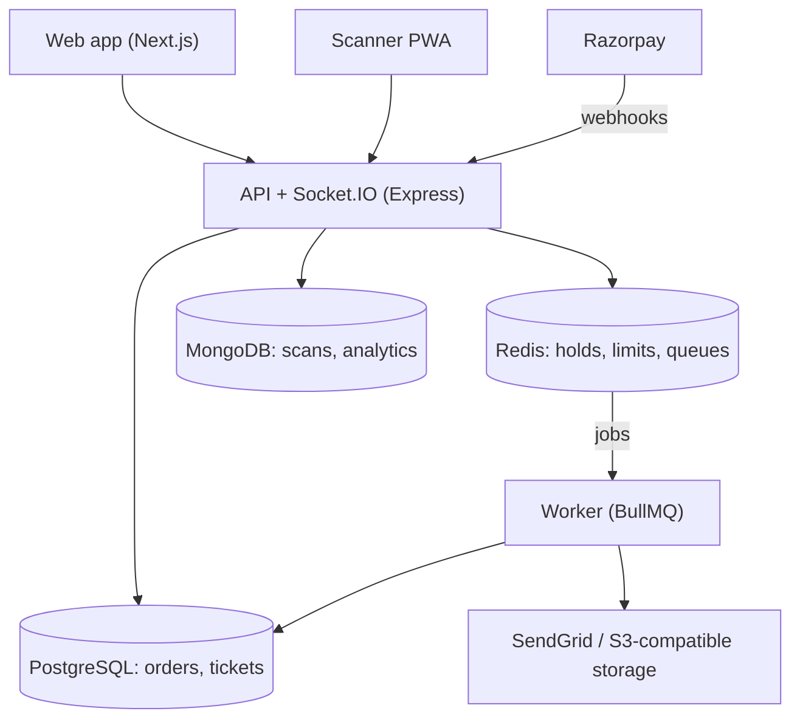
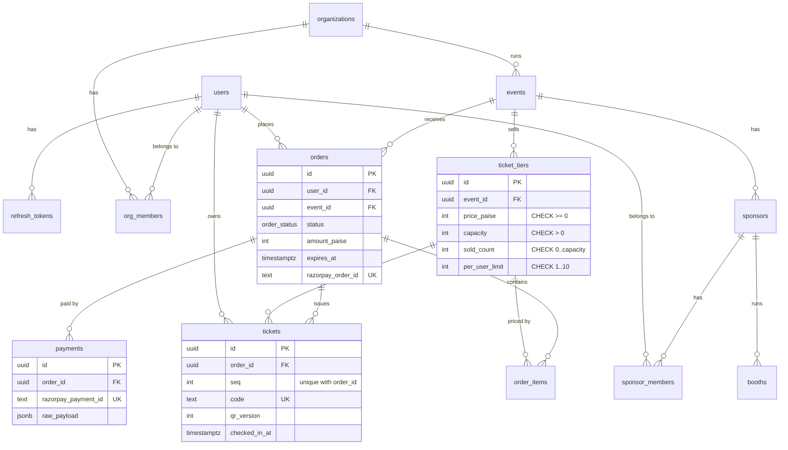

# FestPass

> Flash-sale-safe ticketing and entry for college fests. Built to stay correct when thousands of students hit "Book" at the same second.

<!-- CI badge goes here on Day 28 -->

**Status:** in development. See the [30-day progress](#30-day-progress) tracker and the [build log](#build-log).

**Deeper docs:** [Frontend README](apps/web/README.md) · [Backend README](apps/api/README.md)

## Why I built this

As Sponsorship Coordinator at MAIT's Alumni Cell, I watched fest registrations run on Google Forms and spreadsheets: duplicate entries, passes shared as screenshots, and no way to show sponsors what their money got them. FestPass is the system I wish we'd had.

## Features

| Feature | Status |
|---|---|
| Accounts, clubs (organizations) and roles | Done (Days 4–5) |
| Events and ticket tiers, SEO-friendly public pages | Planned (Days 6–10) |
| Oversell-proof booking engine (Postgres + Redis gate) | Planned (Days 11–12) |
| Automatic hold expiry and rate limiting | Planned (Days 13–14) |
| Razorpay payments with idempotent webhooks | Planned (Days 15–16) |
| Ed25519-signed QR tickets, PDF + email delivery | Planned (Days 17–18) |
| Exactly-once check-in and an offline-capable scanner PWA | Planned (Days 19–20) |
| Live availability and check-in dashboards | Planned (Day 21) |
| Virtual waiting room for flash sales | Planned (Day 22) |
| Caching and load-tested performance | Planned (Days 23–24) |
| Organizer analytics, sponsor booth analytics and reports | Planned (Days 25–26) |
| AI organizer copilot with permission-scoped tools | Planned (Day 27) |
| Security hardening, observability and CI | Planned (Day 28) |
| Live deployment | Planned (Day 29) |

## Architecture



- **PostgreSQL** holds anything involving money or capacity, because it needs transactions and constraints.
- **MongoDB** holds high-volume, append-only scan events that are read through aggregations.
- **Redis** holds fast, temporary state: the inventory gate, rate limits, the waiting room and job queues.

## How it works

FestPass has four kinds of users: **organizers** (college clubs) who run events, **attendees** who buy tickets, **volunteers** who scan passes at the gate and at sponsor booths, and **sponsors** who want to know how many people visited their booth.

One ticket's journey, end to end. The last column shows what works today; everything else is the design being built day by day.

| Step | What happens | Why it's built this way | Status |
|---|---|---|---|
| 1. Publish | An organizer creates an event with ticket tiers (Early bird, Regular, VIP) and publishes it. | Drafts never show on public pages; prices lock once a ticket sells. | Planned (Day 6) |
| 2. Browse | Attendees open a server-rendered event page that is cached and revalidated when the organizer edits it. | Fast, shareable and indexable; availability shown there is only a hint. | Planned (Day 10) |
| 3. Queue | For hot sales, attendees join a virtual waiting room and are admitted at a fixed rate. | Turns a stampede into a line so the database isn't flooded. | Planned (Day 22) |
| 4. Hold | Clicking **Book** reserves tickets for 10 minutes. Redis rejects the crowd quickly; Postgres makes the final decision with a single conditional `UPDATE`. | Two layers: Redis is fast, Postgres is correct. A CHECK constraint makes overselling impossible even if code has a bug. | Planned (Days 11–12) |
| 5. Pay | The attendee pays through Razorpay (test mode). Only the signed webhook marks the order paid, never the browser. | Webhooks can arrive twice, late or out of order, so every step is idempotent. Unpaid holds expire and return their tickets automatically. | Planned (Days 13–16) |
| 6. Ticket | A background worker issues tickets with Ed25519-signed QR codes, builds a PDF and emails it. | Signed QR codes can't be forged, and a phone can verify them without internet. | Planned (Days 17–18) |
| 7. Enter | A volunteer scans the QR at the gate. The ticket is accepted exactly once, even if two phones scan it at the same moment, and the scanner keeps working offline. | One guarded `UPDATE ... WHERE checked_in_at IS NULL` decides entry; offline scans sync later and conflicts are flagged. | Planned (Days 19–20) |
| 8. Measure | Booth scans feed sponsor dashboards (totals only, never names), organizers get live and post-event analytics, and an AI copilot answers questions using permission-checked tools. | Scan events are stored with the fields analytics needs, so dashboards are single aggregation queries. | Planned (Days 21–27) |

## Project structure

```
apps/
  web/       Next.js frontend: public pages, dashboards, checkout, scanner PWA   -> apps/web/README.md
  api/       Express REST API + Socket.IO                                         -> apps/api/README.md
  worker/    BullMQ background jobs (hold expiry, tickets, emails, reports)       -> apps/api/README.md
packages/
  shared/    Zod schemas, types and constants used by frontend and backend
  db/        Prisma schema, migrations and the raw-SQL booking path
  mongo/     Mongoose models for scan events and copilot conversations
infra/
  docker-compose.yml   Postgres, MongoDB, Redis and MinIO for local development
scripts/     Small developer scripts
```

The [frontend README](apps/web/README.md) covers every screen, how pages are rendered and how the browser talks to the API. The [backend README](apps/api/README.md) covers the API, worker, databases, and the booking and payment flows.

## Tech stack

| Layer | Technology |
|---|---|
| Web | Next.js 16.4 (App Router), React 19.3, TypeScript 6.0, Tailwind CSS 4.3 |
| API | Node.js 22, Express 5.3, Zod 4.6, pino 10.4 + pino-http 11, bcrypt 6, jsonwebtoken 9, Socket.IO |
| Jobs | BullMQ worker |
| Data | PostgreSQL 16 (Prisma 7.10 + raw SQL), MongoDB 7 (Mongoose 9.11), Redis 7 (ioredis 6.0) |
| Storage and email | S3-compatible storage (MinIO / Cloudflare R2), SendGrid dynamic templates |
| Payments | Razorpay (test mode) |
| Testing | Vitest 5.0, Supertest 7.3, k6 |
| CI/CD | GitHub Actions, Docker |
| Tooling | pnpm 12 workspaces, ESLint 9 + typescript-eslint 8, Prettier 3 |

Versions are the ones installed so far; rows without a version arrive on later days. TypeScript is pinned to 6.0 because typescript-eslint does not support TypeScript 7 yet, and ESLint stays on 9 because the plugins inside `eslint-config-next` do not support ESLint 10 yet.

## Engineering decisions

_Filled in as each piece is built. Each entry covers the problem, the approach, alternatives considered, and how it is tested._

### Database constraints as the last line of defence (Day 2)

**Problem:** capacity and money rules are checked in application code, but code has bugs, and the booking path (Day 11) uses raw SQL that skips every ORM-level check. One wrong `UPDATE` during a flash sale would oversell a tier.

**Approach:** Postgres itself enforces the invariants with CHECK constraints in a hand-written migration (`packages/db/prisma/migrations/*_check_constraints`): `sold_count` between 0 and `capacity`, `capacity > 0`, prices and amounts `>= 0`, `per_user_limit` between 1 and 10, `qty > 0`, and `ends_at > starts_at`. Unique constraints cover the retry paths: one payment per `razorpay_payment_id`, one ticket per `(order_id, seq)`. If the app tries to write bad data, the statement fails and the transaction rolls back.

**Alternatives:** relying only on application checks (one bug away from overselling) or triggers (harder to read and test than a one-line CHECK).

**Tested by:** `packages/db/test/constraints.test.ts` runs raw `UPDATE`s against a real Postgres and asserts that `sold_count = capacity` succeeds while `capacity + 1` and `-1` are rejected by name.

### Auth: short-lived JWT + rotating refresh tokens (Day 4)

**Problem:** a single long-lived JWT can't be revoked: if it leaks, it works until it expires. But very short sessions make students log in again every few minutes, in the middle of a flash sale.

**Approach** (`apps/api/src/modules/auth/`):
- **Access token:** a JWT (HS256, 15 minutes) sent as `Authorization: Bearer`. It is checked without a database lookup, and if stolen it is only useful for minutes. `requireAuth` verifies it with the algorithm pinned to HS256 and sets `req.user`.
- **Refresh token:** 256 random bits in an `httpOnly`, `SameSite=Lax` cookie scoped to `/api/v1/auth` (`Secure` in production), so page scripts can't read it and it is never sent to the rest of the API. The database stores only its SHA-256, a `family_id` and a 7-day expiry.
- **Rotation:** every refresh revokes the presented token and issues a new one in the same family, inside one transaction. The revoke is a guarded `UPDATE ... WHERE revoked_at IS NULL`, so two concurrent refreshes with the same token can't both succeed.
- **Reuse detection:** a revoked token should never come back. If one does, someone kept a copy, so the whole family is revoked (attacker and user are both logged out, the user logs in again) and a warning is logged with the user and family IDs, never the token.
- **Passwords:** bcrypt cost 12, at most 72 bytes (bcrypt ignores the rest). Wrong password and unknown email return the same `INVALID_CREDENTIALS` error, and an unknown email still runs a bcrypt compare against a dummy hash so the response time doesn't reveal which emails exist.

**Alternatives:** server-side sessions in Redis (simple to revoke, but every request needs a lookup and the API stops being stateless); one long JWT (can't be revoked); refresh tokens in `localStorage` (readable by any XSS).

**Trade-off:** rotation is strict. If two tabs refresh with the same token at the same moment, the second is treated as reuse and the session ends. A short grace window could soften this later.

**Tested by:** `apps/api/test/auth.test.ts`: rotation revokes the old token and keeps the family; replaying an old token returns `REFRESH_TOKEN_REUSED` and kills the newest token too; only hashes are stored; expired and forged access tokens are rejected.

**Planned:**

- Preventing oversells (Days 11–12, 24)
- Hold expiry (Day 13)
- Rate limiting (Day 14)
- Payment idempotency and the order state machine (Days 15–16)
- Forgery-proof QR tickets and offline scanning (Days 17, 20)
- Exactly-once entry (Day 19)
- Real-time updates (Day 21)
- Virtual waiting room (Day 22)
- Sponsor analytics and privacy (Day 26)
- AI copilot safety (Day 27)

## Roles and permissions

A college club is an **organization**; each member has one role in it. The matrix is data in `packages/shared/src/permissions.ts`, so the API (which enforces it) and the web app (which uses it to hide buttons) read the same table.

| Action | OWNER | MANAGER | SCANNER |
|---|:-:|:-:|:-:|
| `org:read`: see the org and its members | ✓ | ✓ | ✓ |
| `member:manage`: add, change and remove members | ✓ | | |
| `event:create` / `event:update` | ✓ | ✓ | |
| `event:publish` | ✓ | ✓ | |
| `checkin:scan`: scan tickets at the gate | ✓ | ✓ | ✓ |

- Enforced by `requireOrgPermission(action)` (`apps/api/src/middleware/require-org-permission.ts`) on every org route. The UI may hide buttons, but the API is the boundary.
- Not a member of the org: **404**, exactly like an org that doesn't exist, so org IDs can't be probed. A member without the permission: **403**.
- An org always keeps at least one OWNER: demoting or removing the last one returns `409 LAST_OWNER`, and the check locks the org's OWNER rows so two owners demoting each other at once can't both succeed.

## Data model

Schema: `packages/db/prisma/schema.prisma`. Tables and columns are snake_case, IDs are UUIDs generated by Postgres, money is integer paise and every timestamp is `timestamptz` (UTC).



- **Orders vs tickets:** an order is a purchase (amount, hold expiry, payment status). A ticket is one entry right (QR code, owner, check-in). An order for 3 tickets has one order row and three ticket rows, and a ticket can later change owner without touching the payment.
- **Hot-path indexes:** `orders(user_id, status)`, `orders(status, expires_at)` for the hold-expiry sweep, `tickets(owner_user_id)`, `events(org_id, status)`. `tickets(order_id)` is served by the unique `(order_id, seq)` index, so it has no separate index.

## Getting started

**Prerequisites**

- Node.js 22 (`.nvmrc`)
- pnpm 12 (`npm i -g pnpm`)
- Docker Desktop or OrbStack (for Postgres, MongoDB, Redis and MinIO)

**Run it locally**

```bash
pnpm install
cp .env.example .env
pnpm infra:up   # starts the four services and waits until all are healthy
pnpm db:migrate  # creates the tables and CHECK constraints
pnpm db:seed     # demo org, users, a published event with three tiers, a sponsor
pnpm dev        # web on :3000, API on :4000, worker in the background
```

Seed accounts (`organizer@`, `scanner@`, `sponsor@` and `attendee@festpass.dev`) all log in with the password `festpass-dev`.

Check it: open http://localhost:3000, and `curl http://localhost:4000/api/v1/health/ready` should return `{"status":"ok","checks":{"postgres":"up","redis":"up","mongo":"up"}}`.

If the MinIO image fails to pull (MinIO stopped publishing free images in 2025), start the other three services with `docker compose --project-directory . -f infra/docker-compose.yml up -d --wait postgres mongo redis`. Nothing uses MinIO until banner uploads (Day 8).

The containers use host ports 5433, 27018 and 6380 instead of the defaults, so they don't clash with a Postgres, MongoDB or Redis already installed on your machine. Change them in `.env` if needed. The MinIO console is at http://localhost:9001.

## Environment variables

| Variable | Used by | Description |
|---|---|---|
| `API_PORT` | api | Port the API listens on (default 4000) |
| `NODE_ENV` | api | `development`, `test` or `production` (default `development`). Only `development` shows error messages and stacks in responses |
| `LOG_LEVEL` | api | pino level: `fatal`, `error`, `warn`, `info`, `debug`, `trace` or `silent` (default `info`) |
| `JWT_ACCESS_SECRET` | api | Secret that signs access tokens (HS256). Required, at least 32 characters; generate one with `openssl rand -base64 48` |
| `ACCESS_TOKEN_TTL_SECONDS` | api | Access-token lifetime (default 900 = 15 minutes) |
| `REFRESH_TOKEN_TTL_DAYS` | api | Refresh-token lifetime; each refresh starts a new period (default 7) |
| `POSTGRES_PORT` | docker compose | Host port for Postgres (default 5433) |
| `DATABASE_URL` | api, db (Prisma CLI, seed) | Postgres connection string |
| `DATABASE_URL_TEST` | tests (`packages/db`, `apps/api`) | Separate Postgres database for tests; must end in `_test`, because tests truncate every table |
| `MONGO_PORT` | docker compose | Host port for MongoDB (default 27018) |
| `MONGODB_URI` | api | MongoDB connection string |
| `REDIS_PORT` | docker compose | Host port for Redis (default 6380) |
| `REDIS_URL` | api (worker from Day 13) | Redis connection string |
| `MINIO_API_PORT` | docker compose | Host port for the MinIO S3 API (default 9000) |
| `MINIO_CONSOLE_PORT` | docker compose | Host port for the MinIO web console (default 9001) |
| `MINIO_ROOT_USER` | docker compose | MinIO admin user (local only) |
| `MINIO_ROOT_PASSWORD` | docker compose | MinIO admin password (local only, min 8 characters) |
| `S3_ENDPOINT` | api (Day 8+) | S3-compatible endpoint; MinIO locally, R2 in production |

## Scripts

| Command | What it does |
|---|---|
| `pnpm dev` | Runs web, API and worker in parallel with hot reload |
| `pnpm build` | Builds every package and app |
| `pnpm lint` | ESLint over the whole repo |
| `pnpm typecheck` | TypeScript checks in every package |
| `pnpm test` | Runs all test suites (Vitest) |
| `pnpm format` | Formats code with Prettier |
| `pnpm infra:up` | Starts Postgres, MongoDB, Redis and MinIO and waits for healthchecks |
| `pnpm infra:down` | Stops the containers (data stays in named volumes) |
| `pnpm db:migrate` | Applies pending Prisma migrations (and creates a new one if the schema changed) |
| `pnpm db:reset` | Drops the database and re-applies every migration (destroys local data) |
| `pnpm db:seed` | Inserts demo data; safe to run repeatedly |
| `pnpm db:studio` | Opens Prisma Studio to browse the tables |

## API reference

### Conventions

- **Base path:** every endpoint lives under `/api/v1` and speaks JSON.
- **Errors** always have one shape, produced by a single error handler (`apps/api/src/middleware/error-handler.ts`):
  ```json
  { "error": { "code": "VALIDATION_FAILED", "message": "Request validation failed", "details": { "fields": [{ "location": "body", "path": "email", "message": "Invalid email address" }] }, "requestId": "6f1c..." } }
  ```
  Codes so far: `VALIDATION_FAILED` (400), `INVALID_JSON` (400), `UNAUTHORIZED`, `INVALID_CREDENTIALS`, `INVALID_ACCESS_TOKEN`, `INVALID_REFRESH_TOKEN`, `REFRESH_TOKEN_REUSED` (401), `FORBIDDEN` (403), `NOT_FOUND` (404), `EMAIL_TAKEN`, `SLUG_TAKEN`, `ALREADY_MEMBER`, `LAST_OWNER` and other conflict codes such as `SOLD_OUT` (409), `RATE_LIMITED` (429), `INTERNAL_ERROR` (500). Outside development, a 500 never includes the internal message or stack.
- **Request IDs:** send `X-Request-Id` (up to 64 letters, digits, `_` or `-`) to reuse your own; otherwise the API generates a UUID. It comes back in the `X-Request-Id` response header, in every error body and in every log line for that request.
- **Validation:** params, query and body are validated with Zod schemas from `packages/shared`; every invalid field is reported at once.
- **Auth:** protected endpoints need `Authorization: Bearer <accessToken>`. The refresh token is only ever an `fp_refresh` cookie; it never appears in a response body.
- **Pagination:** list endpoints take `?cursor=&limit=` (`limit` 1–100, default 20; schema `paginationQuerySchema` in `packages/shared`). First list endpoint: Day 6.

### Endpoints

| Method | Path | Auth | Description |
|---|---|---|---|
| POST | `/api/v1/orgs` | Bearer | Body `{ name, slug? }` (slug derived from the name if missing). Creates the org with the caller as OWNER. `201 { org }`; `409 SLUG_TAKEN` |
| GET | `/api/v1/orgs/mine` | Bearer | `200 { orgs: [{ id, name, slug, role }] }`: every org the caller belongs to, with their role |
| GET | `/api/v1/orgs/:orgId` | Bearer, `org:read` | `200 { org, members: [{ userId, name, email, role }] }`; `404` for non-members |
| POST | `/api/v1/orgs/:orgId/members` | Bearer, `member:manage` | Body `{ email, role }` adds an existing user. `201 { member }`; `404` if no account has that email; `409 ALREADY_MEMBER` |
| PATCH | `/api/v1/orgs/:orgId/members/:userId` | Bearer, `member:manage` | Body `{ role }`. `200 { member }`; `409 LAST_OWNER` if it would leave no OWNER |
| DELETE | `/api/v1/orgs/:orgId/members/:userId` | Bearer, `member:manage` | `204`; `409 LAST_OWNER` for the last OWNER |
| GET | `/api/v1/health/live` | none | Liveness: `200 { "status": "ok" }` whenever the process can answer. Checks no dependencies |
| POST | `/api/v1/auth/register` | none | Body `{ email, password (8+ chars, max 72 bytes), name, college?, branch?, graduationYear? }`. `201 { user, accessToken }` and sets the `fp_refresh` cookie. `409 EMAIL_TAKEN` if the email (case-insensitive) exists |
| POST | `/api/v1/auth/login` | none | Body `{ email, password }`. `200 { user, accessToken }` and a new `fp_refresh` cookie (a new token family). `401 INVALID_CREDENTIALS` for a wrong password or unknown email alike |
| POST | `/api/v1/auth/refresh` | `fp_refresh` cookie | Rotates the refresh token: `200 { user, accessToken }` and a new cookie. `401 INVALID_REFRESH_TOKEN` if missing, unknown or expired; `401 REFRESH_TOKEN_REUSED` (and the whole family is revoked) if the token was already used |
| POST | `/api/v1/auth/logout` | `fp_refresh` cookie | Revokes this session's token family and clears the cookie. Always `204` |
| GET | `/api/v1/auth/me` | Bearer | `200 { user }`. `401` without a valid access token |
| GET | `/api/v1/health/ready` | none | Readiness: pings Postgres, Redis and MongoDB in parallel (1 s timeout each). `200` with `{ "status": "ok", "checks": { "postgres": "up", ... } }`, or `503` with `"status": "unavailable"` and the down dependency marked `"down"` |

## Testing

_How to run the tests and what the key tests prove._

Run `pnpm test`. The `packages/db` tests need Postgres running, because constraints can only be proven by the real database. They use a separate database (`DATABASE_URL_TEST`, default `festpass_test`): Vitest's global setup creates and migrates it automatically, and `truncateAll` (`packages/db/src/testing.ts`) empties it between tests. `truncateAll` refuses to run on any database whose name doesn't end in `_test`, so tests can never wipe dev data.

- `apps/api/test/errors.test.ts`: a bad body or query returns 400 with every invalid field and the request ID; unknown routes return 404 in the standard shape; invalid JSON returns 400; an `AppError` keeps its status and code; an unexpected error returns a generic 500 with no internal message or stack; incoming `X-Request-Id` values are reused only when safe.
- `apps/api/test/health.test.ts`: liveness; readiness returns 200 when all checks pass, and 503 naming the dependency when a check fails or hangs (checks are injected fakes, so no real outage is needed).
- `apps/api/test/auth.test.ts` (against the test database): register stores a cost-12 bcrypt hash and only the SHA-256 of the refresh token, and sets an `HttpOnly`, `SameSite=Lax`, `/api/v1/auth` cookie; duplicate email (any case) returns 409; wrong password and unknown email return the same 401; `/me` rejects a missing, expired or forged token; refresh rotates the token within its family; replaying an old token revokes the whole family; logout makes the refresh token stop working.
- `apps/api/test/orgs.test.ts` (against the test database): loops over every role × action and checks both `can()` and the real `requireOrgPermission` middleware against a hand-written policy table; a non-member gets 404 for every action, identical to a nonexistent org; creating an org makes the creator OWNER; owners add members by email, managers get 403; the last OWNER can't be demoted or removed; two owners demoting each other concurrently leave exactly one OWNER.
- `apps/api/test/env.test.ts`: env parsing applies defaults, coerces numbers and lists every invalid variable in one message.
- `packages/db/test/constraints.test.ts`: Postgres rejects `sold_count` above capacity or below zero and an out-of-range `per_user_limit`, even through raw SQL.
- `packages/db/test/seed.test.ts`: on an empty database the seed creates exactly the demo rows, and a second run changes nothing; seed users log in with `festpass-dev`; `truncateAll` refuses a non-`_test` database.

## Load test results

_Day 24. Only measured numbers, with the exact setup used._

## Deployment

_Day 29._

## 30-day progress

The project is built in 30 daily slices. Each day ships working, tested code and adds an entry to the build log below.

<!-- TRACKER:START -->
- [x] Day 01 (Fri 30 Oct): Monorepo and local infrastructure
- [x] Day 02 (Sat 31 Oct): Database schema v1
- [x] Day 03 (Sun 01 Nov): API foundation
- [x] Day 04 (Mon 02 Nov): Authentication with refresh-token rotation
- [x] Day 05 (Tue 03 Nov): Organizations and role-based access
- [ ] Day 06 (Wed 04 Nov): Events and ticket tiers API
- [ ] Day 07 (Thu 05 Nov): Web foundation and auth UI
- [ ] Day 08 (Fri 06 Nov): Banner uploads with pre-signed URLs
- [ ] Day 09 (Sat 07 Nov): Organizer dashboard UI
- [ ] Day 10 (Sun 08 Nov): Public event pages with SSR and ISR
- [ ] Day 11 (Mon 09 Nov): Booking engine I: Postgres correctness
- [ ] Day 12 (Tue 10 Nov): Booking engine II: the Redis gate
- [ ] Day 13 (Wed 11 Nov): Hold expiry with BullMQ
- [ ] Day 14 (Thu 12 Nov): Rate limiting with a token bucket
- [ ] Day 15 (Fri 13 Nov): Razorpay checkout (test mode)
- [ ] Day 16 (Sat 14 Nov): Webhooks and the order state machine
- [ ] Day 17 (Sun 15 Nov): Signed QR tickets
- [ ] Day 18 (Mon 16 Nov): PDF tickets and email delivery
- [ ] Day 19 (Tue 17 Nov): Check-in API and scan events
- [ ] Day 20 (Wed 18 Nov): Scanner PWA with offline mode
- [ ] Day 21 (Thu 19 Nov): Real-time updates with Socket.IO
- [ ] Day 22 (Fri 20 Nov): Virtual waiting room
- [ ] Day 23 (Sat 21 Nov): Caching and query performance
- [ ] Day 24 (Sun 22 Nov): Load testing with k6
- [ ] Day 25 (Mon 23 Nov): Analytics pipelines and dashboards
- [ ] Day 26 (Tue 24 Nov): Sponsor portal, booth scans and reports
- [ ] Day 27 (Wed 25 Nov): AI organizer copilot
- [ ] Day 28 (Thu 26 Nov): Security, observability and CI
- [ ] Day 29 (Fri 27 Nov): Deploy
- [ ] Day 30 (Sat 28 Nov): Ship it and prepare the story
<!-- TRACKER:END -->

## Build log

<!-- BUILD-LOG:START -->
### Day 01: Monorepo and local infrastructure (2026-10-30)
**Built:**
- pnpm workspace with `apps/web` (Next.js + Tailwind), `apps/api` (Express), `apps/worker` and `packages/shared`, `db`, `mongo`; every package builds.
- Shared TypeScript (strict, `noUncheckedIndexedAccess`), ESLint and Prettier config at the root.
- `infra/docker-compose.yml` with Postgres 16, MongoDB 7, Redis 7 and MinIO, each with a named volume and a healthcheck.
- `GET /api/v1/health` with a Vitest + Supertest test.

**Key decision:** containers publish on non-default host ports (5433, 27018, 6380) bound to 127.0.0.1, instead of 5432/27017/6379, because this machine already runs local copies of all three and a clash would silently connect the app to the wrong database.
**Verify:** `pnpm install && pnpm lint && pnpm typecheck && pnpm test`, then `pnpm infra:up && pnpm dev` and `curl localhost:4000/api/v1/health`.
**Next:** Day 2 adds the Prisma schema, CHECK constraints and seed data in `packages/db`.

### Day 02: Database schema v1 (2026-10-31)
**Built:**
- Prisma 7 in `packages/db` with an exported client singleton and 14 snake_case tables (users and refresh tokens, orgs and roles, events and tiers, orders, payments, tickets, sponsors and booths).
- A hand-written migration with CHECK constraints (capacity, prices, per-user limit, event dates), plus hot-path indexes.
- An idempotent seed: MAIT Alumni Cell, four role users, a published event with Early bird / Regular / VIP tiers, one sponsor with a booth.
- Root `db:migrate`, `db:reset`, `db:seed`, `db:studio` scripts and tests for the constraints and the seed.

**Key decision:** capacity is enforced by a Postgres CHECK constraint, not just application code, because the booking path uses raw SQL and one buggy `UPDATE` must not be able to oversell; the database rejects it no matter which code path wrote it.
**Verify:** `pnpm infra:up && pnpm db:reset && pnpm db:seed && pnpm test`.
**Next:** Day 3 adds env validation, structured errors, request IDs and a readiness check that pings Postgres through this client.

### Day 03: API foundation (2026-11-01)
**Built:**
- `apps/api/src` split into `config/`, `lib/`, `middleware/` and `modules/health/` (routes, controller, service, repository), with env validated by Zod at startup.
- pino + pino-http logging with a request ID per request (reused from `X-Request-Id` when safe), an `AppError` hierarchy and one error handler that returns the standard error shape.
- A `validate({ params, query, body })` middleware, `/api/v1/health/live` and `/api/v1/health/ready` (Postgres, Redis, Mongo, 503 if any is down), and graceful shutdown on SIGTERM/SIGINT.
- A separate test database that Vitest migrates automatically, plus a `truncateAll` helper that only runs on `*_test` databases.

**Key decision:** readiness checks are passed into `createApp()` instead of being imported directly, so tests simulate a dead Redis or a hanging Mongo with a fake function instead of stopping containers; the real checks run in parallel with a 1 s timeout each, because a hung dependency is as bad as a dead one.
**Verify:** `pnpm test`, then `pnpm dev` and `curl -i localhost:4000/api/v1/nope -H 'X-Request-Id: demo-1'` (404 in the standard shape with `requestId: "demo-1"`) and `curl localhost:4000/api/v1/health/ready`.
**Next:** Day 4 adds register, login, refresh-token rotation with reuse detection, logout and `/me` on top of this error and validation layer.

### Day 04: Authentication with refresh-token rotation (2026-11-02)
**Built:**
- `POST /auth/register`, `/login`, `/refresh`, `/logout` and `GET /auth/me`, with request schemas in `packages/shared` and an `auth` module split into routes, controller, service and repository.
- bcrypt (cost 12) passwords and one generic login error; 15-minute HS256 access tokens checked by a `requireAuth` middleware.
- 256-bit refresh tokens stored only as SHA-256 hashes, in an `httpOnly` cookie scoped to `/api/v1/auth`, rotated on every refresh, with reuse detection that revokes the whole token family.
- Seed users now log in with a real password (`festpass-dev`).

**Key decision:** refresh tokens are random strings stored hashed in Postgres instead of being a second JWT, because a refresh token has to be revocable and detectable on reuse, which needs a database row anyway; the short JWT access token keeps every other request free of database lookups.
**Verify:** `pnpm test`, then `pnpm dev` and `curl -c jar -X POST localhost:4000/api/v1/auth/login -H 'Content-Type: application/json' -d '{"email":"organizer@festpass.dev","password":"festpass-dev"}'`, then `curl -b jar -c jar -X POST localhost:4000/api/v1/auth/refresh`.
**Next:** Day 5 adds club organizations with OWNER, MANAGER and SCANNER roles, enforced by middleware on top of `requireAuth`.

### Day 05: Organizations and role-based access (2026-11-03)
**Built:**
- Org endpoints: create (creator becomes OWNER), list mine, get one, and add, change or remove members by email.
- A permission matrix as data in `packages/shared` (OWNER, MANAGER, SCANNER × org, member, event and check-in actions) with a `can(role, action)` helper.
- `requireOrgPermission(action)` middleware: 404 for non-members, 403 for members without the permission.
- The last-OWNER rule, enforced in a transaction that locks the org's OWNER rows.

**Key decision:** non-members get 404 instead of 403, because 403 would confirm that an org with that ID exists; members without a permission get 403, since they already know the org.
**Verify:** `pnpm test`, then log in as `organizer@festpass.dev` and `curl localhost:4000/api/v1/orgs/mine -H "Authorization: Bearer <token>"`; the same org ID with the attendee's token returns 404.
**Next:** Day 6 adds events and ticket tiers under an org, guarded by `event:create` and `event:publish`.

<!-- BUILD-LOG:END -->

## License

MIT
