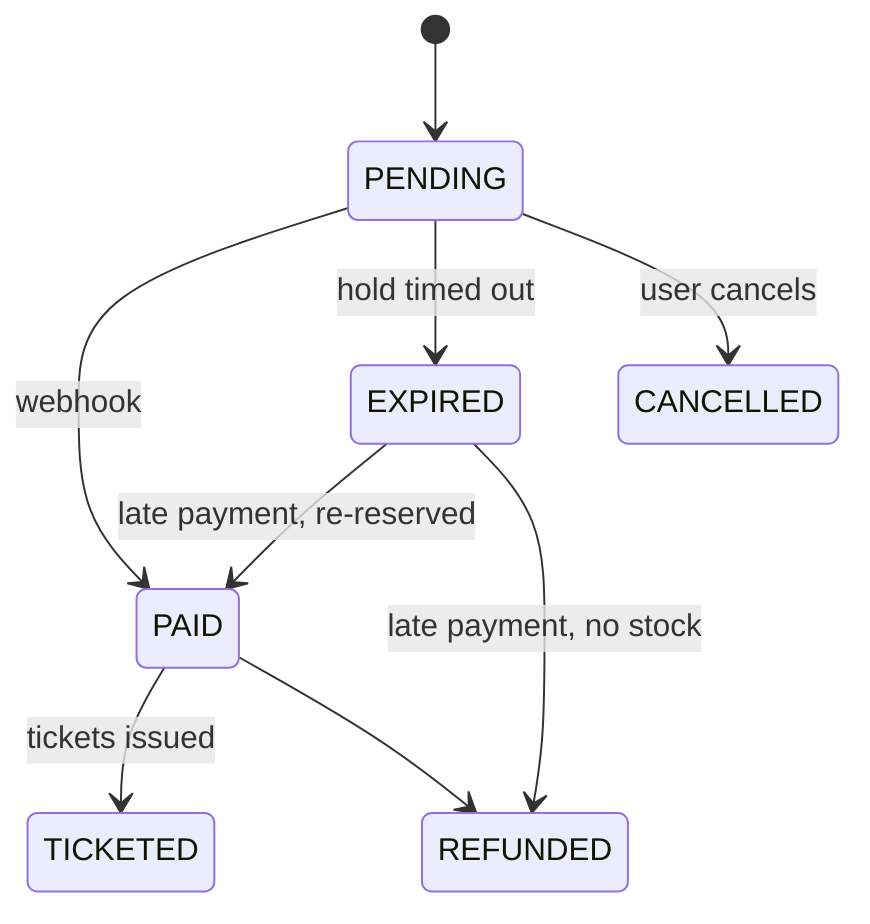

# FestPass backend

Everything behind the browser: the REST API (`apps/api`), the background worker (`apps/worker`), the database packages (`packages/db`, `packages/mongo`), shared schemas (`packages/shared`) and the local infrastructure (`infra/`).

Back to the [project README](../../README.md) · See also the [frontend README](../web/README.md)

## Status

| Area | Where | Status |
|---|---|---|
| Express app with health check, Vitest + Supertest | `apps/api` | Done (Day 1) |
| Worker process with clean shutdown | `apps/worker` | Done (Day 1) |
| Postgres, MongoDB, Redis, MinIO in Docker with healthchecks | `infra/docker-compose.yml` | Done (Day 1) |
| Database schema, CHECK constraints, seed | `packages/db` | Done (Day 2) |
| Env validation, structured errors, request IDs, readiness checks | `apps/api` | Done (Day 3) |
| Auth with rotating refresh tokens | `apps/api` | Planned (Day 4) |
| Organizations and role-based access | `apps/api`, `packages/shared` | Planned (Day 5) |
| Events and ticket tiers | `apps/api` | Planned (Day 6) |
| Pre-signed banner uploads | `apps/api` | Planned (Day 8) |
| Booking engine (Postgres + Redis gate) | `packages/db`, `apps/api` | Planned (Days 11–12) |
| Hold expiry jobs, rate limiting | `apps/worker`, `apps/api` | Planned (Days 13–14) |
| Razorpay orders and webhooks, order state machine | `apps/api`, `apps/worker` | Planned (Days 15–16) |
| Signed QR tickets, PDFs, email | `packages/shared`, `apps/worker` | Planned (Days 17–18) |
| Check-in and scan events | `apps/api`, `packages/mongo` | Planned (Day 19) |
| Socket.IO live updates, waiting room | `apps/api`, `apps/worker` | Planned (Days 21–22) |
| Caching, load tests, analytics, sponsor reports | all | Planned (Days 23–26) |
| AI copilot with typed tools | `apps/api` | Planned (Day 27) |
| Security pass, metrics, Dockerfiles, CI | all | Planned (Day 28) |

Only rows marked **Done** exist in the code. The sections below that are marked _Planned_ describe the design being built.

## Processes

| Process | Started by | Job |
|---|---|---|
| **API** (`apps/api`) | `pnpm dev`, port 4000 | Handles HTTP requests under `/api/v1` and, later, Socket.IO connections. Kept fast: anything slow goes to a queue. |
| **Worker** (`apps/worker`) | `pnpm dev` | Runs background jobs from Redis queues (BullMQ): expiring unpaid holds, issuing tickets, building PDFs, sending email, refunds, reports. |

They are separate processes so a slow PDF or a stuck email can never slow down booking, and each can be restarted or scaled on its own. Both shut down cleanly on SIGTERM so deploys don't cut work off halfway.

## Data stores

| Store | Holds | Why this store |
|---|---|---|
| **PostgreSQL 16** | Users, orgs, events, tiers, orders, payments, tickets | The source of truth for money and capacity. It has transactions, row locks and CHECK constraints, so overselling is blocked by the database itself. |
| **MongoDB 7** | Scan events (time-series), copilot conversations | Many small append-only writes, read through aggregations for analytics. |
| **Redis 7** | Inventory gate, rate limits, waiting room, job queues | Fast, temporary state. Redis can say "no" quickly, but never has the final say on a booking. |
| **MinIO / R2** | Event banners (public), ticket PDFs (private) | S3-compatible storage. The browser uploads directly with pre-signed URLs, so file bytes never pass through the API. |

Locally all four run from `infra/docker-compose.yml` on host ports 5433, 27018, 6380 and 9000/9001, bound to 127.0.0.1.

## Folder layout (today)

```
apps/api/
  src/config/env.ts                 Zod schema for every env var; exits with a readable list if any is invalid
  src/lib/logger.ts                 pino logger (redacts Authorization, Cookie, Set-Cookie)
  src/lib/errors.ts                 AppError + NotFound, Validation, Conflict, Forbidden, Unauthorized, RateLimited
  src/lib/redis.ts                  ioredis client (lazy connect, auto-reconnect)
  src/middleware/request-logger.ts  pino-http: one request ID per request, X-Request-Id header
  src/middleware/validate.ts        validate({ params, query, body }) with Zod; 400 with field details
  src/middleware/error-handler.ts   notFound + the single error handler (standard error shape)
  src/modules/health/               routes, controller, service (parallel checks, 1 s timeout), repository (pings)
  src/app.ts                        Builds the Express app (no listening); readiness checks can be injected
  src/server.ts                     Connects Mongo, listens on API_PORT, graceful shutdown
  test/                             errors, health and env tests (Supertest, no open port)
  vitest.config.ts                  Loads .env, forces NODE_ENV=test, silent logs, test database
  tsconfig.json                     Typecheck config (src + test)
  tsconfig.build.json               Build config (src only, output to dist/, uses packages' built dist/)
apps/worker/
  src/index.ts           Starts, logs "worker started", exits cleanly on SIGTERM/SIGINT
packages/db/
  prisma/schema.prisma   All Postgres tables, enums, relations and indexes (snake_case via @map/@@map)
  prisma/migrations/     *_init (generated from the schema) and *_check_constraints (hand-written SQL)
  prisma.config.ts       Prisma 7 CLI config: schema path, migrations, seed command, DATABASE_URL
  src/index.ts           Exports the PrismaClient singleton (pg driver adapter) and all generated types
  src/seed.ts            Idempotent demo seed; `seed(db)` is also imported by the tests
  src/testing.ts         @festpass/db/testing: migrateTestDatabase(), truncateAll() (only on *_test databases)
  src/generated/         Generated Prisma client (git-ignored, rebuilt by `prisma generate` on install)
  test/                  global-setup.ts (migrates the test DB), constraints.test.ts, seed.test.ts
packages/shared/
  src/index.ts           paginationQuerySchema, idParamsSchema, ApiErrorBody type
packages/mongo/
  src/index.ts           connectMongo(), pingMongo(), disconnectMongo() (models arrive with Day 19)
```

**How packages are imported:** each package's `exports` has a `development` condition pointing at `src/index.ts`. The API's dev server (`tsx --conditions=development`), Vitest and TypeScript (`customConditions` in `tsconfig.base.json`) all use it, so a change in `packages/db` is picked up without a build step. `pnpm build` and `node dist/server.js` ignore it and use each package's compiled `dist/`.

### Postgres schema (`packages/db`)

- **Prisma 7** with the `prisma-client` generator and `@prisma/adapter-pg`. Prisma 7 no longer ships a Rust query engine; it talks to Postgres through the standard `pg` driver, which is why the adapter is a dependency.
- **IDs** default to `gen_random_uuid()` in Postgres itself, so rows inserted by raw SQL (the booking path) get IDs the same way as rows created through Prisma.
- **CHECK constraints** (`*_check_constraints/migration.sql`): `ticket_tiers.sold_count` between 0 and `capacity`, `capacity > 0`, `price_paise >= 0`, `per_user_limit` 1–10, `events.ends_at > starts_at`, plus `orders.amount_paise >= 0` and `order_items.qty > 0`. Prisma can't express CHECKs, so they live in SQL and Prisma's drift check simply ignores them.
- **Unique keys that make retries safe:** `payments.razorpay_payment_id`, `orders.razorpay_order_id`, `tickets(order_id, seq)`, `tickets.code`.
- **Delete rules:** children that mean nothing alone cascade (tiers with their event, order items with their order, memberships). Orders, payments and tickets never cascade, so deleting an event or tier that has sales fails instead of silently erasing money records.
- **Seed** (`src/seed.ts`): every write is an `upsert` with an empty `update`, so a second run inserts nothing and never resets live counters like `sold_count`. Seed users get a placeholder password hash and can't log in until Day 4 adds bcrypt.

### Request pipeline (`apps/api/src/app.ts`)

1. **`requestLogger`** (pino-http) gives the request an ID: the incoming `X-Request-Id` if it is 1–64 characters of `[A-Za-z0-9_-]`, otherwise a new UUID. The ID goes into `req.id`, every log line (`req.log`) and the `X-Request-Id` response header. Responses are logged at `warn` for 4xx and `error` for 5xx.
2. **`express.json()`** parses bodies (100 kB limit).
3. **Feature routers** under `/api/v1`. Each feature is `modules/<feature>/{routes,controller,service,repository}.ts`: controllers handle HTTP only, services hold business rules, and repositories are the only code that touches a data store. `validate({ params, query, body })` runs before a controller, reports every invalid field at once and replaces the raw values with the parsed ones.
4. **`notFound`** turns anything unmatched into a `NotFoundError`.
5. **`errorHandler`** is the only place that writes error responses. `AppError` subclasses keep their status, code and details; body-parser errors become `INVALID_JSON` or `BAD_REQUEST`; anything else is logged with its stack and returned as a generic `INTERNAL_ERROR` 500 (message and stack only when `NODE_ENV=development`). Express 5 forwards rejected promises from async handlers here, so handlers need no try/catch.

### Health and shutdown

- **Liveness** (`/health/live`) answers whenever the process can serve HTTP, and checks nothing else, so a database outage never makes the platform restart a healthy API process.
- **Readiness** (`/health/ready`) runs `SELECT 1` on Postgres, `PING` on Redis and an admin `ping` on Mongo in parallel, each with a 1 s timeout. Any failure returns 503 so the load balancer stops sending traffic; the reasons go to the logs, not to the client.
- **Startup:** env is validated first, then Mongo is connected (fail fast if it can't be). Prisma and ioredis connect on first use and reconnect by themselves.
- **Shutdown** on SIGTERM/SIGINT: `server.close()` stops new connections and waits for in-flight requests, then Prisma, Redis and Mongo are closed, then the process exits 0. If that takes more than 10 s it exits 1.

## Core flows

### Booking a ticket

_Planned (Days 11–13)._

1. The request carries an `Idempotency-Key`. A retry with the same key gets the stored response instead of booking twice.
2. **Redis gate:** a Lua script checks stock and the per-user limit for every tier in one atomic step. Most of the crowd is rejected here, before Postgres is touched.
3. **Postgres decides:** in one transaction, for each tier (sorted by ID so concurrent requests lock rows in the same order and can't deadlock):
   ```sql
   UPDATE ticket_tiers SET sold_count = sold_count + $qty
   WHERE id = $tierId AND sold_count + $qty <= capacity
   RETURNING sold_count;
   ```
   No row returned means sold out. The whole transaction rolls back and Redis stock is given back.
4. The order is saved as `PENDING` with a 10-minute hold, and a delayed job is scheduled to expire it.
5. If Redis is down, booking still works through Postgres alone, just with more load on the database.

### Paying

_Planned (Days 15–16)._

- The API creates a Razorpay order outside any database transaction (no network calls inside transactions).
- The browser's "payment succeeded" callback only updates the screen. The order becomes `PAID` only when Razorpay's webhook arrives and its HMAC signature checks out against the raw request body.
- Webhooks can be delivered more than once, so payments are inserted with `ON CONFLICT DO NOTHING` and only a new row moves the order forward.
- A payment that arrives after the hold expired is either re-reserved (if tickets remain) or refunded automatically.

### Order states

_Planned (Days 13 and 16)._ Status only changes through a guarded `UPDATE ... WHERE status = $from`, so two jobs racing on the same order can't both succeed.



### Entry at the gate

_Planned (Days 17–19)._

- Each ticket's QR code holds `{ ticketId, eventId, qrVersion, issuedAt }` signed with Ed25519. There's no personal data in it, and it can't be forged without the private key, which never leaves the server.
- Check-in runs `UPDATE tickets SET checked_in_at = now() WHERE id = $1 AND checked_in_at IS NULL`. If ten phones scan the same ticket at once, exactly one gets a row back.
- Every scan is then written to MongoDB for analytics. If that write fails it is retried, but the check-in is never undone.

## Engineering rules

- Postgres is the source of truth for capacity and money; Redis is only a fast gate and cache.
- No network calls (payments, storage, email, AI) inside a database transaction.
- Anything that can be retried is idempotent: unique constraints, guarded updates, idempotency keys, job IDs derived from the order ID.
- Webhooks are verified before anything is parsed or acted on.
- Money is integer paise, times are UTC `timestamptz`, IDs are UUIDs.
- Every request body, query and route param is validated with a Zod schema from `packages/shared`.

## API endpoints

| Method | Path | Auth | Description |
|---|---|---|---|
| GET | `/api/v1/health/live` | none | `200 { "status": "ok" }` whenever the process can answer |
| GET | `/api/v1/health/ready` | none | `200` if Postgres, Redis and Mongo all answer, else `503` with the down dependency marked `"down"` |

Error shape, request IDs, validation and pagination conventions: see the [project README](../../README.md#conventions).

## Running and testing

From the repo root (see the [project README](../../README.md#getting-started) for full setup):

```bash
pnpm infra:up                          # Postgres, MongoDB, Redis, MinIO
pnpm db:migrate && pnpm db:seed        # tables, CHECK constraints, demo data
pnpm --filter @festpass/db test        # constraint + seed tests (need Postgres)
curl localhost:4000/api/v1/health/ready
curl -i localhost:4000/api/v1/nope -H 'X-Request-Id: demo-1'
pnpm dev                               # API on :4000, worker, web
pnpm --filter @festpass/api dev        # only the API
pnpm --filter @festpass/worker dev     # only the worker
pnpm --filter @festpass/api test       # API tests
```

Tests use Vitest and Supertest against `createApp()`, without opening a port. `test/errors.test.ts` covers validation (400 with field details and the request ID), the 404 shape, invalid JSON, `AppError` rendering, hidden 500 details and request-ID reuse. `test/health.test.ts` injects fake checks to prove readiness returns 503 when a dependency fails or hangs. `test/env.test.ts` covers env parsing. Database tests run against `DATABASE_URL_TEST`, which Vitest migrates automatically. `packages/db/test/constraints.test.ts` proves Postgres rejects an oversold tier even through raw SQL, and `packages/db/test/seed.test.ts` proves the seed is idempotent; both read `DATABASE_URL` from the root `.env`.

## Environment variables

See the full table in the [project README](../../README.md#environment-variables). The API loads the root `.env` with Node's `--env-file-if-exists` and validates it in `src/config/env.ts`: `NODE_ENV`, `API_PORT`, `LOG_LEVEL`, `DATABASE_URL`, `REDIS_URL` and `MONGODB_URI`. If any is missing or malformed, the process prints every problem and exits with code 1 before opening a port. `packages/db` reads `DATABASE_URL` (Prisma CLI, seed), and tests use `DATABASE_URL_TEST`; the Prisma CLI and Vitest load the root `.env` themselves.

## Change history

- **Day 1:** Express app with `GET /api/v1/health` and its test; worker entry point with clean shutdown; Docker Compose for the four data services.
- **Day 2:** Prisma 7 schema for all Postgres tables in `packages/db`, CHECK-constraint migration, hot-path indexes, idempotent seed, `db:*` scripts, constraint and seed tests.
- **Day 3:** `apps/api/src` split into config, lib, middleware and modules; Zod env validation; pino-http request IDs; `AppError` hierarchy and one error handler; `validate()` middleware; `/health/live` and `/health/ready`; graceful shutdown; Mongo connection in `packages/mongo`; shared pagination schema; separate auto-migrated test database with `truncateAll`.
