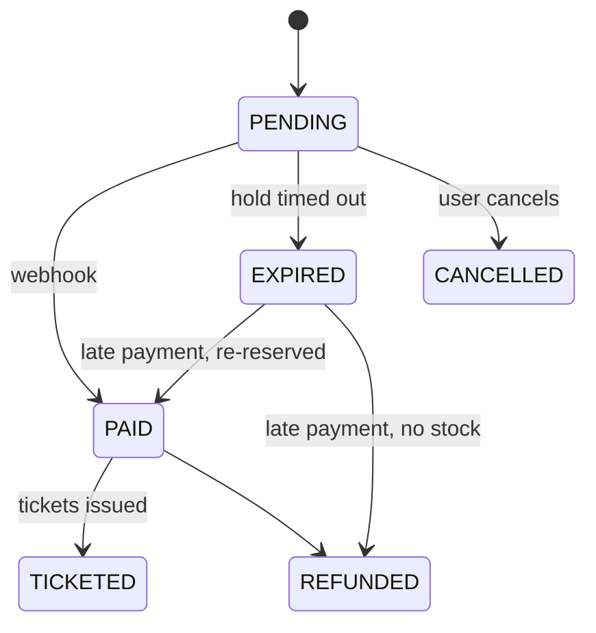

# FestPass backend

Everything behind the browser: the REST API (`apps/api`), the background worker (`apps/worker`), the database packages (`packages/db`, `packages/mongo`), shared schemas (`packages/shared`) and the local infrastructure (`infra/`).

Back to the [project README](../../README.md) · See also the [frontend README](../web/README.md)

## Status

| Area | Where | Status |
|---|---|---|
| Express app with health check, Vitest + Supertest | `apps/api` | Done (Day 1) |
| Worker process with clean shutdown | `apps/worker` | Done (Day 1) |
| Postgres, MongoDB, Redis and S3 storage (SeaweedFS since Day 8) in Docker with healthchecks | `infra/docker-compose.yml` | Done (Day 1) |
| Database schema, CHECK constraints, seed | `packages/db` | Done (Day 2) |
| Env validation, structured errors, request IDs, readiness checks | `apps/api` | Done (Day 3) |
| Auth with rotating refresh tokens | `apps/api` | Done (Day 4) |
| Organizations and role-based access | `apps/api`, `packages/shared` | Done (Day 5) |
| Events and ticket tiers | `apps/api` | Done (Day 6) |
| Pre-signed banner uploads | `apps/api`, `packages/shared` | Done (Day 8) |
| Booking engine (Postgres + Redis gate) | `packages/db`, `apps/api` | Planned (Days 11–12) |
| Hold expiry jobs, rate limiting | `apps/worker`, `apps/api` | Planned (Days 13–14) |
| Razorpay orders and webhooks, order state machine | `apps/api`, `apps/worker` | Planned (Days 15–16) |
| Signed QR tickets, PDFs, email | `packages/shared`, `apps/worker` | Planned (Days 17–18) |
| Check-in and scan events | `apps/api`, `packages/mongo` | Planned (Day 19) |
| Socket.IO live updates, waiting room | `apps/api`, `apps/worker` | Planned (Days 21–22) |
| Caching, load tests, analytics, sponsor reports | all | Planned (Days 23–26) |
| AI copilot with typed tools | `apps/api` | Planned (Day 27) |
| Security pass, metrics, Dockerfiles, CI | all | Planned (Day 28) |

Only rows marked **Done** exist in the code. The sections below that are marked _Planned_ describe the design being built.

## Processes

| Process | Started by | Job |
|---|---|---|
| **API** (`apps/api`) | `pnpm dev`, port 4000 | Handles HTTP requests under `/api/v1` and, later, Socket.IO connections. Kept fast: anything slow goes to a queue. |
| **Worker** (`apps/worker`) | `pnpm dev` | Runs background jobs from Redis queues (BullMQ): expiring unpaid holds, issuing tickets, building PDFs, sending email, refunds, reports. |

They are separate processes so a slow PDF or a stuck email can never slow down booking, and each can be restarted or scaled on its own. Both shut down cleanly on SIGTERM so deploys don't cut work off halfway.

## Data stores

| Store | Holds | Why this store |
|---|---|---|
| **PostgreSQL 16** | Users, orgs, events, tiers, orders, payments, tickets | The source of truth for money and capacity. It has transactions, row locks and CHECK constraints, so overselling is blocked by the database itself. |
| **MongoDB 7** | Scan events (time-series), copilot conversations | Many small append-only writes, read through aggregations for analytics. |
| **Redis 7** | Inventory gate, rate limits, waiting room, job queues | Fast, temporary state. Redis can say "no" quickly, but never has the final say on a booking. |
| **S3 storage** (SeaweedFS locally, R2 in production) | Event banners (public), ticket PDFs (private, Day 18) | S3-compatible object storage. The browser uploads directly with pre-signed URLs, so file bytes never pass through the API. |

Locally all four run from `infra/docker-compose.yml` on host ports 5433, 27018, 6380 and 9000, bound to 127.0.0.1.

## Folder layout (today)

```
apps/api/
  src/config/env.ts                 Zod schema for every env var; exits with a readable list if any is invalid
  src/lib/logger.ts                 pino logger (redacts Authorization, Cookie, Set-Cookie)
  src/lib/errors.ts                 AppError + NotFound, Validation, Conflict, Forbidden, Unauthorized, RateLimited
  src/lib/redis.ts                  ioredis client (lazy connect, auto-reconnect)
  src/lib/slug.ts                   slugify() for org and event URLs
  src/lib/cursor.ts                 Opaque (startsAt, id) cursors for keyset pagination
  src/lib/storage.ts                S3 client (AWS SDK v3, path-style), presignPost(), headObject(), publicUrl()
  src/middleware/request-logger.ts  pino-http: one request ID per request, X-Request-Id header
  src/middleware/validate.ts        validate({ params, query, body }) with Zod; 400 with field details
  src/middleware/error-handler.ts   notFound + the single error handler (standard error shape)
  src/middleware/cors.ts            CORS for WEB_ORIGINS only, with credentials (hand-written, no library)
  src/middleware/require-auth.ts    Verifies the Bearer access token and sets req.user = { id }
  src/middleware/require-org-permission.ts  Loads the caller's membership of :orgId and checks the matrix (404 / 403)
  src/modules/auth/                 routes, controller (cookie handling), service (passwords, tokens, rotation), repository
  src/modules/health/               routes, controller, service (parallel checks, 1 s timeout), repository (pings)
  src/modules/orgs/                 routes, controller, service (slugs, member rules), repository (last-owner lock)
  src/modules/events/               routes (org + public), controller, service (rules), repository (keyset list, tier row lock), status.ts (transitions)
  src/modules/uploads/              routes, controller, service (presignBanner with the permission check, verifyBanner with HeadObject)
  src/app.ts                        Builds the Express app (no listening); readiness checks can be injected
  src/server.ts                     Connects Mongo, listens on API_PORT, graceful shutdown
  scripts/storage-init.ts           Creates the bucket, public-read policy for banners, CORS for WEB_ORIGINS (idempotent)
  scripts/upload-banner.ts          The whole upload flow from the command line, as the web app will do it
  test/                             auth, orgs, events, uploads, cors, errors, health and env tests; helpers.ts (fast users and orgs) (Supertest, no open port); global-setup.ts migrates the test DB
  vitest.config.ts                  Loads .env, forces NODE_ENV=test, silent logs, test database, one test file at a time
  tsconfig.json                     Typecheck config (src, test and scripts)
  tsconfig.build.json               Build config (src only, output to dist/, uses packages' built dist/)
apps/worker/
  src/index.ts           Starts, logs "worker started", exits cleanly on SIGTERM/SIGINT
packages/db/
  prisma/schema.prisma   All Postgres tables, enums, relations and indexes (snake_case via @map/@@map)
  prisma/migrations/     *_init (generated from the schema) and *_check_constraints (hand-written SQL)
  prisma.config.ts       Prisma 7 CLI config: schema path, migrations, seed command, DATABASE_URL
  src/index.ts           Exports the PrismaClient singleton (pg driver adapter) and all generated types
  src/seed.ts            Idempotent demo seed; `seed(db)` is also imported by the tests
  src/testing.ts         @festpass/db/testing: migrateTestDatabase(), truncateAll() (only on *_test databases)
  src/generated/         Generated Prisma client (git-ignored, rebuilt by `prisma generate` on install)
  test/                  global-setup.ts (migrates the test DB), constraints.test.ts, seed.test.ts
packages/shared/
  src/index.ts           paginationQuerySchema, idParamsSchema, ApiErrorBody type
  src/auth.ts            registerSchema, loginSchema, PublicUser and AuthResponse types
  src/orgs.ts            createOrgSchema, member schemas, org/member params, OrgSummary and OrgMemberView
  src/permissions.ts     ORG_ROLES, ORG_ACTIONS, the PERMISSIONS matrix and can(role, action)
  src/pagination.ts      paginationQuerySchema and the Page<T> response type
  src/events.ts          event and tier schemas, eventWindowIssues/tierWindowIssues, public list query, TierView
  src/uploads.ts         BANNER_CONTENT_TYPES, BANNER_MAX_BYTES (2 MB), presignUploadSchema, PresignedUpload
packages/mongo/
  src/index.ts           connectMongo(), pingMongo(), disconnectMongo() (models arrive with Day 19)
```

**How packages are imported:** each package's `exports` has a `development` condition pointing at `src/index.ts`. The API's dev server (`tsx --conditions=development`), Vitest and TypeScript (`customConditions` in `tsconfig.base.json`) all use it, so a change in `packages/db` is picked up without a build step. `pnpm build` and `node dist/server.js` ignore it and use each package's compiled `dist/`.

### Postgres schema (`packages/db`)

- **Prisma 7** with the `prisma-client` generator and `@prisma/adapter-pg`. Prisma 7 no longer ships a Rust query engine; it talks to Postgres through the standard `pg` driver, which is why the adapter is a dependency.
- **IDs** default to `gen_random_uuid()` in Postgres itself, so rows inserted by raw SQL (the booking path) get IDs the same way as rows created through Prisma.
- **CHECK constraints** (`*_check_constraints/migration.sql`): `ticket_tiers.sold_count` between 0 and `capacity`, `capacity > 0`, `price_paise >= 0`, `per_user_limit` 1–10, `events.ends_at > starts_at`, plus `orders.amount_paise >= 0` and `order_items.qty > 0`. Prisma can't express CHECKs, so they live in SQL and Prisma's drift check simply ignores them.
- **Unique keys that make retries safe:** `payments.razorpay_payment_id`, `orders.razorpay_order_id`, `tickets(order_id, seq)`, `tickets.code`.
- **Delete rules:** children that mean nothing alone cascade (tiers with their event, order items with their order, memberships). Orders, payments and tickets never cascade, so deleting an event or tier that has sales fails instead of silently erasing money records.
- **Seed** (`src/seed.ts`): every write is an `upsert`, so a second run inserts nothing. Updates are empty, so live counters like `sold_count` are never reset; the one exception is that seed users get their demo password (`festpass-dev`, bcrypt cost 12) back.

### Request pipeline (`apps/api/src/app.ts`)

1. **`requestLogger`** (pino-http) gives the request an ID: the incoming `X-Request-Id` if it is 1–64 characters of `[A-Za-z0-9_-]`, otherwise a new UUID. The ID goes into `req.id`, every log line (`req.log`) and the `X-Request-Id` response header. Responses are logged at `warn` for 4xx and `error` for 5xx.
2. **`cors(env.WEB_ORIGINS)`**: if the request's `Origin` is on the allow-list it is echoed back with `Access-Control-Allow-Credentials: true` (credentials never work with `*`), preflights get a `204`, and every response has `Vary: Origin`. Other origins get no CORS headers, so browsers won't let their pages read the response.
3. **`express.json()`** parses bodies (100 kB limit).
4. **Feature routers** under `/api/v1`. Each feature is `modules/<feature>/{routes,controller,service,repository}.ts`: controllers handle HTTP only, services hold business rules, and repositories are the only code that touches a data store. `validate({ params, query, body })` runs before a controller, reports every invalid field at once and replaces the raw values with the parsed ones.
5. **`notFound`** turns anything unmatched into a `NotFoundError`.
6. **`errorHandler`** is the only place that writes error responses. `AppError` subclasses keep their status, code and details; body-parser errors become `INVALID_JSON` or `BAD_REQUEST`; anything else is logged with its stack and returned as a generic `INTERNAL_ERROR` 500 (message and stack only when `NODE_ENV=development`). Express 5 forwards rejected promises from async handlers here, so handlers need no try/catch.

### Authentication (`src/modules/auth/`)

- **Register:** the email is trimmed and lowercased by `registerSchema`, the password is hashed with bcrypt (cost 12), and a unique-violation from Postgres becomes `409 EMAIL_TAKEN`, so two simultaneous sign-ups with one email can't both succeed. Registering also logs the user in.
- **Login:** looks the user up by email and always runs `bcrypt.compare`, against a dummy hash when the email is unknown, then returns the same `401 INVALID_CREDENTIALS` either way. The password hash is only ever selected by `findUserForLogin`; every other query uses a column list without it, and `toPublicUser` copies fields one by one.
- **Sessions:** a login creates a refresh token with a new `family_id`. The browser gets 256 random bits (base64url) in the `fp_refresh` cookie (`httpOnly`, `SameSite=Lax`, `Path=/api/v1/auth`, `Secure` in production, expires with the token); Postgres stores only its SHA-256.
- **Refresh:** finds the token by hash. Unknown or expired: `401 INVALID_REFRESH_TOKEN`. Already revoked: reuse, so every token in the family is revoked, a warning is logged (user and family IDs only) and `401 REFRESH_TOKEN_REUSED` is returned. Otherwise one transaction runs `UPDATE refresh_tokens SET revoked_at = now() WHERE id = $old AND revoked_at IS NULL` and inserts the replacement in the same family; if the update matched no row, a parallel refresh already used the token and that counts as reuse too. A rejected refresh also clears the cookie.
- **Access tokens:** HS256 JWTs with `sub = userId`, lifetime `ACCESS_TOKEN_TTL_SECONDS` (15 min). `requireAuth` accepts only `Authorization: Bearer`, verifies with `algorithms: ['HS256']` and sets `req.user = { id }`; anything about the user is loaded fresh from the database.
- **Logout:** revokes the presented token's family and clears the cookie; always 204, even with no cookie.
- **Never logged:** pino redacts `Authorization`, `Cookie` and `Set-Cookie`, and request bodies (passwords) are not logged.

### Organizations and permissions (`src/modules/orgs/`)

- **Matrix as data:** `PERMISSIONS` in `packages/shared/src/permissions.ts` maps each role to its allowed actions; `can(role, action)` is a lookup. Adding an action or changing a role is a one-line data change, and the web app imports the same table to decide which buttons to show.
- **Enforcement:** org routes run `validate({ params })` (orgId must be a UUID), then `requireOrgPermission(action)`, then body validation, so a non-member learns nothing from validation errors. The middleware loads the `(org_id, user_id)` membership row: none is `404 Organization not found` (the same response as an org that doesn't exist), a role without the action is `403`, otherwise `req.membership = { orgId, role }`.
- **Create:** the org and its OWNER membership are one nested Prisma create, so there is never an org without an owner. The slug is derived from the name when not given; a duplicate is `409 SLUG_TAKEN`.
- **Members:** added by email (the user must already have an account; `404` otherwise, `409 ALREADY_MEMBER` via the primary key). Role changes and removals go through `changeMembership()`, which in one transaction runs `SELECT ... FROM org_members WHERE org_id = $1 AND role = 'OWNER' FOR UPDATE`, then refuses (`409 LAST_OWNER`) if the target is the only OWNER. The lock makes concurrent demotions take turns, so the second one sees the first's result.
- **Not yet:** a member can't leave an org on their own (only an OWNER can remove them), and `/orgs/mine` is not paginated.

### Events and ticket tiers (`src/modules/events/`)

- **Routes:** organizer routes are mounted at `/api/v1/orgs/:orgId/events` (`mergeParams`) and use the permission matrix: `event:create` to create, `event:update` for edits and tiers, `event:publish` to publish or close, `org:read` to view. Every lookup is `WHERE id = $eventId AND org_id = $orgId`, so an org can never touch another org's event by ID. Public routes are at `/api/v1/events` and need no login.
- **Slugs:** `slugify(title)`; if the insert hits the unique index, retry up to 5 times with a random 4-hex suffix (`tech-fest-3f9a`). The database decides, so two simultaneous "Tech Fest" events can't get the same slug. Slugs never change after creation.
- **Dates:** the shared schemas check `endsAt > startsAt`, `saleEndsAt > saleStartsAt` and `saleEndsAt ≤ endsAt`; a tier's own window must sit inside the event's. On a partial update the service merges with the stored event and re-runs the same checks, including every existing tier's window.
- **Status:** `status.ts` lists the allowed transitions (DRAFT → PUBLISHED → CLOSED). Publishing also needs at least one tier and `startsAt` in the future. The change itself is `UPDATE ... WHERE id = $1 AND status = $from`, so two parallel publishes can't both succeed.
- **Tier lock after sales:** `updateTierLocked()` runs `SELECT ... FROM ticket_tiers WHERE id = $1 FOR UPDATE`, then checks the rules against the locked row: once `sold_count > 0` the price can't change and capacity can only grow. The booking engine's `UPDATE ... sold_count` takes the same row lock, so no sale can slip in between the check and the update. Deleting uses `DELETE ... WHERE sold_count = 0`. The Day 2 CHECK (`sold_count <= capacity`) stays as the last line of defence.
- **Keyset pagination:** `listEvents()` orders by `(starts_at, id)` and continues with `starts_at > c.starts_at OR (starts_at = c.starts_at AND id > c.id)`, fetching `limit + 1` rows to know whether there's another page. The cursor is that pair, base64url-encoded. Served by the `events(status, starts_at, id)` index.
- **Public view:** `GET /events` shows `PUBLISHED` events whose `ends_at` is still in the future; `GET /events/:slug` also shows `CLOSED` ones, never drafts. Each tier carries `available = capacity - sold_count`, which is only a hint; booking (Day 11) rechecks in Postgres.

### Banner uploads (`src/modules/uploads/`, `src/lib/storage.ts`)

- **Presign:** `POST /uploads/presign { eventId, contentType }`. The body names the event, so the org comes from the event row (`findEventOrg`) and the service checks the membership itself: no membership or no such event is `404 Event not found` (like `requireOrgPermission`), a role without `event:update` is `403`. The key is chosen by the server, `orgs/{orgId}/events/{eventId}/banner/{uuid}.{ext}`, and `createPresignedPost` signs a policy containing that key, `content-length-range 1..2097152` and `Content-Type` equal to the requested type, valid for 5 minutes. Signing is local (HMAC with the secret key), with no call to storage.
- **Upload:** the browser POSTs a multipart form (policy fields first, file last) straight to storage, which rejects a bigger file (`400 EntityTooLarge`) or another content type (`403 AccessDenied`). The API never sees the bytes.
- **Confirm:** `PATCH /orgs/:orgId/events/:eventId { bannerKey }`. `verifyBanner()` first matches the key against `^orgs/{orgId}/events/{eventId}/banner/{uuid}.(jpg|png|webp)$` (without a storage call), then runs `HeadObject`: missing object (404 from storage), a type outside JPEG/PNG/WebP, or a size over 2 MB is a `400` on the `bannerKey` field. This runs before the database update, outside any transaction. `bannerKey: null` removes the banner.
- **Serving:** every event response (organizer, public list, public detail) has `bannerUrl = S3_PUBLIC_URL + '/' + bannerKey`. `pnpm storage:init` sets a bucket policy that allows anonymous `s3:GetObject` only on `orgs/*/events/*/banner/*`; everything else in the bucket needs signed requests. Ticket PDFs (Day 18) will live under a different prefix and be shared only as short-lived pre-signed GETs, because they carry a name and an entry QR.
- **CORS on storage:** the browser talks to storage directly, so `storage:init` also sets bucket CORS for `WEB_ORIGINS` (POST, GET). The API's own CORS doesn't apply there.
- **Not yet:** replaced banners are not deleted from storage, and the content type is the uploader's declaration (not sniffed from the bytes).

### Health and shutdown

- **Liveness** (`/health/live`) answers whenever the process can serve HTTP, and checks nothing else, so a database outage never makes the platform restart a healthy API process.
- **Readiness** (`/health/ready`) runs `SELECT 1` on Postgres, `PING` on Redis and an admin `ping` on Mongo in parallel, each with a 1 s timeout. Any failure returns 503 so the load balancer stops sending traffic; the reasons go to the logs, not to the client.
- **Startup:** env is validated first, then Mongo is connected (fail fast if it can't be). Prisma and ioredis connect on first use and reconnect by themselves.
- **Shutdown** on SIGTERM/SIGINT: `server.close()` stops new connections and waits for in-flight requests, then Prisma, Redis and Mongo are closed, then the process exits 0. If that takes more than 10 s it exits 1.

## Core flows

### Booking a ticket

_Planned (Days 11–13)._

1. The request carries an `Idempotency-Key`. A retry with the same key gets the stored response instead of booking twice.
2. **Redis gate:** a Lua script checks stock and the per-user limit for every tier in one atomic step. Most of the crowd is rejected here, before Postgres is touched.
3. **Postgres decides:** in one transaction, for each tier (sorted by ID so concurrent requests lock rows in the same order and can't deadlock):
   ```sql
   UPDATE ticket_tiers SET sold_count = sold_count + $qty
   WHERE id = $tierId AND sold_count + $qty <= capacity
   RETURNING sold_count;
   ```
   No row returned means sold out. The whole transaction rolls back and Redis stock is given back.
4. The order is saved as `PENDING` with a 10-minute hold, and a delayed job is scheduled to expire it.
5. If Redis is down, booking still works through Postgres alone, just with more load on the database.

### Paying

_Planned (Days 15–16)._

- The API creates a Razorpay order outside any database transaction (no network calls inside transactions).
- The browser's "payment succeeded" callback only updates the screen. The order becomes `PAID` only when Razorpay's webhook arrives and its HMAC signature checks out against the raw request body.
- Webhooks can be delivered more than once, so payments are inserted with `ON CONFLICT DO NOTHING` and only a new row moves the order forward.
- A payment that arrives after the hold expired is either re-reserved (if tickets remain) or refunded automatically.

### Order states

_Planned (Days 13 and 16)._ Status only changes through a guarded `UPDATE ... WHERE status = $from`, so two jobs racing on the same order can't both succeed.



### Entry at the gate

_Planned (Days 17–19)._

- Each ticket's QR code holds `{ ticketId, eventId, qrVersion, issuedAt }` signed with Ed25519. There's no personal data in it, and it can't be forged without the private key, which never leaves the server.
- Check-in runs `UPDATE tickets SET checked_in_at = now() WHERE id = $1 AND checked_in_at IS NULL`. If ten phones scan the same ticket at once, exactly one gets a row back.
- Every scan is then written to MongoDB for analytics. If that write fails it is retried, but the check-in is never undone.

## Engineering rules

- Postgres is the source of truth for capacity and money; Redis is only a fast gate and cache.
- No network calls (payments, storage, email, AI) inside a database transaction.
- Anything that can be retried is idempotent: unique constraints, guarded updates, idempotency keys, job IDs derived from the order ID.
- Webhooks are verified before anything is parsed or acted on.
- Money is integer paise, times are UTC `timestamptz`, IDs are UUIDs.
- Every request body, query and route param is validated with a Zod schema from `packages/shared`.

## API endpoints

| Method | Path | Auth | Description |
|---|---|---|---|
| POST | `/api/v1/auth/register` | none | `201 { user, accessToken }` + `fp_refresh` cookie; `409 EMAIL_TAKEN` |
| POST | `/api/v1/auth/login` | none | `200 { user, accessToken }` + cookie; `401 INVALID_CREDENTIALS` |
| POST | `/api/v1/auth/refresh` | cookie | Rotates the cookie, `200 { user, accessToken }`; `401 INVALID_REFRESH_TOKEN` or `REFRESH_TOKEN_REUSED` |
| POST | `/api/v1/auth/logout` | cookie | Revokes the session's token family, clears the cookie, `204` |
| GET | `/api/v1/auth/me` | Bearer | `200 { user }`; `401` without a valid access token |
| POST | `/api/v1/orgs` | Bearer | Create an org; caller becomes OWNER. `201 { org }`; `409 SLUG_TAKEN` |
| GET | `/api/v1/orgs/mine` | Bearer | `200 { orgs }` with the caller's role in each |
| GET | `/api/v1/orgs/:orgId` | `org:read` | `200 { org, members }`; `404` for non-members |
| POST | `/api/v1/orgs/:orgId/members` | `member:manage` | Add a user by email with a role. `201`; `404` unknown email; `409 ALREADY_MEMBER` |
| PATCH | `/api/v1/orgs/:orgId/members/:userId` | `member:manage` | Change role. `200`; `409 LAST_OWNER` |
| DELETE | `/api/v1/orgs/:orgId/members/:userId` | `member:manage` | Remove. `204`; `409 LAST_OWNER` |
| POST | `/api/v1/orgs/:orgId/events` | `event:create` | Create a DRAFT event; slug from the title. `201 { event }` |
| GET | `/api/v1/orgs/:orgId/events` | `org:read` | The org's events (all statuses), `{ items, nextCursor }` |
| GET | `/api/v1/orgs/:orgId/events/:eventId` | `org:read` | `200 { event }` with tiers |
| PATCH | `/api/v1/orgs/:orgId/events/:eventId` | `event:update` | Partial update, including `bannerKey` (checked with HeadObject) or `null`; `409 EVENT_CLOSED` |
| POST | `/api/v1/orgs/:orgId/events/:eventId/publish` | `event:publish` | DRAFT → PUBLISHED; `409 NO_TIERS`, `EVENT_IN_PAST`, `INVALID_TRANSITION` |
| POST | `/api/v1/orgs/:orgId/events/:eventId/close` | `event:publish` | PUBLISHED → CLOSED |
| POST | `/api/v1/orgs/:orgId/events/:eventId/tiers` | `event:update` | Add a tier. `201 { tier }`; `409 TIER_NAME_TAKEN` |
| PATCH | `/api/v1/orgs/:orgId/events/:eventId/tiers/:tierId` | `event:update` | Edit a tier; `409 PRICE_LOCKED` / `CAPACITY_LOCKED` after a sale |
| DELETE | `/api/v1/orgs/:orgId/events/:eventId/tiers/:tierId` | `event:update` | `204`; `409 TIER_HAS_SALES` |
| GET | `/api/v1/events` | none | Published, not-yet-ended events; `?cursor=&limit=&orgId=` |
| GET | `/api/v1/events/:slug` | none | Published or closed event with tiers and `available`; drafts `404` |
| POST | `/api/v1/uploads/presign` | Bearer, `event:update` on the event's org | `201 { upload: { url, fields, key, maxBytes, expiresAt } }` for a JPEG/PNG/WebP banner up to 2 MB; `400` other types, `404` non-members, `403` scanners |
| GET | `/api/v1/health/live` | none | `200 { "status": "ok" }` whenever the process can answer |
| GET | `/api/v1/health/ready` | none | `200` if Postgres, Redis and Mongo all answer, else `503` with the down dependency marked `"down"` |

Error shape, request IDs, validation and pagination conventions: see the [project README](../../README.md#conventions).

## Running and testing

From the repo root (see the [project README](../../README.md#getting-started) for full setup):

```bash
pnpm infra:up                          # Postgres, MongoDB, Redis, SeaweedFS
pnpm db:migrate && pnpm db:seed        # tables, CHECK constraints, demo data
pnpm storage:init                      # bucket, banner public-read policy, CORS
pnpm storage:upload-banner ./banner.png  # with the API running: presign, upload, PATCH, print the URL
pnpm --filter @festpass/db test        # constraint + seed tests (need Postgres)
curl localhost:4000/api/v1/health/ready
curl -i localhost:4000/api/v1/nope -H 'X-Request-Id: demo-1'
pnpm dev                               # API on :4000, worker, web
pnpm --filter @festpass/api dev        # only the API
pnpm --filter @festpass/worker dev     # only the worker
pnpm --filter @festpass/api test       # API tests
```

Tests use Vitest and Supertest against `createApp()`, without opening a port. `test/events.test.ts` covers the organizer flow, every tier rule, the price and capacity lock after a sale, publish rules and transitions, draft visibility and cursor pagination (every event exactly once, even with an insert between pages). `test/orgs.test.ts` drives every role × action through the real permission middleware, checks 404 for non-members, the member endpoints and the last-owner rule (including a concurrent race on the repository). `test/auth.test.ts` runs the full auth flow against the test database (truncated before each test): register, duplicate email, generic login error, `/me` with missing/expired/forged tokens, rotation, reuse revoking the family, and logout. `test/errors.test.ts` covers validation (400 with field details and the request ID), the 404 shape, invalid JSON, `AppError` rendering, hidden 500 details and request-ID reuse. `test/health.test.ts` injects fake checks to prove readiness returns 503 when a dependency fails or hangs. `test/uploads.test.ts` spies on the S3 client's `send` (no storage server needed): the presigned policy holds the size range and content type, bad types are 400, non-members 404, scanners 403, and a PATCH with a missing, oversized, non-image or foreign key is rejected. `test/env.test.ts` covers env parsing. Database tests run against `DATABASE_URL_TEST`, which Vitest migrates automatically. `packages/db/test/constraints.test.ts` proves Postgres rejects an oversold tier even through raw SQL, and `packages/db/test/seed.test.ts` proves the seed is idempotent; both read `DATABASE_URL` from the root `.env`.

## Environment variables

See the full table in the [project README](../../README.md#environment-variables). The API loads the root `.env` with Node's `--env-file-if-exists` and validates it in `src/config/env.ts`: `NODE_ENV`, `API_PORT`, `LOG_LEVEL`, `DATABASE_URL`, `REDIS_URL`, `MONGODB_URI`, `JWT_ACCESS_SECRET` (32+ characters), `ACCESS_TOKEN_TTL_SECONDS` (default 900), `REFRESH_TOKEN_TTL_DAYS` (default 7), `WEB_ORIGINS` (comma-separated, default `http://localhost:3000`), and storage: `S3_ENDPOINT`, `S3_REGION` (default `us-east-1`), `S3_BUCKET`, `S3_ACCESS_KEY_ID`, `S3_SECRET_ACCESS_KEY` and `S3_PUBLIC_URL`. If any is missing or malformed, the process prints every problem and exits with code 1 before opening a port. `packages/db` reads `DATABASE_URL` (Prisma CLI, seed), and tests use `DATABASE_URL_TEST`; the Prisma CLI and Vitest load the root `.env` themselves.

## Change history

- **Day 1:** Express app with `GET /api/v1/health` and its test; worker entry point with clean shutdown; Docker Compose for the four data services.
- **Day 2:** Prisma 7 schema for all Postgres tables in `packages/db`, CHECK-constraint migration, hot-path indexes, idempotent seed, `db:*` scripts, constraint and seed tests.
- **Day 3:** `apps/api/src` split into config, lib, middleware and modules; Zod env validation; pino-http request IDs; `AppError` hierarchy and one error handler; `validate()` middleware; `/health/live` and `/health/ready`; graceful shutdown; Mongo connection in `packages/mongo`; shared pagination schema; separate auto-migrated test database with `truncateAll`.
- **Day 4:** auth module (register, login, refresh with rotation and reuse detection, logout, `/me`), `requireAuth` middleware, bcrypt cost 12, hashed refresh tokens in an `httpOnly` cookie, shared auth schemas, API tests against the test database, seed users with a real password.
- **Day 5:** organizations with OWNER/MANAGER/SCANNER roles, permission matrix and `can()` in `packages/shared`, `requireOrgPermission` middleware (404 for non-members, 403 for missing permission), member management with a row-locked last-owner rule, matrix-driven tests.
- **Day 6:** events and ticket tiers under `/orgs/:orgId/events` (create, list, get, update, publish, close; tier create, update, delete), status transitions, price lock and grow-only capacity after a sale under a row lock, public keyset-paginated `GET /events` and `GET /events/:slug`, `events(status, starts_at, id)` index.
- **Day 7:** CORS middleware for the web app's origin with credentials (`WEB_ORIGINS`); `packages/shared` imports its own files with `.ts` extensions (rewritten to `.js` on build) so the Next.js bundler can read it as source.
- **Day 8:** storage module on AWS SDK v3 and SeaweedFS in docker compose (MinIO images are no longer pullable); `POST /uploads/presign` with a 2 MB, type-locked pre-signed POST for a server-chosen key; `bannerKey` on event PATCH verified with HeadObject; `bannerUrl` on every event; `storage:init` (bucket, banner-only public-read policy, CORS) and `storage:upload-banner` scripts; upload tests with S3 mocked.
