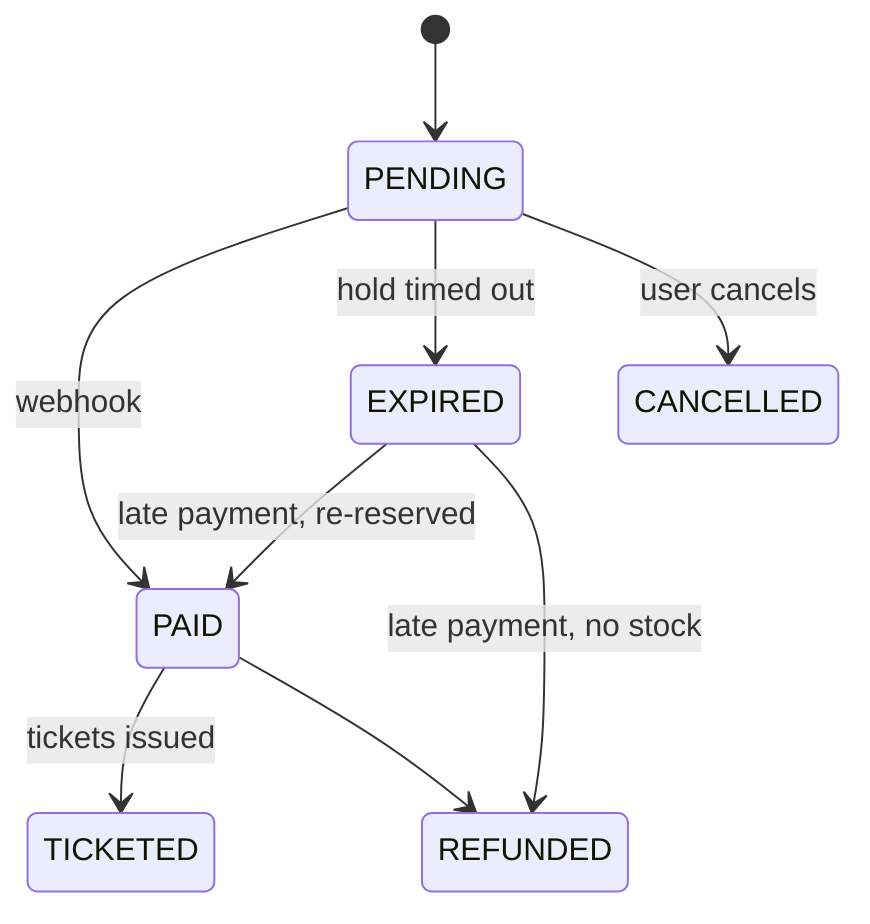

# FestPass backend

Everything behind the browser: the REST API (`apps/api`), the background worker (`apps/worker`), the database packages (`packages/db`, `packages/mongo`), shared schemas (`packages/shared`) and the local infrastructure (`infra/`).

Back to the [project README](../../README.md) · See also the [frontend README](../web/README.md)

## Status

| Area | Where | Status |
|---|---|---|
| Express app with health check, Vitest + Supertest | `apps/api` | Done (Day 1) |
| Worker process with clean shutdown | `apps/worker` | Done (Day 1) |
| Postgres, MongoDB, Redis, MinIO in Docker with healthchecks | `infra/docker-compose.yml` | Done (Day 1) |
| Database schema, CHECK constraints, seed | `packages/db` | Planned (Day 2) |
| Env validation, structured errors, request IDs, readiness checks | `apps/api` | Planned (Day 3) |
| Auth with rotating refresh tokens | `apps/api` | Planned (Day 4) |
| Organizations and role-based access | `apps/api`, `packages/shared` | Planned (Day 5) |
| Events and ticket tiers | `apps/api` | Planned (Day 6) |
| Pre-signed banner uploads | `apps/api` | Planned (Day 8) |
| Booking engine (Postgres + Redis gate) | `packages/db`, `apps/api` | Planned (Days 11–12) |
| Hold expiry jobs, rate limiting | `apps/worker`, `apps/api` | Planned (Days 13–14) |
| Razorpay orders and webhooks, order state machine | `apps/api`, `apps/worker` | Planned (Days 15–16) |
| Signed QR tickets, PDFs, email | `packages/shared`, `apps/worker` | Planned (Days 17–18) |
| Check-in and scan events | `apps/api`, `packages/mongo` | Planned (Day 19) |
| Socket.IO live updates, waiting room | `apps/api`, `apps/worker` | Planned (Days 21–22) |
| Caching, load tests, analytics, sponsor reports | all | Planned (Days 23–26) |
| AI copilot with typed tools | `apps/api` | Planned (Day 27) |
| Security pass, metrics, Dockerfiles, CI | all | Planned (Day 28) |

Only rows marked **Done** exist in the code. The sections below that are marked _Planned_ describe the design being built.

## Processes

| Process | Started by | Job |
|---|---|---|
| **API** (`apps/api`) | `pnpm dev`, port 4000 | Handles HTTP requests under `/api/v1` and, later, Socket.IO connections. Kept fast: anything slow goes to a queue. |
| **Worker** (`apps/worker`) | `pnpm dev` | Runs background jobs from Redis queues (BullMQ): expiring unpaid holds, issuing tickets, building PDFs, sending email, refunds, reports. |

They are separate processes so a slow PDF or a stuck email can never slow down booking, and each can be restarted or scaled on its own. Both shut down cleanly on SIGTERM so deploys don't cut work off halfway.

## Data stores

| Store | Holds | Why this store |
|---|---|---|
| **PostgreSQL 16** | Users, orgs, events, tiers, orders, payments, tickets | The source of truth for money and capacity. It has transactions, row locks and CHECK constraints, so overselling is blocked by the database itself. |
| **MongoDB 7** | Scan events (time-series), copilot conversations | Many small append-only writes, read through aggregations for analytics. |
| **Redis 7** | Inventory gate, rate limits, waiting room, job queues | Fast, temporary state. Redis can say "no" quickly, but never has the final say on a booking. |
| **MinIO / R2** | Event banners (public), ticket PDFs (private) | S3-compatible storage. The browser uploads directly with pre-signed URLs, so file bytes never pass through the API. |

Locally all four run from `infra/docker-compose.yml` on host ports 5433, 27018, 6380 and 9000/9001, bound to 127.0.0.1.

## Folder layout (today)

```
apps/api/
  src/app.ts             Builds the Express app (no listening), so tests can import it
  src/server.ts          Starts the app on API_PORT
  test/health.test.ts    Supertest test for GET /api/v1/health
  tsconfig.json          Typecheck config (src + test)
  tsconfig.build.json    Build config (src only, output to dist/)
apps/worker/
  src/index.ts           Starts, logs "worker started", exits cleanly on SIGTERM/SIGINT
packages/shared|db|mongo/
  src/index.ts           Empty for now; filled from Days 2–3
```

Planned layout inside `apps/api/src` (Day 3): `config/`, `lib/`, `middleware/`, `modules/<feature>/{routes,controller,service,repository,schemas}.ts`, `sockets/`. Controllers handle HTTP only, services hold business rules, and repositories are the only code that touches the database.

## Core flows

### Booking a ticket

_Planned (Days 11–13)._

1. The request carries an `Idempotency-Key`. A retry with the same key gets the stored response instead of booking twice.
2. **Redis gate:** a Lua script checks stock and the per-user limit for every tier in one atomic step. Most of the crowd is rejected here, before Postgres is touched.
3. **Postgres decides:** in one transaction, for each tier (sorted by ID so concurrent requests lock rows in the same order and can't deadlock):
   ```sql
   UPDATE ticket_tiers SET sold_count = sold_count + $qty
   WHERE id = $tierId AND sold_count + $qty <= capacity
   RETURNING sold_count;
   ```
   No row returned means sold out. The whole transaction rolls back and Redis stock is given back.
4. The order is saved as `PENDING` with a 10-minute hold, and a delayed job is scheduled to expire it.
5. If Redis is down, booking still works through Postgres alone, just with more load on the database.

### Paying

_Planned (Days 15–16)._

- The API creates a Razorpay order outside any database transaction (no network calls inside transactions).
- The browser's "payment succeeded" callback only updates the screen. The order becomes `PAID` only when Razorpay's webhook arrives and its HMAC signature checks out against the raw request body.
- Webhooks can be delivered more than once, so payments are inserted with `ON CONFLICT DO NOTHING` and only a new row moves the order forward.
- A payment that arrives after the hold expired is either re-reserved (if tickets remain) or refunded automatically.

### Order states

_Planned (Days 13 and 16)._ Status only changes through a guarded `UPDATE ... WHERE status = $from`, so two jobs racing on the same order can't both succeed.



### Entry at the gate

_Planned (Days 17–19)._

- Each ticket's QR code holds `{ ticketId, eventId, qrVersion, issuedAt }` signed with Ed25519. There's no personal data in it, and it can't be forged without the private key, which never leaves the server.
- Check-in runs `UPDATE tickets SET checked_in_at = now() WHERE id = $1 AND checked_in_at IS NULL`. If ten phones scan the same ticket at once, exactly one gets a row back.
- Every scan is then written to MongoDB for analytics. If that write fails it is retried, but the check-in is never undone.

## Engineering rules

- Postgres is the source of truth for capacity and money; Redis is only a fast gate and cache.
- No network calls (payments, storage, email, AI) inside a database transaction.
- Anything that can be retried is idempotent: unique constraints, guarded updates, idempotency keys, job IDs derived from the order ID.
- Webhooks are verified before anything is parsed or acted on.
- Money is integer paise, times are UTC `timestamptz`, IDs are UUIDs.
- Every request body, query and route param is validated with a Zod schema from `packages/shared`.

## API endpoints

| Method | Path | Auth | Description |
|---|---|---|---|
| GET | `/api/v1/health` | none | Returns `{ "status": "ok" }` when the process is up |

## Running and testing

From the repo root (see the [project README](../../README.md#getting-started) for full setup):

```bash
pnpm infra:up                          # Postgres, MongoDB, Redis, MinIO
pnpm dev                               # API on :4000, worker, web
pnpm --filter @festpass/api dev        # only the API
pnpm --filter @festpass/worker dev     # only the worker
pnpm --filter @festpass/api test       # API tests
curl localhost:4000/api/v1/health
```

Tests use Vitest and Supertest. `test/health.test.ts` checks the health route and that unknown routes return 404, without opening a port.

## Environment variables

See the full table in the [project README](../../README.md#environment-variables). Today the API reads only `API_PORT` (default 4000), loaded from the root `.env` with Node's `--env-file-if-exists`. From Day 3 every variable is validated at startup and the process refuses to start if any is missing or invalid.

## Change history

- **Day 1:** Express app with `GET /api/v1/health` and its test; worker entry point with clean shutdown; Docker Compose for the four data services.
